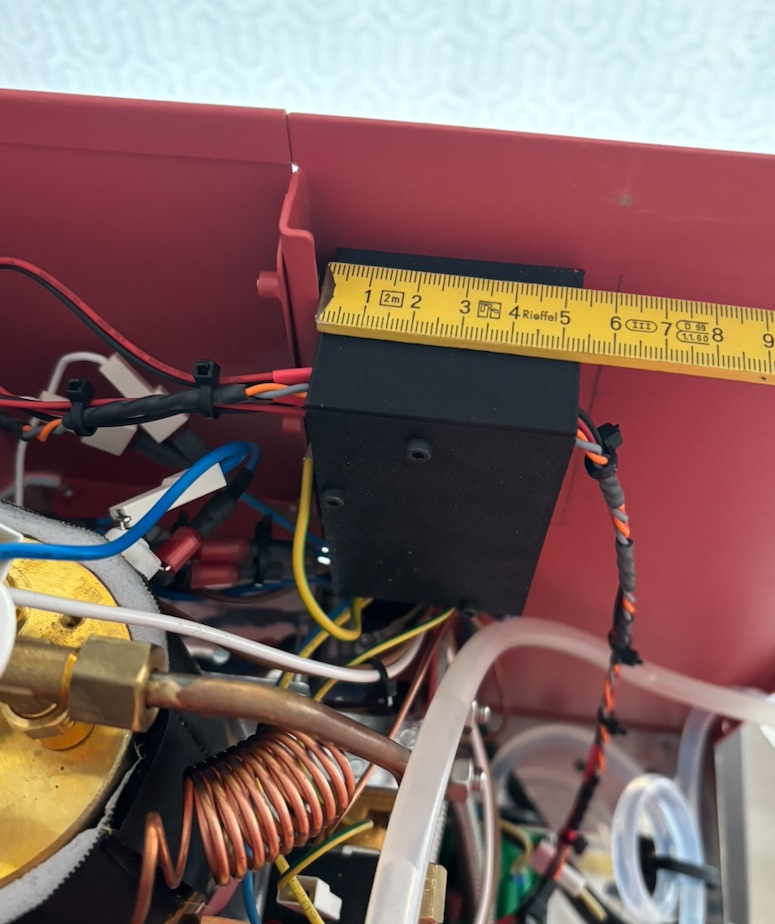
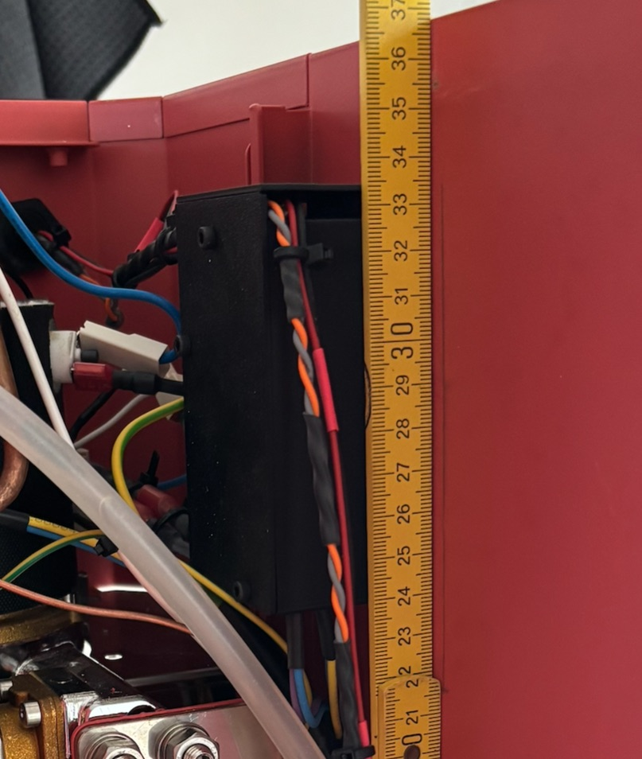
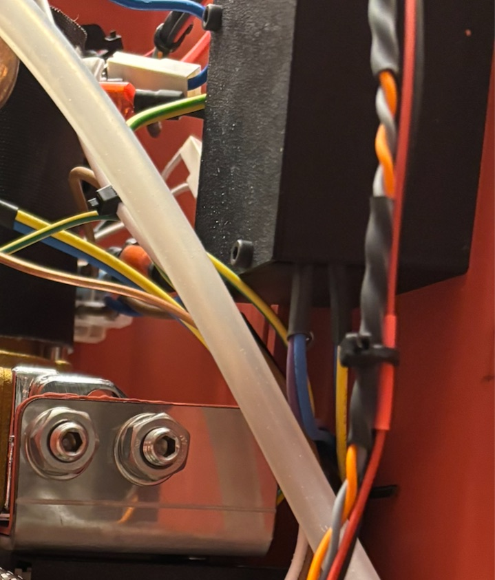

# Boîtier d'alimentation 24 V

`boitier_ps` est à refaire pour l'alimentation 24 V, 96 W de la pompe à
engrenage (voir [pompe-engrenage.md](pompe-engrenage.md), « Alimentation »).
Le boîtier actuel loge deux Wago 230 V, deux Wago 5 V et la RECOM
RAC05-05SK ; il est reconstruit de zéro sur le modèle de `boitier_ac` et
`boitier_dc` : contour et corbeaux M2 définis pour que le couvercle les
reprenne.

**État au 3 novembre 2026 : alimentation reçue, ps_upstream abandonnée pour
l'instant.** Les pistes A, B1 et B2 ci-dessous ont été étudiées **avec**
ps_upstream et sont à refaire : le boîtier loge maintenant l'alimentation et
des Wago (voir [pompe-engrenage.md](pompe-engrenage.md), « Appel de courant
et interrupteur »). Prochaine étape : essais d'orientation et de courbure des
fils de 0,75 mm² à plat sur table, alimentation en main, puis proposition de
disposition par David. Les relevés de réception (dimensions mesurées,
isolation, M3 taraudé, polarité) sont dans pompe-engrenage.md, « Réception
et premiers essais ».

## Place dans la machine

Le boîtier se plaque par aimants contre la face interne ouest de la machine.
Repère : X ouest → est, Y sud → nord (vertical dans la machine, nord en
haut), Z depuis la face de la machine vers l'intérieur.

| Axe | Limite |
| --- | --- |
| X | 55 mm, 60 mm possibles |
| Y | 100 mm, 110 mm en poussant contre d'autres structures |
| Z | ≈ 50 mm si Y ≈ 80 mm, ≈ 40 mm si Y ≈ 100 mm |

- Le trait de crayon sur la face rouge marque la limite en Z : une tôle de
  séparation du réservoir est montée ensuite.
- Au nord, le capillaire en cuivre du manomètre ne bouge pas ; il bloque
  probablement 8 à 10 mm plus bas que sur la photo de côté.
- Le boîtier actuel mesure 53,3 × 97,5 × 41,6 mm (couvercle non compris).







## Ce qu'il loge

| Pièce | Cotes | Remarques |
| --- | --- | --- |
| Alimentation 24 V, 96 W | **68,5 × 44,1 × 25,8**, 111,8 g (mesuré) | radiateur en U ; entrée VH (vertical) et sortie bornier aux deux bouts opposés, bornier au pas de 5 mm ; fixation par 4 trous **M3 taraudés** dans les flancs de 2 mm |
| `pcb/ps_upstream` | 38,6 × 19,0, RT1 haute de 16 | **abandonnée pour l'instant** ; J1 HT396R coudé (plug HT396K), J2 VH vertical ; H1 et H2 M3 **nylon seulement** |
| 2 Wago | 221-423 : 18,8 × 18,6 × 8,4 ; 221-415 : 30 × 18,6 × 8,4 | 221-423 si l'embout double fait gagner une position (voir Câblage) |

Rien en DC à part le bornier de l'alimentation : le 24 V part directement
vers `boitier_dc`, sans Wago.

**Charge thermique** : 95 % du temps moins de 4 W en sortie, soit ≈ 0,3 W de
pertes ; ≈ 3 W de pertes pendant une infusion de 30 s à 35 W. Un boîtier
fermé suffit tant que les deux bouts du U restent dégagés (Y vertical dans la
machine : effet cheminée). Pas de PETG collé à la plaque alu : 1 à 2 mm
d'air.

## Câblage

Fil **Helutherm 145, 0,75 mm²** partout, AC et DC.

- **Rayon de courbure** : Ø 2,2 mm, 4 × Ø = **8,8 mm** en pose fixe, 8 × Ø
  en pose mobile (fiche Helukabel M50999). Un virage à 90° occupe ≈ 11 mm.
  Le boîtier actuel laisse 21,6 mm (`helu145_rayon_min`) au sud des Wago
  AC, mais cette cote a été fixée pour garder la cavité, pas mesurée comme
  un minimum : c'est un montage qui marche, pas une limite.
- **0,75 mm² en DC, pas 0,5** : IEC 60335-1 (table 11) donne 0,5 mm²
  jusqu'à 3 A et 0,75 mm² de 3 à 6 A ; pire cas 3,8 A, surintensité de
  l'alimentation vers 4,8 A. Chute de tension négligeable dans les deux cas
  (0,15 V contre 0,10 V sur 1 m aller-retour à 3,8 A), et le 0,5 mm² ne
  gagne que ≈ 1 mm de rayon.
- **Embouts** au bornier DC : ≈ 5 mm droits avant tout virage.
- **VH serti par David** au bout du câble d'arrivée sur l'alimentation. Sans
  ps_upstream, ce câble vient directement d'un Wago : plus de câble tendu
  entre deux plugs face à face.

### Cheminement prévu

- **AC** : entre au sud-ouest par une encoche qui commence au-dessus des
  modules (les fils passent par-dessus), longe le sud de l'alimentation,
  voire le couvercle, jusqu'aux Wago.
- **Répartition** : L et N vont de deux Wago à l'alimentation (VH) ; des Wago
  partent aussi la LED de la façade et combined (vanne). La sortie vers combined
  est **directe au sud**.
- **Embout double 2 × 0,75** (en stock) : met l'arrivée et le départ vers
  l'alimentation dans la même borne de Wago, ce qui ramène les Wago à **3
  positions** (221-423). À vérifier : l'embout double entre-t-il dans un Wago
  221 ?
- **DC** : sort au **nord-est**. Sortie droite au ras du mur nord retenue
  pour l'instant : le virage se fait dehors, réglé par la position en Y du
  boîtier ; la zone nord intérieure tombe à ≈ 7 mm. Défaut connu : la face
  nord est en haut dans la machine et peut recevoir de l'eau coulée d'une
  tasse ; un petit capot sera dessiné après un montage d'essai. Garder un
  mur nord plein autour de l'ouverture pour l'y fixer.

## Pistes étudiées (avec ps_upstream)

Ces pistes datent d'avant l'abandon de ps_upstream. Elles restent comme
repère de place et de gabarit pour l'alimentation sur sa tranche.

Toutes les cotes sont à ± 3 mm. Murs 1,68, fond 1,6, couvercle 1,6, jeu
1 mm autour des pièces, comme `boitier_ac` / `boitier_dc`.

### A — alimentation à plat

Le VH de l'alimentation est vertical : le plug enfiché monte à ≈ 25 mm du
fond du radiateur (estimé sur photo), plus ≈ 11 mm de virage. **C'est le
virage, pas les 25,8 mm de l'alimentation, qui fait la hauteur** : Z ≈ 41 à
45 mm, déjà au-dessus de 40 mm à Y = 100. Avec ps_upstream et les Wago dans
une colonne ouest : ≈ 79 × 80 × 41. Écartée : trop large.

### B — alimentation sur sa tranche (proposition de David)

- Fixée au fond par deux **inserts M2,5** dans les trous d'un flanc (plots
  de 3 à 5 mm) : de l'air sous l'alimentation, et la plaque alu décalée de
  1–2 mm du mur latéral. Pas de press-fit contre l'alu.
- Wago **sur leur tranche, ouvertures vers le bas** (sud), dans un
  compartiment à l'est : 2 × `wago_epaisseur` en X, `wago_profondeur` en Y,
  largeur du Wago + 1 mm en Z pour un surplomb ; seuil au sud, mur au nord,
  muret à l'ouest qui les sépare de l'alu.
- Z ≈ 1,6 + 3 + 43,8 + 0,5 + 1,6 ≈ **50,5 mm** (52,5 avec des plots de 5).

**Variante B1, ps_upstream sur sa tranche contre le mur sud** (mur porté à
4 mm aux trous, trou en goutte, vis ou insert) : la zone sud prend 4 + 1,6 +
16 (RT1) ≈ 22 mm. Y ≈ 22 + 71,6 + 17 à 27 (virage DC intérieur) + 1,7 ≈
**111 à 122 mm**. Écartée : Y et Z dépassent ensemble.

**Variante B2, ps_upstream dans la colonne est** (accepté par David), J1
vers le sud pour que l'arrivée entre tout droit :

| Cas | X | Z | Isolation |
| --- | ---: | ---: | --- |
| VH de l'alimentation vers l'ouest, câble par-dessus l'alimentation et demi-tour à l'ouest | ≈ 64 | ≈ 53 | 230 V au-dessus de l'alimentation |
| **Alimentation retournée**, VH vers l'est, J2 de ps_upstream coudé vers l'ouest, face à face | ≈ 61–63 | ≈ 50,5 | alu contre le mur ouest, tout le 230 V à l'est |

La version retournée était la piste préférée :

```
        N  (24 V sort droit par le mur nord, coin NE de l'alim)
 ┌─────────────────────────────┐
 │ air │ alim sur tranche │gap│ Wago ×2  │
 │ 1,5 │ 25,8 × 69,6      │   │──────────│
 │     │ composants → E   │   │ ps_upstr.│  à plat, RT1 au nord
 │     │ VH (bout sud) →  │ ← │ J2 coudé │
 │     │                  │   │ J1 ↓     │
 └─────────────────────────────┘
   ↑ AC sud-ouest           ↓ combined sud
```

- X : 1,68 + 1,5 + 25,8 + 10 à 12 (plugs et mou) + 21 (carte 19 + jeu) +
  1,68 ≈ **61–63**, au-dessus de 60 à cause de l'écart entre plugs.
- Y : 1,68 + 11 (virage AC vers J1) + 71,6 + 7 (DC au ras) + 1,68 ≈
  **93**. Colonne est : 11 + 8 (plug J1) + 38,6 + 3 + 18,6 (Wago) ≈ 80.
- ps_upstream à modifier : J2 en VH coudé sur le bord ouest, **près du coin
  sud** (le VH de l'alimentation est au bout sud), RT1 au nord.
- Défaut : les Wago 230 V sont au nord de la colonne, à ≈ 10 mm du bornier
  24 V, derrière le muret. Repli : Wago sur une tablette au-dessus de
  ps_upstream.

## Insert sous ps_upstream

H1 et H2 sont « nylon only » à cause de la tête de vis côté cuivre. Un insert
laiton noyé dans le plastique **côté B.Cu**, qui est vide, reste acceptable :
1,36 mm du trou aux pistes sur F.Cu + 1,6 mm à travers le fût ≈ 3 mm de
ligne de fuite, au-dessus des 2,5 mm de l'isolation principale. La vis reste
en nylon ; une vis nylon autotaraudeuse dans un trou en goutte évite tout
métal.

## Questions encore ouvertes

1. Quel Z est disponible à Y ≈ 90–95 mm ? Le compromis Y–Z décide si
   l'alimentation sur sa tranche (Z ≈ 50,5) passe.
2. X ≈ 61–63 acceptable, ou rogner l'air côté ouest et le mou du câble VH ?
3. Wago au nord de la colonne, près du DC, ou sur une tablette au-dessus de
   ps_upstream ?
4. J2 coudé : quel VH coudé 3,96 mm en stock JLCPCB, et où exactement sur le
   bord ouest ?

## À relever avec l'alimentation en main

Déjà relevés le 3 novembre : encombrement, pas du bornier (5 mm), fixation
(M3 taraudé). Restent les lignes ci-dessous, sauf celles qui concernaient
ps_upstream.

| Point | Pour |
| --- | --- |
| Position du VH : distance au bout sud, au fond du radiateur, hauteur du plug enfiché | X du câble VH, Z en piste A |
| Trous des flancs : nombre, position (distance au bout, hauteur), diamètre, lisses ou taraudés | plots d'inserts M2,5 |
| Saillie des têtes de vis sous le radiateur | jeu côté plaque alu |
| Pas du bornier de sortie, position de son coin | ouverture nord DC |
| Virage à 90° d'un 0,75 mm² avec embout, à plat sur table | zones sud et nord |
| Demi-tour et mou du câble VH entre deux plugs | écart entre l'alimentation et ps_upstream |
| Embout double 2 × 0,75 : entre-t-il dans un HT396K ? dans un Wago 221 ? | nombre de positions des Wago |
