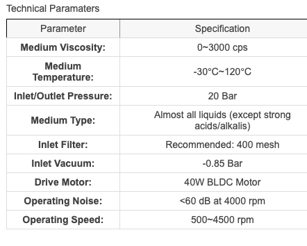
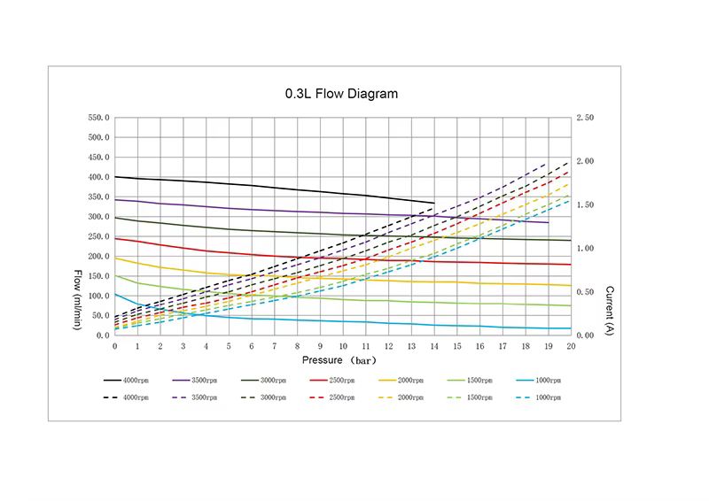
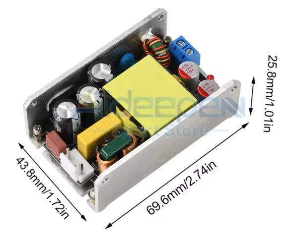
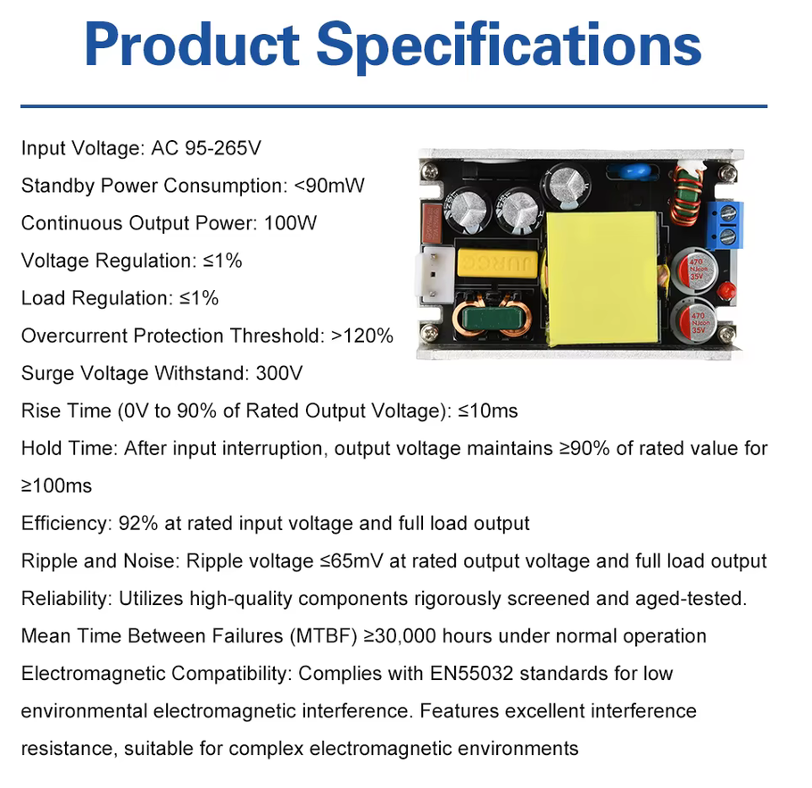
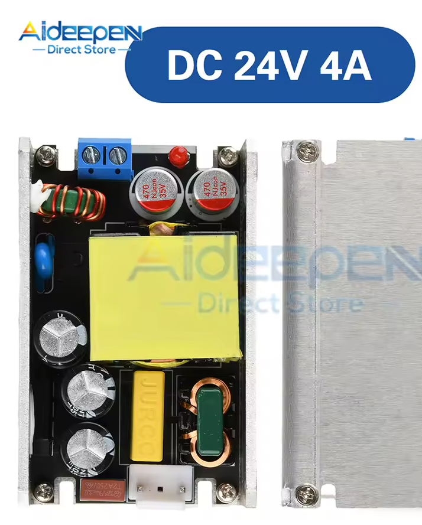
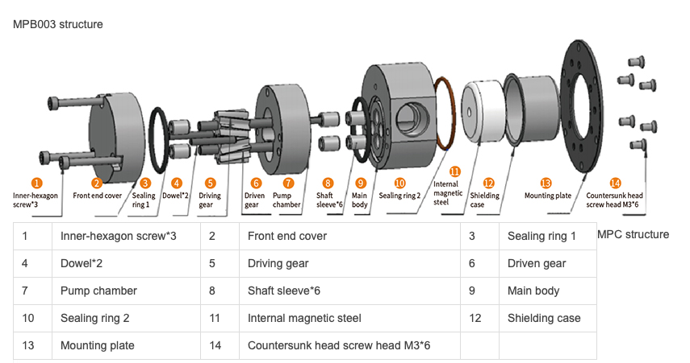
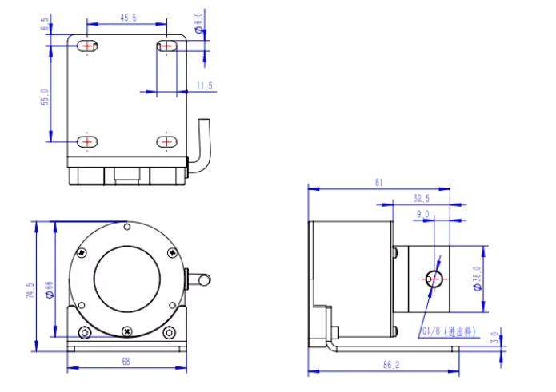
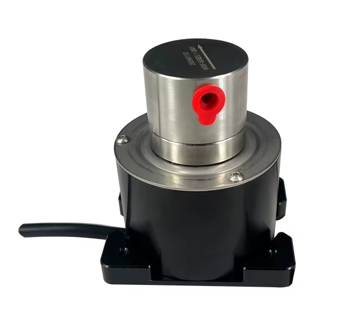

# Pompe à engrenage SOVOFLO MPB003

Pompe envisagée pour remplacer la pompe vibratoire OLAB Silent Green 35 W.
Commandée le 22 octobre 2026, reçue le 5 novembre 2026, **pas encore
installée** : le remplacement n'est pas décidé. Les valeurs viennent de la fiche du vendeur, de la notice
du fabricant ([gearpump-mpb003.pdf](datasheets/gearpump-mpb003.pdf), Chenhui
Technology) et de la notice SOVOFLO de la famille de groupes moteur-pompe
(série FG, électronique 82 040 001, dont le brochage diffère de l'article ;
elle n'est plus dans le dépôt) ;
les points marqués **à relever** se mesurent à réception.

Deux usages motivent le changement :

- **Piloter le débit pendant l'infusion** : une pompe volumétrique donne un
  débit fixé par la vitesse, sans pulsation.
- **Purge lente chauffée** : à 1–2 ml/s, la loi au débit compense l'eau
  entrante pendant la purge. L'eau sort par le bas et la colonne descend :
  l'eau chaude du haut remplace la couche froide de la cuvette du groupe, sans
  refroidir la chaudière ni imposer d'attente avant l'infusion (voir
  [chauffe-chaudiere.md](chauffe-chaudiere.md)).

## Référence

**MPB003BAAA**, moteur BLDC **24 V, 40 W** avec électronique intégrée.

L'étiquette de l'exemplaire reçu porte la référence abrégée **MPB003BAA**,
avec 24 V, 40 W, 0,3 L/min et 0,1 ml/tour. La lettre du moteur manque, mais
c'est un moteur brushless : elle vaut A.

| Lettre | Code | Signification |
| --- | --- | --- |
| MP | — | série à engrenage, entraînement magnétique |
| B | MPB | joint torique caoutchouc (FKM) ; MPC = joint PTFE |
| 003 | 003 | 0 à 0,3 L/min, **0,1 ml par tour** |
| B | corps | inox 316L |
| A | engrenages | PEEK, arbres 316L |
| A | raccords | **G1/8** |
| A | moteur | BLDC |

Engrenages hélicoïdaux en PEEK dans une chambre en inox 316L. Le moteur
entraîne la pompe par un accouplement magnétique à travers une cloche
(*shielding case*) : aucun joint tournant, seulement des joints toriques
statiques. Les matériaux en contact avec le liquide sont annoncés aptes au
contact alimentaire.

## Limites



Le vendeur et la notice ne disent pas la même chose ; la valeur retenue est la
plus prudente.

| Paramètre | Vendeur | Notice | **Retenu** |
| --- | --- | --- | --- |
| Pression au refoulement | 20 bar | **12 bar maximum**, tuyauterie à 12 bar × 1,5 | **12 bar** |
| Température du liquide | −30 à 120 °C | 55 °C au couple maximal, 95 °C à couple réduit | 55 °C |
| Température ambiante | — | 5 à 40 °C au couple maximal, 70 °C à 70 mNm | 70 °C (voir ci-dessous) |
| Filtration | 400 mesh (≈ 37 µm), particules < 20 µm | **10 µm** | 10 µm |
| Vitesse | 500 à 4 500 tr/min | 300 à 5 000 tr/min (moteur) | 500 à 4 500 tr/min |
| Viscosité | 0 à 3 000 cP | eau propre à l'ambiante | eau du bac |
| Dépression à l'aspiration | −0,85 bar (auto-amorçante) | à faire fonctionner mouillée | — |
| Bruit | < 60 dB à 4 000 tr/min | — | — |

- **L'OPV à 11 bar reste sous les 12 bar de la notice.** Elle protège aussi
  la pompe : l'accouplement magnétique ne limite pas la pression de
  refoulement, une soupape après la pompe est obligatoire.
- **Couple à 9 bar** : idéalement `ΔP × cylindrée / 2π` = 9·10⁵ × 0,1·10⁻⁶ /
  2π ≈ **14 mNm**, plus les frottements. On reste loin des 70 mNm : l'ambiance
  de 40–50 °C de la machine est admise.
- **Eau du bac à l'ambiante**, sous les 55 °C. Le clapet anti-retour (plus bas)
  empêche l'eau chaude de la chaudière de refluer vers la pompe.

## Courbes débit-pression



Traits pleins : débit en ml/min. Pointillés : courant en A sous 24 V. Valeurs
lues sur le graphique, à environ ±10 ml/min, converties en ml/s :

| Vitesse | 0 bar | 3 bar | 6 bar | 9 bar | 12 bar | Glissement à 9 bar |
| ---: | ---: | ---: | ---: | ---: | ---: | ---: |
| 4 000 tr/min | 6,7 | 6,5 | 6,3 | 6,0 | 5,8 | 0,7 |
| 3 000 tr/min | 5,0 | 4,7 | 4,4 | 4,25 | 4,15 | 0,75 |
| 2 000 tr/min | 3,25 | 2,8 | 2,5 | 2,35 | 2,3 | 1,0 |
| 1 500 tr/min | 2,5 | 2,0 | 1,75 | 1,65 | 1,5 | 0,85 |
| 1 000 tr/min | 1,75 | 0,9 | 0,7 | 0,65 | 0,5 | 1,05 |

Glissement = débit théorique (vitesse × 0,1 ml) − débit lu.

- **0,1 ml/tour est confirmé** : à 0 bar, chaque courbe part de la vitesse
  × 0,1 ml.
- **Le glissement à 9 bar vaut 0,7 à 1 ml/s**, à peu près indépendant de la
  vitesse, un peu plus fort à basse vitesse. C'est la moitié d'un débit
  d'infusion de 1,5–2 ml/s : le compteur Hall seul ne suffit pas, il faut un
  modèle de glissement en fonction de la pression (voir
  [Calibration du glissement](#calibration-du-glissement)).
- **Points de fonctionnement utiles** :

  | Besoin | Vitesse estimée | Consigne (≈ 1 000 tr/min par V) |
  | --- | ---: | ---: |
  | 1 ml/s à 9 bar | ≈ 1 200 tr/min | ≈ 1,2 V |
  | 2 ml/s à 9 bar | ≈ 1 750 tr/min | ≈ 1,75 V |
  | 2 ml/s à 0 bar (purge lente) | ≈ 1 300 tr/min | ≈ 1,3 V |
  | 3,6 ml/s à 2 bar (remplissage actuel) | ≈ 2 300 tr/min | ≈ 2,3 V |
  | Débit nul à 9 bar (tenir la pression) | ≈ 500–900 tr/min | ≈ 0,5–0,9 V |
  | Maximum à 9 bar | ≈ 6,5 ml/s à 4 500 tr/min | ≈ 4,5 V |

  À la vitesse minimale de 500 tr/min, le débit théorique (0,83 ml/s) est de
  l'ordre du glissement à 9 bar : la pompe peut **tenir une pression sans
  débit**, ce que la pompe vibratoire ne sait pas faire.
- **Courant** : environ 0,5 à 1 A à 9 bar selon la vitesse (12 à 24 W), au
  plus ≈ 1,1 A jusqu'à l'OPV (11 bar). Le courant suit surtout la pression :
  c'est le couple.
- **Fluide des courbes non précisé**, supposé de l'eau à l'ambiante, comme
  l'eau du bac.

## Interface électrique

Brochage : fiche du vendeur et photo de l'article, **7 fils**, confirmé par
la [notice du fabricant](datasheets/gearpump-mpb003.pdf) (page 3,
« Potentiometer seven-wire speed regulation ») et par l'exemplaire reçu :
7 fils, avec les couleurs du tableau. La notice SOVOFLO décrit une
autre électronique de la famille FG (82 040 001, 6 fils, couleurs
différentes) : son brochage ne s'applique pas à cet article. Ses protections internes et son temps
d'initialisation, plus bas, sont repris comme ordre de grandeur, à confirmer.

| Fil | Signal | Rôle |
| --- | --- | --- |
| Rouge, épais | +24 V | alimentation |
| Noir, épais | GND | masse puissance |
| Jaune, fin | +5V_P | **5 V fourni par la pompe**, pour un potentiomètre |
| Marron, fin | SPEED | **consigne** : curseur du potentiomètre |
| Vert, fin | GND_P | référence de la consigne |
| Bleu, fin | TACHO | sortie vitesse |
| Blanc, fin | DIR | sens : la pompe s'inverse quand il est relié au vert |

Montage du vendeur : un potentiomètre entre jaune et vert, curseur sur le
marron.

Fils multibrins, diamètre extérieur mesuré sur l'isolant (l'écrasement des
brins fausse la mesure de la section) :

- **Rouge et noir : 2 mm.** Les Wago 221 les acceptent.
- **Les cinq fils fins : 1,5 mm.** C'est le maximum du contact JST XH
  (SXH-001T-P0.6 : AWG 28 à 22, isolant de 0,8 à 1,5 mm). Le sertissage
  sur le connecteur de combined v2 est à essayer sur un fil avant le câble
  complet.

### Masses : la consigne reste du côté de la pompe

La fiche ne dit pas si le vert (GND_P) est relié au noir dans la pompe.
Mesuré hors tension le 5 novembre 2026 : **pas de continuité entre le vert
et le noir**, ni entre le noir et aucun des six autres fils. La notice SOVOFLO de la famille interdit de relier la référence de consigne à la
masse puissance : ça détruit l'électronique. Le buck 24 → 5 V n'est pas
isolé : la masse de combined v2 est le noir.

**Règle : jaune, marron, vert et bleu ne touchent jamais une masse ni une
alimentation de la carte.** Ils ne voient que le côté isolé de deux
optocoupleurs. Le montage marche donc que le vert soit relié au noir ou non,
sans avoir à le mesurer avant de commander la carte.

### Consigne (marron)

- Plage annoncée 0–5 V. La relation consigne-vitesse de cet article n'est
  pas publiée ; la famille donne l'arrêt sous 0,2 V et ≈ 1 000 tr/min par
  volt, repris dans [Courbes débit-pression](#courbes-débit-pression).
  **Mesuré : 2 455 tr/min à 2,456 V**, soit 1 000 tr/min par volt (un seul
  point, voir [Relevés à réception](#relevés-à-réception)).
- Consigne plafonnée vers 3,6 V (3 600 tr/min) tant que le Digmesa est dans
  le circuit (voir [Débitmètre](#débitmètre)), à recaler sur la vitesse lue.
- **Montage sur combined v2 : PWM à travers un optocoupleur EL817C.**
  - Côté XIAO : la LED est commandée directement par le GPIO, 330 Ω, soit
    (3,3 − 1,2) / 330 ≈ 6 mA. 100 kΩ du GPIO à la masse.
  - Côté pompe : le collecteur sur le jaune, l'émetteur rappelé au vert par
    10 kΩ. LED allumée, l'émetteur monte à ≈ 5 V ; il faut 0,5 mA, pour un
    gain en courant de l'EL817C de 200 à 400 % à 5 mA.
  - Filtre : deux cellules 1,5 kΩ / 2,2 µF (coupure 48 Hz) entre l'émetteur
    et le marron, condensateurs vers le vert. PWM à 1 kHz : l'opto commute
    en ≈ 18 µs. Ondulation ≈ 5 V × (48 / 1 000)² ≈ 12 mV, soit ≈ 12 tr/min ;
    temps de réponse ≈ 10 ms. Le LEDC donne 16 bits à 1 kHz.
  - Impédance de source ≈ 3 kΩ, proche d'un potentiomètre de 10 kΩ à mi-course
    (2,5 kΩ).
  - Le PWM déforme la consigne aux extrêmes, de façon monotone : la vitesse
    est relue sur le tachymètre.
- **Consigne à 0 sans commande** : LED éteinte, les 10 kΩ ramènent la
  consigne au vert. C'est le cas à la mise sous tension, pendant un reset,
  XIAO absent ou firmware arrêté.

### Tachymètre (bleu)

- **Sortie active 0–5 V** (push-pull ou rappel interne), rapport cyclique
  ≈ 50 % : 2,51 V en moyenne au multimètre. Pas de rappel à ajouter.
- **2 impulsions par tour**, mesurées (la famille en annonçait 32) :
  `tr/min = fréquence × 60 / 2`, 17 Hz à 500 tr/min, 120 Hz à
  3 600 tr/min, 167 Hz à 5 000 tr/min.
- **Vitesse mesurée par la période** entre deux fronts : à basse vitesse, un
  comptage sur une fenêtre courte n'a que quelques impulsions.
- **Montage sur combined v2 : second EL817C.** Sa LED va du jaune au bleu à
  travers 1,8 kΩ, soit ≈ 2 mA quand le bleu est bas. Ça marche en
  push-pull comme en collecteur ouvert : à l'état haut, la LED n'a plus de
  tension. Côté XIAO, le transistor tire vers la masse un GPIO rappelé au
  3V3 par 4,7 kΩ (0,7 mA). Le signal est inversé ; le PCNT compte les
  fronts.
- L'EL817C convient jusqu'à ≈ 2,7 kHz : large marge à 167 Hz.
- Débit théorique par impulsion : **0,05 ml**, contre 0,42 g par impulsion
  pour le Digmesa.

### Courant pris au jaune

≈ 0,5 mA pour la consigne et ≈ 2 mA pour le tachymètre : 2,5 mA. Un
potentiomètre de 10 kΩ en prend déjà 0,5 mA. Le jaune les fournit sans chute
mesurable (voir [Relevés à réception](#relevés-à-réception)) : la résistance
de 1,8 kΩ reste telle quelle.

### Sens (blanc)

Non branché, extrémité isolée sous gaine : le sens n'est jamais commandé. Le
sens par défaut suit la flèche de la tête (mesuré à réception).

### Connecteur sur combined v2

XH 4 positions : 1 vert (GND_P), 2 marron (SPEED), 3 bleu (TACHO), 4 jaune
(+5V_P). Rouge et noir passent par les Wago (voir [Alimentation](#alimentation)).

### Protections internes (notice de la famille)

| Protection | Seuil | Réarmement |
| --- | --- | --- |
| Sous-tension | 15,5 V | alimentation > 16,5 V, puis consigne à 0 |
| Surtension | 30 V | alimentation < 29 V, puis consigne à 0 |
| Température | 120 °C interne | < 110 °C (90 °C selon la procédure), puis consigne à 0 |
| Blocage | rotor bloqué 1 s | rotor libre, puis consigne à 0 |

Le réarmement exige la **consigne à 0 V pendant au moins 10 ms**. Le firmware
reconnaît un arrêt sur défaut quand le tachymètre reste muet alors que la
consigne est au-dessus de 0,3 V : il remet la consigne à 0, journalise le
défaut et ne relance pas tout seul pendant une infusion.

Au démarrage à froid (alimentation sous 9 V), l'électronique met **65 ms** à
s'initialiser : une consigne envoyée plus tôt est ignorée.

### Relevés à réception

Relevés du 5 novembre 2026, pompe vide, raccords ouverts.

**Hors tension, au multimètre**

| Mesure | Résultat |
| --- | --- |
| Vert ↔ noir | pas de continuité |
| Noir ↔ les six autres fils | pas de continuité |
| Rouge ↔ les cinq fils fins | pas de continuité |
| Rouge ↔ noir | 1,435 MΩ et croissant : le condensateur d'entrée se charge |
| Marron ↔ vert | **176 kΩ** : rappel interne de la consigne vers le vert |
| Jaune ↔ vert | 2,78 kΩ : circuits internes, pas de court-circuit |

Le rappel de 176 kΩ ramène un marron en l'air à 0 V, donc à l'arrêt (essai
ci-dessous). Il charge un peu le filtre de consigne (≈ 3 kΩ) :
environ 1,7 % de consigne en moins, relue sur le tachymètre.

**Sous tension, 24 V**

| Mesure | Résultat |
| --- | --- |
| Pompe, marron relié au vert | immobile |
| Marron en l'air ↔ vert | **0,007 V**, pompe immobile (essai bref, pompe vide) |
| Jaune ↔ vert, à vide, marron relié au vert | **4,98 V** |
| Jaune ↔ vert, 2 192 Ω (2,27 mA) | 4,98 V |
| Jaune ↔ vert, 998 Ω (5,0 mA) | 4,98 V |
| Consommation au secteur, pompe au repos | 1,2 W (prise wattmètre) |

**Pompe amorcée, 0 bar**

Aspiration dans un pichet sur la balance, tuyau rempli d'eau passant
par-dessus le bord ; refoulement libre vers l'évier, plus bas. Consigne par
diviseur entre jaune et vert, marron au point milieu.

| Mesure | Résultat |
| --- | --- |
| Consigne, 4,7 kΩ / 1 kΩ | 0,86 V : la pompe tourne lentement |
| Consigne, 4,7 kΩ / 4,7 kΩ | **2,456 V** |
| Bleu ↔ vert, tension continue | **2,514 V** |
| Bleu ↔ vert, fréquence | **81,8–81,9 Hz** |
| Eau pompée en 30 s | **128,3 g** |

- **2 impulsions par tour** : 81,85 Hz × 60 / 2 = 2 455 tr/min, soit
  122,8 ml en 30 s à 0,1 ml par tour. 1 ou 4 impulsions par tour
  donneraient 245 g ou 61 g.
- **1 000 tr/min par volt** : 2 455 tr/min pour 2,456 V.
- **4,5 % d'eau en plus** que la cylindrée (0,1045 ml par tour). Piste : le
  pichet est plus haut que l'évier, l'eau passe un peu à travers les
  engrenages en plus de ce qu'ils déplacent. À recouper à refoulement
  surélevé.
- **Sens par défaut**, blanc non branché : l'eau coule dans le sens de la
  flèche de la tête.
- Quelques petites bulles au refoulement, aucune dans le tuyau
  d'aspiration : prise d'air probable au filetage d'aspiration, serré à la
  main sans étanchéité.

- **Le jaune est une sortie régulée** : pas de chute mesurable à 5 mA, soit
  une résistance interne sous 2 Ω. Le besoin du montage est de 2,5 mA.
- **Marron en l'air : 7 mV**, très loin du seuil d'arrêt de la famille
  (≈ 0,2 V) : la pompe reste arrêtée si le connecteur ou le câble lâche,
  alors que son 24 V, pris aux Wago, ne passe pas par combined v2. Pas de
  résistance à ajouter dans le câble.
- **Repos ≈ 1 W sous 24 V**, soit ≈ 40–45 mA, une fois retirés la
  consommation à vide de l'alimentation (< 90 mW) et ses pertes. La notice de
  la famille donne 0,06 A. La prise wattmètre ne donne qu'un ordre de
  grandeur.
- À la coupure, le jaune tombe à 0 V en ≈ 10 s : l'énergie des condensateurs
  de l'alimentation et de la pompe.

## Alimentation

Montage prévu, en remplacement de la RECOM RAC05-05SK (5 V, 1 A) :

Chaîne prévue, du secteur à la pompe :

```
secteur ─ Wago ─ câble VH ─ alimentation 24 V ─ fils ─ Wago ─┬─ 24 V : pompe
                  (fusible T2A)     (bornier)                 └─ 24 V : combined v2 (buck 5 V) ─ 5 V : écran
```

1. **Pas de carte AC pour l'instant** (décision du 3 novembre 2026). Le
   secteur arrive aux Wago, puis au VH de l'alimentation : rien entre eux,
   donc pas de limitation de l'appel de courant (voir
   [Appel de courant et interrupteur](#appel-de-courant-et-interrupteur)).
   La carte `pcb/ps_upstream` (38,6 × 19 mm, détails dans
   `pcb/ps_upstream/ps_upstream_design.md`) reste dessinée : entrée HT396R,
   thermistance CTN d'appel de courant sur L, sortie VH vers
   l'alimentation, sans fusible. C'est la seule option de protection
   retenue si elle revient dans le montage : un montage 230 V se fait avec
   des Wago, des VH3.96 ou des HT3.96, pas avec une CTN à pattes volante.
2. **Alimentation 24 V, 96 W** (4 A), décrite ci-dessous. Elle remplace la
   RECOM RAC05-05SK (5 V, 1 A) et ne rentre pas dans `boitier_ps` actuel
   (logement de la RECOM : 21,9 × 27,1 × 33 mm) : nouveau boîtier, voir
   [boitier-ps-24v.md](boitier-ps-24v.md).
3. **Deux Wago 221-423** (+24 V et GND) répartissent le 24 V entre la
   pompe et combined v2. Pas de carte DC dans `boitier_ps` : le 24 V part
   directement du bornier de l'alimentation. Les Wago vont dans
   `boitier_ps` ou dans `boitier_dc`, à décider au montage : dans
   `boitier_dc`, le câble de la pompe reste entier sous une seule gaine.
4. **Combined v2** : la partie dimmer et la détection du passage par zéro
   disparaissent. La carte reçoit le 24 V sur un HT3.96, porte le buck
   24 → 5 V et renvoie le 5 V de l'écran le long du câble CAN. Elle commande
   la pompe et lit son tachymètre à travers deux optocoupleurs (voir
   [Interface électrique](#interface-électrique)). Le buck reçoit moins de
   5 W ; le courant de la pompe ne traverse pas la carte.



### Description de l'alimentation

Module ouvert vendu « DC 24V 4A » (Aideepen), annoncé GaN. Photos :
[vue d'ensemble](datasheets/alim-24v-gan.png), [carte vue de
dessus](datasheets/alim-24v-carte.png), [fiche](datasheets/alim-24v-specs.png).

**Mécanique**

- **Encombrement mesuré : 68,5 × 44,1 × 25,8 mm** (longueur × largeur ×
  hauteur), radiateur compris, **111,8 g**. La fiche et les photos donnaient
  69,6 × 43,8.
- **Radiateur en U**, aluminium de 2 mm : un fond sous la carte et deux
  flancs de 25,8 mm le long des 68,5 mm. Les deux bouts (côtés de 44,1 mm)
  sont ouverts, et le dessus de la carte aussi : l'air passe par là.
- **Fixation de la carte** : quatre vis **métalliques** aux coins, vissées
  dans des entretoises en laiton serties dans le fond du radiateur. Les
  vis ont une tête conique, à fleur sous la plaque : posée sur du métal,
  l'alimentation touche donc ces vis. Les trous de coin de la carte ont une
  couronne de cuivre ; leur potentiel est mesuré (voir Isolation).
- **Fixation du module** : les flancs sont percés aux coins, côté extérieur,
  en **M3 taraudé** dans les 2 mm de la plaque, sans écrou. Les vis en
  nylon dont David dispose sont du M2 : elles ne vont pas. Une vis en
  nylon M3 vissée depuis l'extérieur du boîtier, où le fond touche la
  face de la machine reliée à la terre, évite tout contact entre cette
  terre et le radiateur.
- **Dos de la carte** (sortie à droite) : composants CMS des deux côtés.
  Côté sortie, les deux MOSFET du redressement synchrone (boîtiers plats
  8 broches) et le contrôleur sont au dos. Côté entrée, une longue fente
  fraisée traverse la carte ; une ouverture au centre est couverte de ruban
  jaune. Les bords de la carte ont des encoches en demi-lune.
- **L'entrée et la sortie sont aux deux bouts opposés** de la longueur de
  68,5 mm. Il faut donc prévoir le passage des fils aux deux bouts.

**Thermique**

- **Côté sortie** : un pad thermique bleu, posé directement sur
  l'aluminium du fond, refroidit le dos de la carte sous les MOSFET du
  redressement synchrone.
- **Côté entrée** : un film isolant noir couvre le fond sous la partie
  haute tension. Le pont redresseur, un boîtier noir plat debout contre le
  flanc, y est collé à la pâte thermique.
- Le radiateur évacue donc la chaleur du primaire (pont) et du secondaire
  (MOSFET). Le boîtier doit le laisser respirer : ne pas le noyer dans le
  plastique, garder de l'air aux deux bouts et au-dessus.

**Entrée secteur** (bout « entrée »)

- **Connecteur JST VH 3,96 mm à trois positions, broche centrale
  supprimée** : L et N sont écartés de 7,92 mm. Il est dans la largeur de
  44,1 mm, près du milieu. Le câble d'arrivée porte un boîtier VH 3
  positions, la position 2 vide, serti par David.
- **Fusible T2A 250 V**, temporisé, rectangulaire, soudé juste à côté du
  connecteur : c'est la seule protection de toute la chaîne en aval du
  disjoncteur.
- Ensuite : condensateur X à film (jaune), self de mode commun (en fil
  plat), pont redresseur collé au radiateur, **3 × 27 µF / 400 V**
  (105 °C), soit 81 µF au total. Pas de CTN (voir [Appel de courant et
  interrupteur](#appel-de-courant-et-interrupteur)).

**Sortie 24 V** (bout « sortie »)

- **Bornier à vis bleu à deux positions**, dans un coin du bout de sortie :
  à gauche quand on regarde la carte de dessus, entrée vers soi. Pas
  mesuré : **5 mm**.
- **Polarité** : carte vue de dessus, sortie à droite, la LED est sous le
  bornier. **GND est la vis du haut**, contre le flanc, et **+24 V la vis du
  bas**, du côté de la LED. Sur la [carte vue de
  dessus](datasheets/alim-24v-carte.png) (entrée en bas), GND est donc la vis
  de gauche. Relevé d'abord sur la version 12 V, **confirmé sous tension sur
  l'exemplaire reçu** : LED au sud, GND au nord ; **23,89 V à vide**.
- **LED rouge** à côté du bornier. À vide, elle reste allumée environ une
  minute après la coupure (voir [Réception](#réception-et-premiers-essais)).
- Self de sortie (tore vert), **2 × 470 µF / 35 V**. La tension de sortie
  est fixe : il n'y a pas de potentiomètre.
- Le courant prévu (1,4 A, 4 A au pire) passe dans du fil de 0,5 mm²
  (AWG 20) ; 0,75 mm² laisse de la marge pour le pire cas.

**Composants principaux**

| Côté | Composants |
| --- | --- |
| Primaire | fusible T2A, condensateur X, self de mode commun, pont redresseur, 3 × 27 µF / 400 V, contrôleur marqué « BST25 » (sans fiche), transformateur (ruban jaune) |
| Barrière | transformateur, condensateur Y (disque bleu, entre primaire et secondaire) |
| Secondaire | redressement synchrone par deux MOSFET 003N10H (100 V), self de sortie, 2 × 470 µF / 35 V, LED |

**Isolation**

- **Primaire-radiateur** : le film noir sous la partie haute tension et le
  boîtier isolé du pont redresseur, collé au flanc. Le radiateur n'est pas
  relié à la terre : l'alimentation n'a pas de borne de terre.
- **Potentiel du radiateur** : mesuré hors tension, voir
  [Réception](#réception-et-premiers-essais). Les quatre vis, leurs
  entretoises et les couronnes de la carte forment un réseau **flottant**,
  relié ni au GND, ni au +24 V, ni à L ou N. Le pad thermique bleu sépare de
  toute façon les MOSFET du secondaire de l'aluminium. La plaque, sans doute
  anodisée, n'a pas été reconnue reliée à ce réseau, mais la mesure n'est
  pas concluante : la tête conique des vis affleure sous la plaque, donc
  l'alimentation posée sur du métal touche les vis. Le boîtier traite la
  plaque et les vis comme une pièce métallique qui n'est ni L ni N :
  isolation principale, 3 mm entre le cuivre et le bord de la carte.
- **Primaire-secondaire** : par le transformateur et le condensateur Y. Le
  vendeur ne donne ni tension d'essai ni homologation (seulement EN 55032,
  qui est une norme d'émissions). La sortie 24 V et toute la basse tension
  en aval ne sont donc **pas garanties TBTS**. On ne la touche pas sous
  tension sans l'avoir vérifié.
- Le condensateur Y laisse passer un petit courant de fuite alternatif vers
  la sortie : une sortie flottante peut « picoter » une sonde ou un PC
  raccordé en USB.

### Réception et premiers essais

Relevés du 3 novembre 2026 sur l'exemplaire reçu.

**Hors tension, au multimètre**

| Mesure | Résultat |
| --- | --- |
| L ↔ N (broches du VH) | pas de continuité |
| +24 V ↔ GND (bornier) | pas de continuité |
| Les 4 vis de fixation entre elles | continuité |
| Vis ↔ entretoises | continuité |
| Vis ↔ plaque du radiateur | pas de continuité (aluminium sans doute anodisé ; léger bip, grattage insuffisant : non concluant) |
| Vis ↔ bornier DC (les deux vis) | pas de continuité |
| Vis ↔ connecteur L/N | pas de continuité |

La résistance d'isolement entre l'entrée et la sortie n'a pas été mesurée : un
multimètre n'applique que quelques volts, donc l'absence de continuité tient
lieu de test. Le fusible n'a pas été testé : sans continuité, l'alimentation
ne démarre pas.

**Sous tension, à vide, sans CTN** : pas de claquage au premier essai.

| Observation | Valeur |
| --- | --- |
| Tension de sortie | **23,89 V**, soit −0,46 % : dans les ± 1 % de la fiche |
| Polarité | +24 V côté LED, GND de l'autre côté du bornier |
| Après la coupure | 23,89 V maintenus ≈ 30 s, puis chute à 0 V en ≈ 20 s ; LED allumée presque une minute |

L'alimentation continue de fonctionner sur l'énergie de ses condensateurs
primaires : ½ × 81 µF × 325² ≈ 4,3 J, soit ≈ 48 s à 90 mW de consommation à
vide, ce qui correspond au relevé. Le primaire reste donc chargé à plusieurs
centaines de volts **pendant environ une minute à vide**, tant que la LED est
allumée. Avec les ESP32 branchés (2–3 W), la décharge ne prend plus que 1 à 2 s.
Le couvercle transparent du boîtier laisse voir la LED : on n'ouvre pas tant
qu'elle est allumée.

### Appel de courant et interrupteur

**Décision du 3 novembre 2026 : pas de ps_upstream, pas de CTN pour l'instant.**

- **Le maillon faible est l'interrupteur**, pas l'alimentation : un
  **Profitec bipolaire 16 A / 250 V (P9111)**, pièce détachée à une dizaine
  de dollars. Avec la RECOM RAC05-05SK actuelle, le contact claque environ
  une fois tous les 50 démarrages, à vue d'œil. Cette RECOM a un appel de
  courant de 30 A à froid à 230 V d'après sa fiche (`RAC05-K_277.pdf`, T1A
  temporisé). Les 16 A de l'interrupteur sont une valeur résistive ; sa
  tenue à un appel capacitif n'est pas donnée.
- **Sans limitation, cette alimentation donne une crête de l'ordre de 300 à
  650 A**, de 325 V divisé par la résistance série (0,5 à 1 Ω : fusible,
  self, pont, câblage et réseau), pendant plusieurs fois plus longtemps que
  la RECOM. Le I²t vaut environ 4,3 J ÷ R, soit 4 à 9 A²s. Ce sont des
  ordres de grandeur : ni la fiche du pont ni celle du fusible ne sont connues.
  Une charge DC branchée n'y change rien : l'appel a lieu avant le démarrage
  du contrôleur.
- **Avec la CTN de 10 Ω de ps_upstream, la crête retombe à ≈ 30 A**, soit le
  niveau de la RECOM actuelle : le claquage de l'interrupteur serait ramené
  à la fréquence actuelle, pas supprimé.
- **81 µF pour 100 W**, soit 0,8 µF/W : pas surdimensionné.
- **Contre ps_upstream** : un élément de plus dans le boîtier, qui doit
  placer la carte en face du VH de l'alimentation, entrée de ps_upstream du
  côté de l'arrivée secteur. Sa chaleur est faible (≈ 4 mW au repos).
- **Pour rien** : les Wago se placent librement, plus de virage serré du
  0,75 mm² vers une carte. L'alimentation coûte moins de 10 francs, des
  dizaines de vendeurs la proposent, une de réserve est envisagée.
- **Risque assumé** : usure ou, plus rarement, soudure des contacts de
  l'interrupteur. Remplacer l'interrupteur est possible, mais plus gênant que
  remplacer l'alimentation. Une CTN à pattes volante entre deux Wago a été
  écartée : le 230 V se monte avec des Wago, des VH3.96 ou des HT3.96.

### Fiche du vendeur



| Paramètre | Valeur annoncée | Pour la machine |
| --- | --- | --- |
| Entrée | 95 à 265 VAC | 230 V au milieu de la plage |
| Consommation à vide | < 90 mW | — |
| Puissance continue | 100 W | 24 V × 4 A = 96 W sur l'étiquette ; retenu : 96 W |
| Régulation (ligne et charge) | ≤ 1 % | 24 V ± 0,24 V, loin des seuils de 15,5 et 30 V de la pompe |
| Protection de surintensité | > 120 % | déclenche au-delà de ≈ 4,8 A, au-dessus du pire cas de 3,8 A |
| Surtension d'entrée tenue | 300 V | — |
| Montée de 0 à 90 % | ≤ 10 ms | — |
| Maintien après coupure secteur | ≥ 90 % pendant ≥ 100 ms | une micro-coupure ne redémarre ni les ESP32 ni la pompe |
| Rendement | 92 % à pleine charge | cohérent avec l'essai (≈ 91–92 %) ; non donné à faible charge |
| Ondulation | ≤ 65 mV à pleine charge | cohérent avec l'essai (42–85 mV en 12 V) |
| MTBF | ≥ 30 000 h | ≈ 3,4 ans sous tension permanente |
| CEM | EN 55032 | — |

### Bilan de puissance

| Poste | Courant sous 24 V |
| --- | ---: |
| Pompe, usage prévu, jusqu'à l'OPV (11 bar) | ≈ 1,1 A |
| Pompe, limite en service continu (> 30 min) | 2,5 A (60 W) |
| Pompe, limite instantanée en service intermittent | 3,5 A (84 W) |
| Électronique de la pompe au repos | 0,06 A |
| Buck, 1 A en 5 V comme la RECOM, rendement ≈ 85 % | ≈ 0,25 A |
| **Pire cas** | **≈ 3,8 A**, sous les 4 A de l'alimentation |
| **Usage prévu** (pompe à 11 bar au plus, buck) | **≈ 1,4 A, 35 W**, 35 % de la charge nominale |

**Profil de charge.** Ces 35 W sont une pointe, pas la charge habituelle :

- **La plupart du temps, 2 à 3 W** (≈ 0,1 A sous 24 V) : les deux ESP32,
  dont un seul utilise la radio. L'alimentation est alors à
  2–3 % de sa charge nominale et chauffe à peine.
- **Pompe en marche, rarement à pleine charge** : le courant suit la
  pression, pas le débit.
  - Faible débit à haute pression (infusion, tenue de pression) : ≈ 0,5 à
    1 A à 9 bar, 12 à 24 W.
  - Fort débit sans résistance (remplissage, purge) : couple faible, courant
    bien en dessous.
  - Le haut des deux à la fois, fort débit à 11 bar, n'arrive pas en usage
    normal.
- **Durées courtes** : une purge dure 5 à 15 s, en général 5 s ; une
  infusion 20 à 60 s, en général 30 s. La température de l'alimentation suit la charge moyenne, proche
  du repos.

- **Buck** : au moins **2 A en 5 V**, pour garder de la marge sur la RECOM
  actuelle.
- **Pas de fusible sur la carte AC.** Le fusible **T2A 250 V** de
  l'alimentation est le premier composant après son connecteur ; il protège
  l'alimentation et la CTN, en série avec lui. Le câblage en amont est
  protégé par le disjoncteur de la maison. Un T1,6 A en amont ne protégerait
  que la carte AC elle-même.
- **CTN : TDK B57236S0100M000** (série S236, 10 Ω à froid), **C125458**
  chez JLCPCB, en série sur la phase. L'alimentation n'en a pas (essai
  ci-dessous). Elle limite la crête d'appel à ≈ 325 V / 10 Ω ≈ 33 A. Fiche :
  [C125458.pdf](datasheets/C125458.pdf).
- **Composant traversant, pas CMS.** Une CTN d'appel absorbe à chaque mise
  sous tension l'énergie des condensateurs d'entrée, ½ × 81 µF × (325 V)² ≈
  4,3 J, et dissipe en continu. Il faut la masse d'un disque ; les CTN CMS
  sont des sondes de mesure. JLCPCB monte le traversant en option.
- **24 V** dans la plage de 20 à 29 V de la pompe, loin de ses seuils de
  15,5 et 30 V.

### CTN d'appel de courant

Cette section décrit la CTN de `pcb/ps_upstream`. Cette carte n'est pas dans
le montage pour l'instant (voir [Appel de courant et
interrupteur](#appel-de-courant-et-interrupteur)) ; le choix reste valable
si elle y revient.

#### Choix de la CTN

Références comparées, toutes 10 Ω, traversantes et « extended » chez JLCPCB :

| | **C125458** TDK S236 | C3790 Ruilon 10D-9 | C6793809 10D-7 | C125456 TDK S235 |
| --- | ---: | ---: | ---: | --- |
| Courant permanent max | **3,5 A** (0 à 65 °C) | 2 A | 1 A | 3 A |
| Capacité admise à 230–240 V | **300 µF** (essai UL et IEC) | 150 µF | 100 µF | non connue |
| Marge sur 81 µF | **× 3,7** | × 1,85 | × 1,2 | — |
| Dissipation | 10 mW/K | ≈ 11 mW/K | 6–9 mW/K | — |
| Constante de temps | 70 s | ≈ 35 s | 20–27 s | 60 s |
| Capacité thermique | 700 mJ/K | ≈ 0,4 J/K | ≈ 0,2 J/K | — |
| Échauffement par allumage (4,3 J) | ≈ 6 K | ≈ 11 K | ≈ 20 K | — |
| Corps | Ø 11,5, haut. 16 mm | Ø 9 mm | Ø 7 mm | Ø 9,5 mm |
| Pas | 5 mm | 7,5 mm | 5 mm | 5 mm |
| Homologations | UL 1434, IEC, VDE, CQC | — | — | UL, VDE, CQC |
| Prix unitaire | 0,33 $ | 0,09 $ | 0,04 $ | 0,20 $ |

- **C125458 retenue** : seule capacité admise vérifiée par un essai
  normalisé, avec la plus grande marge ; ses 3,5 A dépassent le fusible T2A,
  qui lâche avant elle en cas de défaut. Le surcoût est négligeable sur un
  montage unique.
- **C3790** : convient en repli. La fiche donne 2 A ; la base JLCPCB
  affiche 1 A à tort. Sa marge de capacité est deux fois plus faible.
- **C6793809** : écartée, 81 µF sur 100 µF admis, et plus d'échauffement
  à chaque allumage.
- **C125456** : la fiche disponible ne couvre que l'emballage ; repli si les
  16 mm de hauteur de la S236 ne passent pas dans le boîtier, après avoir
  trouvé sa capacité admise.

#### Échauffement de la CTN

La CTN chauffe peu, parce que la charge est le plus souvent celle du repos
(voir [Profil de charge](#bilan-de-puissance)) :

| Situation | Courant secteur | Pertes | Échauffement (S236) |
| --- | ---: | ---: | ---: |
| Repos, 2–3 W | ≈ 0,04 A | ≈ 16 mW | ≈ 2 K |
| Mise sous tension | crête ≈ 33 A | 4,3 J | ≈ 6 K |
| Infusion de 30 s à 35 W | ≈ 0,35 A | ≈ 0,4 W | ≈ 14 K |
| Pompe à 35 W tenue en continu | ≈ 0,35 A | ≈ 0,4 W | ≈ 40 K, vers 3 Ω |

- **Presque toujours à 10 Ω** : elle protège à chaque allumage, y compris
  un rallumage juste après une infusion. Seul un arrêt après plusieurs
  minutes de pompe en continu la laisserait assez chaude pour qu'un
  rallumage immédiat claque.
- **Résistance en charge sans effet** : quelques volts de chute, alors que
  l'alimentation accepte de 95 à 265 V.
- **Température de la machine** : 40–50 °C, dans la plage de 0 à 65 °C où
  TDK garantit les 3,5 A.

#### Montage de la CTN

- **À l'écart** des condensateurs, du plastique et des composants voisins,
  comme le demande TDK pour son refroidissement. Les pattes coudées de la
  S236 fixent sa hauteur au-dessus de la carte.
- **Au sec** : l'eau et les électrolytes traversent le revêtement et
  dégradent la céramique. Dans la machine, la protéger des projections et de
  la vapeur par le boîtier.

### Essai publié de l'alimentation

Essai d'un vidéaste sur la version **12 V / 8 A** du même module (96 W). La
carte 24 V est la même, aux condensateurs de sortie près (voir
[Carte 24 V](#carte-24-v-photo-du-vendeur)).

| Point | Résultat |
| --- | --- |
| Entrée | fusible d'environ 4 A en boîtier rectangulaire, pont redresseur collé au radiateur par pâte thermique, **3 × 27 µF / 400 V** (105 °C), condensateur X à film, self de mode commun. **Pas de CTN** : étincelle au branchement |
| Sortie (12 V) | self, 2 × 1 000 µF / 16 V, LED rouge. La LED reste allumée longtemps après la coupure : les condensateurs de sortie se vident lentement |
| Radiateur | aluminium de 2 mm sur trois faces, film plastique entre la partie haute tension et le radiateur |
| Consommation à vide | non mesurable au wattmètre |
| Tension (12 V) | 12,2 V à vide, 11,87 V à 8 A aux bornes de la charge, fils compris |
| Surcharge | 9 A (≈ 105 W) tenus brièvement |
| Rendement | ≈ 92 % jusqu'à 3 A, ≈ 91 % de 5 à 8 A |
| Ondulation | 42 à 85 mV crête à crête, moins de 1 % |
| Tension secteur | 170 à 250 V sans effet sur la sortie |
| Composants | deux MOSFET 003N10H (100 V, redressement synchrone) et un contrôleur marqué « BST25 », sans fiche : **le GaN n'est pas confirmé** |

Échauffement à 96 W, points chauds sur la self et la zone des condensateurs
de sortie :

| Condition | Self | Condensateurs |
| --- | ---: | ---: |
| À l'air libre, 10 min | 94 °C | 99 °C |
| À l'air libre, 20 min | 104 °C | 108 °C |
| À l'air libre, 30 min (stable) | 109 °C | 109 °C |
| Enfermée dans sa boîte, +10 min | 124 °C | 128 °C |
| Enfermée dans sa boîte, +20 min | 126 °C | **133 °C** |
| Sortie de la boîte, 85 W, +10 min | 93 °C | 102 °C |

Conséquences pour la machine :

- **Charge de 35 W au plus**, pompe en marche, soit un peu plus du tiers de
  la charge nominale. Les pertes, ≈ 9 W à 96 W, tombent vers ≈ 3 W :
  l'échauffement au-dessus de l'ambiante est environ trois fois plus faible.
  Même tenue en continu, cette charge laisserait les points chauds vers
  80–95 °C dans une enceinte à 40–50 °C, sous les 125 °C des condensateurs
  de sortie. Au repos (2–3 W), l'alimentation reste proche de l'ambiante.
- **Le boîtier ne doit pas l'enfermer étroitement** : garder un espace d'air
  autour du radiateur et des ouïes. La pointe de 84 W de la pompe ne dure
  pas : elle ne compte pas pour l'échauffement.
- **Appel de courant confirmé** : condensateurs d'entrée chargés
  directement sur le secteur redressé, sans CTN. Voir [Appel de courant et
  interrupteur](#appel-de-courant-et-interrupteur) pour la décision.
- **Sortie qui décroît lentement à la coupure** : le moteur de la pompe
  s'arrête par sa sous-tension à 15,5 V, l'ESP32-S3 quand le buck décroche ;
  la consigne est alors à 0. Aucune action nécessaire.

### Carte 24 V (photo du vendeur)



La photo de l'article acheté, « DC 24V 4A », montre la **même carte que
l'essai** : trois condensateurs d'entrée, self de mode commun en fil plat,
condensateur X jaune, fusible T2A rectangulaire près du connecteur secteur, pas de
CTN visible. Seuls changent les condensateurs de sortie, **2 × 470 µF / 35 V**,
et aucun potentiomètre de réglage n'apparaît : la tension de sortie est fixe.

- **35 V suffisent** pour 24 V : marge de 45 %.
- **24 V × 4 A = 96 W**, cohérent avec l'annonce et l'essai.
- **Fusible interne T2A 250 V**, temporisé, lisible sur la photo (l'essai
  l'estimait à 4 A).

## Hydraulique

### Raccords

Les raccords **G1/8** sont à filetage cylindrique. Le vendeur conseille du
ruban PTFE à l'aspiration ; la notice interdit qu'un fragment de ruban ou de
pâte entre dans la pompe. Les raccords cannelés n'ont pas d'épaulement pour
une rondelle.

**Règle : frein-filet Loxeal sur 2 à 3 mm du filetage mâle**, côté
extérieur, les premiers filets laissés nus : le filetage fait 12 mm, le
produit ne peut pas atteindre la pompe. Même étanchéité que celle du
capteur de pression XDB401, qui tient la pression de la chaudière. Pas de
ruban. Une prise d'air à l'aspiration fait entrer des bulles ou empêche la
pompe d'aspirer.

Respecter le **sens de la flèche** du couvercle avant. Pompe près du bac,
aspiration courte, tuyaux au moins aussi gros que les raccords.

### Clapet anti-retour

Une pompe à engrenage n'a pas de clapet : à l'arrêt, la pression de la
chaudière repousse l'eau à travers les engrenages vers le bac. Après une
infusion, la chaudière isolée monte à 9–9,5 bar ; elle se viderait vers le
bac par la pompe, de l'eau chaude atteindrait les engrenages, et le Digmesa,
en amont, compterait ce débit à l'envers comme un débit normal.

**Règle : un clapet anti-retour à la sortie de la pompe**, avant le capteur de
pression, pour que celui-ci continue de lire la chaudière. Si la machine
d'origine a déjà un clapet à l'entrée de la chaudière (**à vérifier** au
démontage), il suffit.

### Vanne trois voies

La notice demande de ne manœuvrer une électrovanne située après la pompe
qu'une fois la pompe arrêtée, pour éviter les coups de bélier : une pompe
volumétrique qui refoule contre une vanne qui se ferme monte en pression
jusqu'à l'ouverture de l'OPV. **Règle : en fin d'infusion, la vanne se ferme
quand le tachymètre indique l'arrêt de la pompe**, au plus tard 500 ms après
la consigne à 0.

### Filtration

La notice demande un filtre à **10 µm** avant la pompe, avec une surface
assez grande pour ne pas freiner l'aspiration. Le filtre actuel, en amont du
Digmesa, protège une buse de 1 mm : sa finesse est **à relever**. S'il est
plus grossier, ajouter un filtre fin à l'aspiration de la pompe.

### Mise en service

Rincer la pompe et la ligne avant la première infusion. Pour un usage
alimentaire, la notice demande de faire circuler de l'eau à 80 °C pendant
20 minutes, eau jetée ensuite.

## Ce qui change dans le firmware

### Marche à sec

La pompe doit toujours tourner mouillée. Le tachymètre et le Digmesa
détectent un bac vide : la pompe tourne et le Digmesa ne compte rien.

**Règle par défaut** : pompe au-dessus de 1 000 tr/min, aucune impulsion
Digmesa pendant **2 s** et pression qui ne monte pas → consigne à 0 et erreur
« bac vide ». Les seuils se règlent au premier essai, bac débranché.

### Débitmètre

Le Digmesa est limité à **0,40 L/min (6,7 ml/s)**. La pompe le dépasse à
basse pression au-delà de 4 000 tr/min : jusqu'à 0,5 L/min à 5 000 tr/min.
Le Digmesa envoie toujours ses impulsions (≈ 20 Hz à 0,5 L/min), mais la fiche
pose trois limites :

- **Précision** : les ±2 % ne valent que dans la plage linéaire. Au-delà, le
  nombre d'impulsions par litre dérive sans que rien ne le signale.
- **Usure** : turbine sous **500 tr/min en service continu**, atteints vers
  0,40 L/min.
- **Perte de charge à l'aspiration** : **0,48 bar à 0,40 L/min** pour la buse
  de 1,0 mm, à peu près en carré du débit, soit ≈ 0,75 bar à 0,5 L/min.
  Le Digmesa est en amont de la pompe, annoncée à −0,85 bar au plus, tuyaux
  non compris : elle caviterait et dégazerait l'eau, et les bulles faussent
  le Digmesa.

**Règle** : plafonner la vitesse à **3 600 tr/min** (6 ml/s théoriques, soit
0,36 L/min, ≈ 0,39 bar de perte de charge) tant que le Digmesa est dans le
circuit. Ce plafond couvre le remplissage actuel (3,6 ml/s).

### Pression

La pompe vibratoire pousse par impulsions à 50 Hz ; le filtrage de la mesure
de pression du XDB401 a été réglé pour cette ondulation (voir
[firmware.md](firmware.md)). Sans pulsation, ce filtrage pourra être allégé,
après une capture de comparaison.

En panier aveugle, une pompe volumétrique monte la pression jusqu'à
l'ouverture de l'OPV (11 bar), sous les 12 bar de la notice.

### Durée de marche

La limite de 60 s de marche continue venait du thermique de la pompe
vibratoire. Elle reste : elle couvre aussi la vanne, et la pompe a sa propre
limite de 60 W en service continu.

## Calibration du glissement

Le Digmesa, en amont, mesure le débit net (OPV fermée). Le glissement est une
fuite interne de la sortie vers l'entrée de la pompe, après le Digmesa :

```
glissement = volume tachymètre (impulsions / 2 × 0,1 ml) − volume Digmesa
```

Modèle de départ : `glissement(P) = k × P`, à remplacer par une table si les
mesures s'en écartent. Le glissement dépend aussi de la viscosité, donc de la
température de l'eau du bac, à peu près constante.

Protocole :

1. **Panier aveugle, pression asservie** : la pompe tient des paliers de 2,
   4, 6, 8, 9 et 10 bar. Le débit net est nul : la vitesse nécessaire pour
   tenir chaque palier donne le glissement pur. Le Digmesa doit rester à
   zéro, ce qui sert de contrôle. Ne pas lancer de vitesse fixe en panier
   aveugle : la pression monterait jusqu'à l'OPV.
2. **Panier SCACE (trou de 0,3 mm) et balance** : des vitesses fixes donnent
   des points avec débit réel, à comparer au modèle.
3. **En service** : chaque infusion OPV fermée recalcule `k` à partir du
   tachymètre et du Digmesa, pour suivre l'usure.

## Structure et cotes



Vis creuses ×3, couvercle avant, joint 1, goupilles ×2, engrenage menant,
engrenage mené, chambre, bagues d'arbre ×6, corps, joint 2, aimant intérieur,
cloche, platine de fixation, vis fraisées M3 ×6. La tête se sépare du moteur
par les 4 vis arrière, resserrées à 1 ± 0,2 Nm.



Cotes lues sur le plan, en mm :

| Cote | Valeur |
| --- | ---: |
| Longueur moteur + tête | 81 |
| Longueur de l'équerre | 86,2 |
| Largeur de l'équerre | 68 |
| Hauteur totale | 74,5 |
| Diamètre du moteur | 66 |
| Diamètre de la tête de pompe | 38 |
| Longueur de la tête de pompe | 32,5 |
| Axe des raccords depuis la face avant | 9,0 |
| Épaisseur de l'équerre | 3,0 |
| Entraxe des boutonnières | 45,5 × 55,0 |
| Largeur des boutonnières | 6,0 |

Les deux raccords **G1/8** sont radiaux, opposés sur la tête. Le câble sort
latéralement du moteur, côté équerre.



## Mécanique

Pas encore de support. À dessiner quand l'emplacement de la pompe vibratoire
sera relevé : équerre à quatre boutonnières de 6 mm, entraxe 45,5 × 55 mm.
Le moteur de 66 mm de diamètre et la tête de 38 mm dépassent l'encombrement
d'une pompe vibratoire ; la pompe doit rester près du bac, aspiration courte.

## À relever à réception

| Point | Méthode |
| --- | --- |
| Relation consigne-vitesse, au-delà du point à 2,456 V | diviseurs sur le marron, vitesse lue sur le bleu |
| Écart de 4,5 % sur la cylindrée | pesée à refoulement plus haut que l'aspiration |
| Courant d'appel au démarrage | shunt ou pince, démarrage à 9 bar |
| Tension de sortie à vide et à 1,5 A | multimètre aux bornes ; 20 à 29 V pour la pompe |
| Clapet à l'entrée de la chaudière d'origine | démontage de l'arrivée |
| Finesse du filtre actuel | référence du filtre |
