# Pompe à engrenage SOVOFLO MPB003

Pompe qui remplace la pompe vibratoire OLAB Silent Green 35 W.
Commandée le 22 octobre 2026, reçue le 5 novembre 2026, **installée le
12 novembre 2026** avec la carte combined, raccords au Loxeal. Première
purge le 13 novembre 2026. **Le même jour, l'exemplaire reçu s'est révélé fuir
à l'intérieur environ 5 fois plus que la courbe du fabricant**
([Essai au banc](#essai-au-banc-sortie-bouchée-13-novembre-2026)). C'est
bien une MPB003 : la notice dessine la même tête à sabot, seule la vue éclatée
de l'annonce montre une autre construction
([Construction réelle](#construction-réelle--une-tête-à-sabot)). Un litige
est ouvert chez le vendeur AliExpress (annonce non conforme, fuite hors
fiche) : il propose le remboursement du prix payé contre le retour de la
pompe, frais d'envoi (≈ 30 % du prix) et change à la charge de l'acheteur,
ce qui ne vaut pas le coup. La MPB003BAAA commandée chez le fabricant, Zhuhai
Chenhui Technology, a été annulée : elle aurait livré la même construction.
Retendre le fil du sabot n'a rien changé : la fuite vient d'un jeu
([Remontage](#remontage-fil-tendu-sur-le-sommet-du-sabot-14-novembre-2026)).
**Remontée dans la machine le 14 novembre 2026, elle y reste en service**
([Dans la machine, contre l'OPV](#dans-la-machine-contre-lopv-14-novembre-2026)) :
malgré sa fuite, elle livre 2 ml/s à 9–10 bar vers 78 % et jusqu'à 3,9 ml/s
à 100 %. La décision sera revue à l'arrivée de la
[MPB010](#alternative--mpb010). Les valeurs viennent de la
fiche du vendeur, de la notice du fabricant
([gearpump-mpb003.pdf](datasheets/gearpump-mpb003.pdf), Chenhui Technology) et de la notice SOVOFLO de la famille de groupes moteur-pompe
(série FG, électronique 82 040 001, dont le brochage diffère de l'article ;
elle n'est plus dans le dépôt) ;
les points marqués **à relever** se mesurent à réception.

Deux usages motivent le changement :

- **Piloter le débit pendant l'infusion** : une pompe volumétrique donne un
  débit fixé par la vitesse, sans pulsation.
- **Purge lente chauffée** : à 1–2 ml/s, la loi au débit compense l'eau
  entrante pendant la purge. L'eau sort par le bas et la colonne descend :
  l'eau chaude du haut remplace la couche froide de la cuvette du groupe, sans
  refroidir la chaudière ni imposer d'attente avant l'infusion (voir
  [chauffe-chaudiere.md](chauffe-chaudiere.md)).

## Référence

**MPB003BAAA**, moteur BLDC **24 V, 40 W** avec électronique intégrée.

L'étiquette de l'exemplaire reçu porte la référence abrégée **MPB003BAA**,
avec 24 V, 40 W, 0,3 L/min et 0,1 ml/tour. La lettre du moteur manque, mais
c'est un moteur brushless : elle vaut A. Les photos du fabricant montrent une
tête gravée (logo 晨辉, P/N MPB003, S/N) ; celle de l'exemplaire reçu porte
« 2025081201 » et la flèche du sens.

| Lettre | Code | Signification |
| --- | --- | --- |
| MP | — | série à engrenage, entraînement magnétique |
| B | MPB | joint torique caoutchouc (FKM) ; MPC = joint PTFE |
| 003 | 003 | 0 à 0,3 L/min, **0,1 ml par tour** |
| B | corps | inox 316L |
| A | engrenages | PEEK, arbres 316L |
| A | raccords | **G1/8** |
| A | moteur | BLDC |

Le moteur entraîne la pompe par un accouplement magnétique à travers une
cloche (*shielding case*) : aucun joint tournant, seulement des joints toriques
statiques. Les matériaux en contact avec le liquide sont annoncés aptes au
contact alimentaire. La tête est une tête à sabot, pas la chambre usinée de la
vue éclatée (voir [Construction réelle](#construction-réelle--une-tête-à-sabot)).
Le texte de la notice annonce 0,13 ml/tour ; sa courbe et la pesée du
5 novembre donnent 0,1 ml/tour.

La boutique AliExpress du fabricant donne, pour la MPB003 : viscosité 0 à
1 500 cP, −40 à 100 °C, 20 bar de différence de pression, filtre 400 mesh,
−0,85 bar à l'aspiration, 500 à 4 500 tr/min, moins de 60 dB à 3 000 tr/min.
Le vendeur AliExpress annonçait 0 à 3 000 cP, −30 à 120 °C et 60 dB à
4 000 tr/min.

## Limites

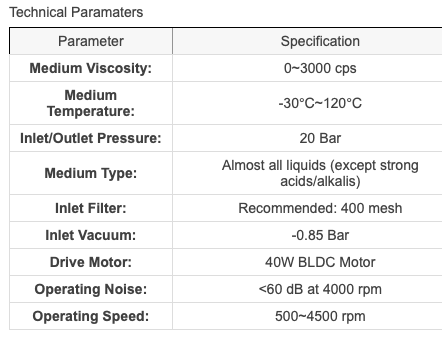

Le vendeur et la notice ne disent pas la même chose ; la valeur retenue est la
plus prudente.

| Paramètre | Vendeur | Notice | **Retenu** |
| --- | --- | --- | --- |
| Pression au refoulement | 20 bar | **12 bar maximum**, tuyauterie à 12 bar × 1,5 | **12 bar** |
| Température du liquide | −30 à 120 °C | 55 °C au couple maximal, 95 °C à couple réduit | 55 °C |
| Température ambiante | — | 5 à 40 °C au couple maximal, 70 °C à 70 mNm | 70 °C (voir ci-dessous) |
| Filtration | 400 mesh (≈ 37 µm), particules < 20 µm | **10 µm** | 10 µm |
| Vitesse | 500 à 4 500 tr/min | 300 à 5 000 tr/min (moteur) | 500 à 4 500 tr/min |
| Viscosité | 0 à 3 000 cP | eau propre à l'ambiante | eau du bac |
| Dépression à l'aspiration | −0,85 bar (auto-amorçante) | à faire fonctionner mouillée | — |
| Bruit | < 60 dB à 4 000 tr/min | — | — |

- **L'OPV à 11 bar reste sous les 12 bar de la notice.** Elle protège aussi
  la pompe : l'accouplement magnétique ne limite pas la pression de
  refoulement, une soupape après la pompe est obligatoire.
- **Couple à 9 bar** : idéalement `ΔP × cylindrée / 2π` = 9·10⁵ × 0,1·10⁻⁶ /
  2π ≈ **14 mNm**, plus les frottements. On reste loin des 70 mNm : l'ambiance
  de 40–50 °C de la machine est admise.
- **Eau du bac à l'ambiante**, sous les 55 °C. Le clapet anti-retour (plus bas)
  empêche l'eau chaude de la chaudière de refluer vers la pompe.

## Courbes débit-pression

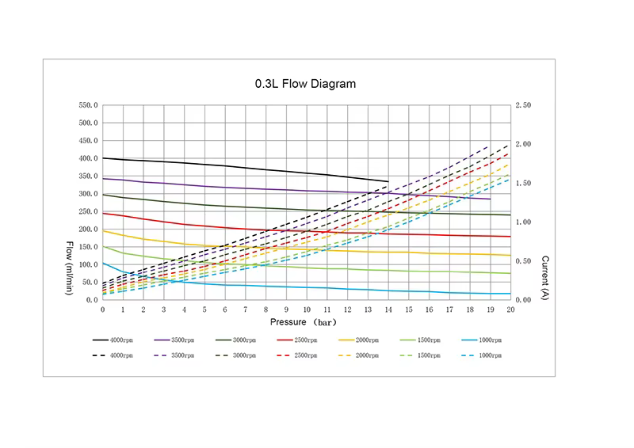

Traits pleins : débit en ml/min. Pointillés : courant en A sous 24 V. Valeurs
lues sur le graphique, à environ ±10 ml/min, converties en ml/s :

| Vitesse | 0 bar | 3 bar | 6 bar | 9 bar | 12 bar | Glissement à 9 bar |
| ---: | ---: | ---: | ---: | ---: | ---: | ---: |
| 4 000 tr/min | 6,7 | 6,5 | 6,3 | 6,0 | 5,8 | 0,7 |
| 3 000 tr/min | 5,0 | 4,7 | 4,4 | 4,25 | 4,15 | 0,75 |
| 2 000 tr/min | 3,25 | 2,8 | 2,5 | 2,35 | 2,3 | 1,0 |
| 1 500 tr/min | 2,5 | 2,0 | 1,75 | 1,65 | 1,5 | 0,85 |
| 1 000 tr/min | 1,75 | 0,9 | 0,7 | 0,65 | 0,5 | 1,05 |

Glissement = débit théorique (vitesse × 0,1 ml) − débit lu.

- **0,1 ml/tour est confirmé** : à 0 bar, chaque courbe part de la vitesse
  × 0,1 ml.
- **Le glissement à 9 bar vaut 0,7 à 1 ml/s**, à peu près indépendant de la
  vitesse, un peu plus fort à basse vitesse. C'est la moitié d'un débit
  d'infusion de 1,5–2 ml/s : le compteur Hall seul ne suffit pas, il faut un
  modèle de glissement en fonction de la pression (voir
  [Calibration du glissement](#calibration-du-glissement)).
- **La fuite croît vite jusqu'à ≈ 3 bar, puis presque plus** : à
  1 000 tr/min, 0,42 ml/s à 1 bar, 0,92 à 4 bar, 1,13 à 9 bar, 1,45 à 20 bar
  (la courbe va jusqu'à 20 bar). C'est la signature d'un sabot que la pression
  plaque contre les engrenages (voir
  [Construction réelle](#construction-réelle--une-tête-à-sabot)) : une pompe à
  jeux fixes, comme la MPB010, fuit à peu près en proportion de la pression.
- **Points de fonctionnement utiles** :

  | Besoin | Vitesse estimée | Consigne (≈ 1 000 tr/min par V) |
  | --- | ---: | ---: |
  | 1 ml/s à 9 bar | ≈ 1 200 tr/min | ≈ 1,2 V |
  | 2 ml/s à 9 bar | ≈ 1 750 tr/min | ≈ 1,75 V |
  | 2 ml/s à 0 bar (purge lente) | ≈ 1 300 tr/min | ≈ 1,3 V |
  | 3,6 ml/s à 2 bar (remplissage actuel) | ≈ 2 300 tr/min | ≈ 2,3 V |
  | Débit nul à 9 bar (tenir la pression) | ≈ 500–900 tr/min | ≈ 0,5–0,9 V |
  | Maximum à 9 bar | ≈ 6,5 ml/s à 4 500 tr/min | ≈ 4,5 V |

  À la vitesse minimale de 500 tr/min, le débit théorique (0,83 ml/s) est de
  l'ordre du glissement à 9 bar : la pompe peut **tenir une pression sans
  débit**, ce que la pompe vibratoire ne sait pas faire.
- **Courant** : environ 0,5 à 1 A à 9 bar selon la vitesse (12 à 24 W), au
  plus ≈ 1,1 A jusqu'à l'OPV (11 bar). Le courant suit surtout la pression :
  c'est le couple.
- **Fluide des courbes non précisé**, supposé de l'eau à l'ambiante, comme
  l'eau du bac.

## Interface électrique

Brochage : fiche du vendeur et photo de l'article, **7 fils**, confirmé par
la [notice du fabricant](datasheets/gearpump-mpb003.pdf) (page 3,
« Potentiometer seven-wire speed regulation ») et par l'exemplaire reçu :
7 fils, avec les couleurs du tableau. La notice SOVOFLO décrit une
autre électronique de la famille FG (82 040 001, 6 fils, couleurs
différentes) : son brochage ne s'applique pas à cet article. Ses protections internes et son temps
d'initialisation, plus bas, sont repris comme ordre de grandeur, à confirmer.

| Fil | Signal | Rôle |
| --- | --- | --- |
| Rouge, épais | +24 V | alimentation |
| Noir, épais | GND | masse puissance |
| Jaune, fin | +5V_P | **5 V fourni par la pompe**, pour un potentiomètre |
| Marron, fin | SPEED | **consigne** : curseur du potentiomètre |
| Vert, fin | GND_P | référence de la consigne |
| Bleu, fin | TACHO | sortie vitesse |
| Blanc, fin | DIR | sens : la pompe s'inverse quand il est relié au vert |

Montage du vendeur : un potentiomètre entre jaune et vert, curseur sur le
marron.

Fils multibrins, diamètre extérieur mesuré sur l'isolant (l'écrasement des
brins fausse la mesure de la section) :

- **Rouge et noir : 2 mm.** Ils entrent dans les embouts doubles
  2 × 0,75 mm² de J7 (voir [Alimentation](#alimentation)).
- **Les cinq fils fins : 1,5 mm.** C'est le maximum du contact JST XH
  (SXH-001T-P0.6 : AWG 28 à 22, isolant de 0,8 à 1,5 mm) ; le sertissage
  essayé passe.

### Masses : la consigne reste du côté de la pompe

La fiche ne dit pas si le vert (GND_P) est relié au noir dans la pompe.
Mesuré hors tension le 5 novembre 2026 : **pas de continuité entre le vert
et le noir**, ni entre le noir et aucun des six autres fils. La notice SOVOFLO de la famille interdit de relier la référence de consigne à la
masse puissance : ça détruit l'électronique. Le buck 24 → 5 V n'est pas
isolé : la masse de combined v2 est le noir.

**Règle : jaune, marron, vert et bleu ne touchent jamais une masse ni une
alimentation de la carte.** Ils ne voient que le côté isolé de deux
optocoupleurs. Le montage marche donc que le vert soit relié au noir ou non,
sans avoir à le mesurer avant de commander la carte.

### Consigne (marron)

- Plage annoncée 0–5 V. La relation consigne-vitesse de cet article n'est
  pas publiée ; la famille donne l'arrêt sous 0,2 V et ≈ 1 000 tr/min par
  volt, repris dans [Courbes débit-pression](#courbes-débit-pression).
  **Mesuré : ≈ 1 000 tr/min par volt**, 1 168 tr/min à 1,195 V et
  4 827 tr/min à 4,98 V (voir [Relevés à réception](#relevés-à-réception)).
- Pas de plafond lié au Digmesa : la consigne va jusqu'à 4,5 V (4 500 tr/min),
  le maximum retenu pour la pompe (voir [Débitmètre](#débitmètre)).
  Sur combined, 4,5 V correspond à un rapport cyclique de ≈ 65,5 % : le
  rapport cyclique plein donne ≈ 4,83 V, soit ≈ 4 800 tr/min. Il reste
  donc ≈ 7 % de débit disponible sans toucher à la carte, en relevant
  `PUMP_MAX_RPM` dans le firmware.
- **Montage sur combined v2 : PWM à travers un optocoupleur EL817C.**
  - Côté XIAO : la LED est commandée directement par le GPIO, 330 Ω, soit
    (3,3 − 1,2) / 330 ≈ 6 mA. 100 kΩ du GPIO à la masse.
  - Côté pompe : le collecteur sur le jaune, l'émetteur rappelé au vert par
    10 kΩ. LED allumée, l'émetteur monte à ≈ 5 V ; il faut 0,5 mA, pour un
    gain en courant de l'EL817C de 200 à 400 % à 5 mA.
  - Filtre : deux cellules 1,5 kΩ / 2,2 µF (coupure 48 Hz) entre l'émetteur
    et le marron, condensateurs vers le vert. PWM à 1 kHz : l'opto commute
    en ≈ 18 µs. Ondulation ≈ 5 V × (48 / 1 000)² ≈ 12 mV, soit ≈ 12 tr/min ;
    temps de réponse ≈ 10 ms. Le LEDC de l'ESP32-S3 s'arrête à 14 bits
    (pas de 0,006 %), largement assez à 1 kHz.
  - Impédance de source ≈ 3 kΩ, proche d'un potentiomètre de 10 kΩ à mi-course
    (2,5 kΩ).
  - **La consigne n'est pas linéaire en rapport cyclique** (mesuré sur la
    carte le 11 novembre 2026, PWM à 1 kHz, sans pompe) : 0,1 % donne
    0,071 V, 1 % donne 1,045 V, 3,09 % donne 1,727 V, 50 % donne 4,55 V et
    100 % donne 5,09 V. Le condensateur se charge par 1,5 kΩ quand l'opto
    conduit, mais se décharge par 1,5 + 10 kΩ quand il est bloqué, et l'opto
    allonge chaque impulsion de 24 à 31 µs dès 20 µs. La courbe reste
    monotone de 0,07 à 5,09 V, et 0 % donne 0 V. Le firmware interpole dans
    la table mesurée (`pcb/combined/combined_design.md`, Gear pump
    interface). La descente prend ≈ 25 ms. La vitesse est relue sur le
    tachymètre. La prochaine révision de la carte doit rendre la consigne
    linéaire (même document, Open points).
- **Consigne à 0 sans commande** : LED éteinte, les 10 kΩ ramènent la
  consigne au vert. C'est le cas à la mise sous tension, pendant un reset,
  XIAO absent ou firmware arrêté.

### Tachymètre (bleu)

- **Sortie active 0–5 V** (push-pull ou rappel interne), rapport cyclique
  ≈ 50 % : 2,51 V en moyenne au multimètre. Pas de rappel à ajouter.
- **2 impulsions par tour**, mesurées (la famille en annonçait 32) :
  `tr/min = fréquence × 60 / 2`, 17 Hz à 500 tr/min, 120 Hz à
  3 600 tr/min, 167 Hz à 5 000 tr/min.
- **Vitesse mesurée par la période** entre deux fronts : à basse vitesse, un
  comptage sur une fenêtre courte n'a que quelques impulsions.
- **Fronts parasites au front opposé** (purge du 13 novembre 2026) : à
  4 605 tr/min, quelques fronts descendants de plus, 3,26 à 3,32 ms après un
  vrai front, soit au quart de tour, sur la remontée du signal. Le compte
  gonflait d'environ 3 %. Le firmware 0.5.1 rejette un front arrivé moins de
  35 % d'un tour après le précédent ; le tour de référence est le plus court
  de la mesure et de la vitesse visée.
- **Montage sur combined v2 : second EL817C.** Sa LED va du jaune au bleu à
  travers 1,8 kΩ, soit ≈ 2 mA quand le bleu est bas. Ça marche en
  push-pull comme en collecteur ouvert : à l'état haut, la LED n'a plus de
  tension. Côté XIAO, le transistor tire vers la masse un GPIO rappelé au
  3V3 par 4,7 kΩ (0,7 mA). Le signal est inversé ; une interruption
  GPIO compte et date les fronts descendants.
- L'EL817C convient jusqu'à ≈ 2,7 kHz : large marge à 167 Hz.
- Débit théorique par impulsion : **0,05 ml**, contre 0,42 g par impulsion
  pour le Digmesa.

### Courant pris au jaune

≈ 0,5 mA pour la consigne et ≈ 2 mA pour le tachymètre : 2,5 mA. Un
potentiomètre de 10 kΩ en prend déjà 0,5 mA. Le jaune les fournit sans chute
mesurable (voir [Relevés à réception](#relevés-à-réception)) : la résistance
de 1,8 kΩ reste telle quelle.

### Sens (blanc)

Non branché, extrémité isolée sous gaine : le sens n'est jamais commandé. Le
sens par défaut suit la flèche de la tête (mesuré à réception).

### Connecteur sur combined v2

XH 4 positions : 1 vert (GND_P), 2 marron (SPEED), 3 bleu (TACHO), 4 jaune
(+5V_P). Rouge et noir vont dans le boîtier de J7, avec les fils de
l'alimentation (voir [Alimentation](#alimentation)).

### Protections internes (notice de la famille)

| Protection | Seuil | Réarmement |
| --- | --- | --- |
| Sous-tension | 15,5 V | alimentation > 16,5 V, puis consigne à 0 |
| Surtension | 30 V | alimentation < 29 V, puis consigne à 0 |
| Température | 120 °C interne | < 110 °C (90 °C selon la procédure), puis consigne à 0 |
| Blocage | rotor bloqué 1 s | rotor libre, puis consigne à 0 |

Le réarmement exige la **consigne à 0 V pendant au moins 10 ms**. Le firmware
reconnaît un arrêt sur défaut quand le tachymètre reste muet alors que la
consigne est au-dessus de 0,3 V : il remet la consigne à 0, journalise le
défaut et ne relance pas tout seul pendant une infusion.

Au démarrage à froid (alimentation sous 9 V), l'électronique met **65 ms** à
s'initialiser : une consigne envoyée plus tôt est ignorée.

### Relevés à réception

Relevés du 5 novembre 2026, pompe vide, raccords ouverts.

**Hors tension, au multimètre**

| Mesure | Résultat |
| --- | --- |
| Vert ↔ noir | pas de continuité |
| Noir ↔ les six autres fils | pas de continuité |
| Rouge ↔ les cinq fils fins | pas de continuité |
| Rouge ↔ noir | 1,435 MΩ et croissant : le condensateur d'entrée se charge |
| Marron ↔ vert | **176 kΩ** : rappel interne de la consigne vers le vert |
| Jaune ↔ vert | 2,78 kΩ : circuits internes, pas de court-circuit |

Le rappel de 176 kΩ ramène un marron en l'air à 0 V, donc à l'arrêt (essai
ci-dessous). Il charge un peu le filtre de consigne (≈ 3 kΩ) :
environ 1,7 % de consigne en moins, relue sur le tachymètre.

**Sous tension, 24 V**

| Mesure | Résultat |
| --- | --- |
| Pompe, marron relié au vert | immobile |
| Marron en l'air ↔ vert | **0,007 V**, pompe immobile (essai bref, pompe vide) |
| Jaune ↔ vert, à vide, marron relié au vert | **4,98 V** |
| Jaune ↔ vert, 2 192 Ω (2,27 mA) | 4,98 V |
| Jaune ↔ vert, 998 Ω (5,0 mA) | 4,98 V |
| Consommation au secteur, pompe au repos | 1,2 W (prise wattmètre) |

- **Le jaune est une sortie régulée** : pas de chute mesurable à 5 mA, soit
  une résistance interne sous 2 Ω. Le besoin du montage est de 2,5 mA.
- **Marron en l'air : 7 mV**, très loin du seuil d'arrêt de la famille
  (≈ 0,2 V) : la pompe reste arrêtée si le connecteur ou le câble lâche,
  alors que son 24 V, pris dans le boîtier de J7, reste présent. Pas de
  résistance à ajouter dans le câble.
- **Repos ≈ 1 W sous 24 V**, soit ≈ 40–45 mA, une fois retirés la
  consommation à vide de l'alimentation (< 90 mW) et ses pertes. La notice de
  la famille donne 0,06 A. La prise wattmètre ne donne qu'un ordre de
  grandeur.
- À la coupure, le jaune tombe à 0 V en ≈ 10 s : l'énergie des condensateurs
  de l'alimentation et de la pompe.

**Pompe amorcée, 0 bar**

Aspiration dans un pichet sur la balance, tuyau rempli d'eau passant
par-dessus le bord ; refoulement libre vers l'évier, plus bas. Consigne par
diviseur entre jaune et vert, marron au point milieu ; marche et arrêt par
le 230 V de l'alimentation.

| Diviseur (haut / bas) | Consigne | Fréquence (bleu ↔ vert) | Vitesse | Pesée | Volume à 0,1 ml/tour, sans le ralentissement |
| --- | ---: | ---: | ---: | ---: | ---: |
| 4,7 kΩ / 1 kΩ | 0,86 V | — | lente | — | — |
| 4,7 kΩ / 1,5 kΩ | **1,195 V** | **38,94 Hz** | 1 168 tr/min | 33,4 g, 15 s + 3 s | 29,2 ml en 15 s |
| 4,7 kΩ / 4,7 kΩ | **2,456 V** | **81,85 Hz** | 2 455 tr/min | 128,3 g en 30 s | 122,8 ml |
| marron sur jaune | ≈ 4,98 V | **160,9 Hz** | 4 827 tr/min | 83,5 g en 10 s | 80,4 ml |

Bleu ↔ vert en tension continue, à 2,456 V de consigne : **2,514 V**.

- **2 impulsions par tour** : `tr/min = Hz × 30`. 1 ou 4 impulsions par
  tour donneraient 245 g ou 61 g au lieu de 128,3 g à 2,456 V.
- **≈ 1 000 tr/min par volt** : 1 168 tr/min à 1,195 V (977 par volt),
  2 455 à 2,456 V (1 000), 4 827 à 4,98 V (969).
- **Cylindrée de 0,1 ml par tour confirmée.** Le surplus pesé (3 à 5,5 g)
  s'explique par la pompe qui continue de tourner après la coupure du 230 V, en
  ralentissant, sur l'énergie des condensateurs de l'alimentation : 3 s à
  1,20 V, soit ≈ 2 s à pleine vitesse. La pesée ne mesure donc pas la
  vitesse à mieux que quelques pour cent ; la fréquence, si.
- **Couper le 230 V n'arrête pas la pompe tout de suite** : quelques
  secondes de marche en ralentissant, d'autant plus que la charge est
  faible. En service, le firmware arrête la pompe par la consigne.
- **Sens par défaut**, blanc non branché : l'eau coule dans le sens de la
  flèche de la tête.
- Quelques petites bulles au refoulement, aucune dans le tuyau
  d'aspiration : prise d'air probable au filetage d'aspiration, serré à la
  main sans étanchéité. Seuil de démarrage et bas de la plage à mesurer avec
  combined v2, en essais automatisés, le montage définitif étanche.

## Alimentation

Montage en service depuis le 12 novembre 2026, en remplacement de la RECOM
RAC05-05SK (5 V, 1 A). Chaîne du secteur à la pompe :

```
secteur ─ Wago ─ câble VH ─ alimentation 24 V ─ rouge/noir 0,75 mm² ─ J7 ─┬─ embouts doubles : pompe
                  (fusible T2A)     (bornier)                               └─ combined v2 (buck 5 V) ─ 5 V : écran
```

1. **Pas de carte AC pour l'instant** (décision du 3 novembre 2026). Le
   secteur arrive aux Wago, puis au VH de l'alimentation : rien entre eux,
   donc pas de limitation de l'appel de courant (voir
   [Appel de courant et interrupteur](#appel-de-courant-et-interrupteur)).
   La carte `pcb/ps_upstream` (38,6 × 19 mm, détails dans
   `pcb/ps_upstream/ps_upstream_design.md`) reste dessinée : entrée HT396R,
   thermistance CTN d'appel de courant sur L, sortie VH vers
   l'alimentation, sans fusible. C'est la seule option de protection
   retenue si elle revient dans le montage : un montage 230 V se fait avec
   des Wago, des VH3.96 ou des HT3.96, pas avec une CTN à pattes volante.
2. **Alimentation 24 V, 96 W** (4 A), décrite ci-dessous. Elle remplace la
   RECOM RAC05-05SK (5 V, 1 A) et ne rentre pas dans `boitier_ps` actuel
   (logement de la RECOM : 21,9 × 27,1 × 33 mm) : nouveau boîtier, voir
   [boitier-ps-24v.md](boitier-ps-24v.md).
3. **Embouts doubles dans J7** : le 24 V part du bornier de l'alimentation
   en deux fils 0,75 mm² rouge / noir jusqu'à J7 de combined v2. Dans le
   boîtier HT3.96 de J7, chaque fil est serti avec le fil de même polarité
   de la pompe dans un embout double 2 × 0,75 mm². Les deux Wago 221-423
   prévus pour répartir le 24 V ne sont pas montés. Fil par fil :
   [cablage.md](cablage.md), « 24 V ».
4. **Combined v2** : la partie dimmer et la détection du passage par zéro
   disparaissent. La carte reçoit le 24 V sur un HT3.96, porte le buck
   24 → 5 V et renvoie le 5 V de l'écran le long du câble CAN. Elle commande
   la pompe et lit son tachymètre à travers deux optocoupleurs (voir
   [Interface électrique](#interface-électrique)). Le buck reçoit moins de
   5 W ; le courant de la pompe passe d'un fil à l'autre dans l'embout de
   J7, sans traverser les pistes de la carte.

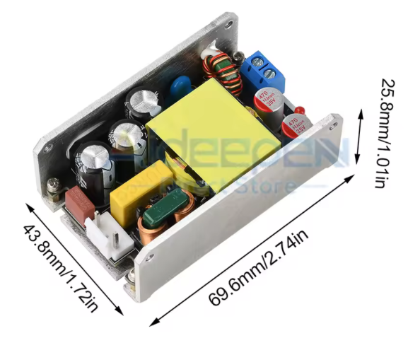

### Description de l'alimentation

Module ouvert vendu « DC 24V 4A » (Aideepen), annoncé GaN. Photos :
[vue d'ensemble](datasheets/alim-24v-gan.png), [carte vue de
dessus](datasheets/alim-24v-carte.png), [fiche](datasheets/alim-24v-specs.png).

**Mécanique**

- **Encombrement mesuré : 68,5 × 44,1 × 25,8 mm** (longueur × largeur ×
  hauteur), radiateur compris, **111,8 g**. La fiche et les photos donnaient
  69,6 × 43,8.
- **Radiateur en U**, aluminium de 2 mm : un fond sous la carte et deux
  flancs de 25,8 mm le long des 68,5 mm. Les deux bouts (côtés de 44,1 mm)
  sont ouverts, et le dessus de la carte aussi : l'air passe par là.
- **Fixation de la carte** : quatre vis **métalliques** aux coins, vissées
  dans des entretoises en laiton serties dans le fond du radiateur. Les
  vis ont une tête conique, à fleur sous la plaque : posée sur du métal,
  l'alimentation touche donc ces vis. Les trous de coin de la carte ont une
  couronne de cuivre ; leur potentiel est mesuré (voir Isolation).
- **Fixation du module** : les flancs sont percés aux coins, côté extérieur,
  en **M3 taraudé** dans les 2 mm de la plaque, sans écrou. Les vis en
  nylon dont David dispose sont du M2 : elles ne vont pas. Une vis en
  nylon M3 vissée depuis l'extérieur du boîtier, où le fond touche la
  face de la machine reliée à la terre, évite tout contact entre cette
  terre et le radiateur.
- **Dos de la carte** (sortie à droite) : composants CMS des deux côtés.
  Côté sortie, les deux MOSFET du redressement synchrone (boîtiers plats
  8 broches) et le contrôleur sont au dos. Côté entrée, une longue fente
  fraisée traverse la carte ; une ouverture au centre est couverte de ruban
  jaune. Les bords de la carte ont des encoches en demi-lune.
- **L'entrée et la sortie sont aux deux bouts opposés** de la longueur de
  68,5 mm. Il faut donc prévoir le passage des fils aux deux bouts.

**Thermique**

- **Côté sortie** : un pad thermique bleu, posé directement sur
  l'aluminium du fond, refroidit le dos de la carte sous les MOSFET du
  redressement synchrone.
- **Côté entrée** : un film isolant noir couvre le fond sous la partie
  haute tension. Le pont redresseur, un boîtier noir plat debout contre le
  flanc, y est collé à la pâte thermique.
- Le radiateur évacue donc la chaleur du primaire (pont) et du secondaire
  (MOSFET). Le boîtier doit le laisser respirer : ne pas le noyer dans le
  plastique, garder de l'air aux deux bouts et au-dessus.

**Entrée secteur** (bout « entrée »)

- **Connecteur JST VH 3,96 mm à trois positions, broche centrale
  supprimée** : L et N sont écartés de 7,92 mm. Il est dans la largeur de
  44,1 mm, près du milieu. Le câble d'arrivée porte un boîtier VH 3
  positions, la position 2 vide, serti par David.
- **Fusible T2A 250 V**, temporisé, rectangulaire, soudé juste à côté du
  connecteur : c'est la seule protection de toute la chaîne en aval du
  disjoncteur.
- Ensuite : condensateur X à film (jaune), self de mode commun (en fil
  plat), pont redresseur collé au radiateur, **3 × 27 µF / 400 V**
  (105 °C), soit 81 µF au total. Pas de CTN (voir [Appel de courant et
  interrupteur](#appel-de-courant-et-interrupteur)).

**Sortie 24 V** (bout « sortie »)

- **Bornier à vis bleu à deux positions**, dans un coin du bout de sortie :
  à gauche quand on regarde la carte de dessus, entrée vers soi. Pas
  mesuré : **5 mm**.
- **Polarité** : carte vue de dessus, sortie à droite, la LED est sous le
  bornier. **GND est la vis du haut**, contre le flanc, et **+24 V la vis du
  bas**, du côté de la LED. Sur la [carte vue de
  dessus](datasheets/alim-24v-carte.png) (entrée en bas), GND est donc la vis
  de gauche. Relevé d'abord sur la version 12 V, **confirmé sous tension sur
  l'exemplaire reçu** : LED au sud, GND au nord ; **23,89 V à vide**.
- **LED rouge** à côté du bornier. À vide, elle reste allumée environ une
  minute après la coupure (voir [Réception](#réception-et-premiers-essais)).
- Self de sortie (tore vert), **2 × 470 µF / 35 V**. La tension de sortie
  est fixe : il n'y a pas de potentiomètre.
- Le courant prévu (1,4 A, 4 A au pire) passe dans du fil de 0,5 mm²
  (AWG 20) ; 0,75 mm² laisse de la marge pour le pire cas.

**Composants principaux**

| Côté | Composants |
| --- | --- |
| Primaire | fusible T2A, condensateur X, self de mode commun, pont redresseur, 3 × 27 µF / 400 V, contrôleur marqué « BST25 » (sans fiche), transformateur (ruban jaune) |
| Barrière | transformateur, condensateur Y (disque bleu, entre primaire et secondaire) |
| Secondaire | redressement synchrone par deux MOSFET 003N10H (100 V), self de sortie, 2 × 470 µF / 35 V, LED |

**Isolation**

- **Primaire-radiateur** : le film noir sous la partie haute tension et le
  boîtier isolé du pont redresseur, collé au flanc. Le radiateur n'est pas
  relié à la terre : l'alimentation n'a pas de borne de terre.
- **Potentiel du radiateur** : mesuré hors tension, voir
  [Réception](#réception-et-premiers-essais). Les quatre vis, leurs
  entretoises et les couronnes de la carte forment un réseau **flottant**,
  relié ni au GND, ni au +24 V, ni à L ou N. Le pad thermique bleu sépare de
  toute façon les MOSFET du secondaire de l'aluminium. La plaque, sans doute
  anodisée, n'a pas été reconnue reliée à ce réseau, mais la mesure n'est
  pas concluante : la tête conique des vis affleure sous la plaque, donc
  l'alimentation posée sur du métal touche les vis. Le boîtier traite la
  plaque et les vis comme une pièce métallique qui n'est ni L ni N :
  isolation principale, 3 mm entre le cuivre et le bord de la carte.
- **Primaire-secondaire** : par le transformateur et le condensateur Y. Le
  vendeur ne donne ni tension d'essai ni homologation (seulement EN 55032,
  qui est une norme d'émissions). La sortie 24 V et toute la basse tension
  en aval ne sont donc **pas garanties TBTS**. On ne la touche pas sous
  tension sans l'avoir vérifié.
- Le condensateur Y laisse passer un petit courant de fuite alternatif vers
  la sortie : une sortie flottante peut « picoter » une sonde ou un PC
  raccordé en USB.

### Réception et premiers essais

Relevés du 3 novembre 2026 sur l'exemplaire reçu.

**Hors tension, au multimètre**

| Mesure | Résultat |
| --- | --- |
| L ↔ N (broches du VH) | pas de continuité |
| +24 V ↔ GND (bornier) | pas de continuité |
| Les 4 vis de fixation entre elles | continuité |
| Vis ↔ entretoises | continuité |
| Vis ↔ plaque du radiateur | pas de continuité (aluminium sans doute anodisé ; léger bip, grattage insuffisant : non concluant) |
| Vis ↔ bornier DC (les deux vis) | pas de continuité |
| Vis ↔ connecteur L/N | pas de continuité |

La résistance d'isolement entre l'entrée et la sortie n'a pas été mesurée : un
multimètre n'applique que quelques volts, donc l'absence de continuité tient
lieu de test. Le fusible n'a pas été testé : sans continuité, l'alimentation
ne démarre pas.

**Sous tension, à vide, sans CTN** : pas de claquage au premier essai.

| Observation | Valeur |
| --- | --- |
| Tension de sortie | **23,89 V**, soit −0,46 % : dans les ± 1 % de la fiche |
| Polarité | +24 V côté LED, GND de l'autre côté du bornier |
| Après la coupure | 23,89 V maintenus ≈ 30 s, puis chute à 0 V en ≈ 20 s ; LED allumée presque une minute |

L'alimentation continue de fonctionner sur l'énergie de ses condensateurs
primaires : ½ × 81 µF × 325² ≈ 4,3 J, soit ≈ 48 s à 90 mW de consommation à
vide, ce qui correspond au relevé. Le primaire reste donc chargé à plusieurs
centaines de volts **pendant environ une minute à vide**, tant que la LED est
allumée. Avec les ESP32 branchés (2–3 W), la décharge ne prend plus que 1 à 2 s.
Le couvercle transparent du boîtier laisse voir la LED : on n'ouvre pas tant
qu'elle est allumée.

### Appel de courant et interrupteur

**Décision du 3 novembre 2026 : pas de ps_upstream, pas de CTN pour l'instant.**

- **Le maillon faible est l'interrupteur**, pas l'alimentation : un
  **Profitec bipolaire 16 A / 250 V (P9111)**, pièce détachée à une dizaine
  de dollars. Avec la RECOM RAC05-05SK actuelle, le contact claque environ
  une fois tous les 50 démarrages, à vue d'œil. Cette RECOM a un appel de
  courant de 30 A à froid à 230 V d'après sa fiche (`RAC05-K_277.pdf`, T1A
  temporisé). Les 16 A de l'interrupteur sont une valeur résistive ; sa
  tenue à un appel capacitif n'est pas donnée.
- **Sans limitation, cette alimentation donne une crête de l'ordre de 300 à
  650 A**, de 325 V divisé par la résistance série (0,5 à 1 Ω : fusible,
  self, pont, câblage et réseau), pendant plusieurs fois plus longtemps que
  la RECOM. Le I²t vaut environ 4,3 J ÷ R, soit 4 à 9 A²s. Ce sont des
  ordres de grandeur : ni la fiche du pont ni celle du fusible ne sont connues.
  Une charge DC branchée n'y change rien : l'appel a lieu avant le démarrage
  du contrôleur.
- **Avec la CTN de 10 Ω de ps_upstream, la crête retombe à ≈ 30 A**, soit le
  niveau de la RECOM actuelle : le claquage de l'interrupteur serait ramené
  à la fréquence actuelle, pas supprimé.
- **81 µF pour 100 W**, soit 0,8 µF/W : pas surdimensionné.
- **Contre ps_upstream** : un élément de plus dans le boîtier, qui doit
  placer la carte en face du VH de l'alimentation, entrée de ps_upstream du
  côté de l'arrivée secteur. Sa chaleur est faible (≈ 4 mW au repos).
- **Pour rien** : les Wago se placent librement, plus de virage serré du
  0,75 mm² vers une carte. L'alimentation coûte moins de 10 francs, des
  dizaines de vendeurs la proposent, une de réserve est envisagée.
- **Risque assumé** : usure ou, plus rarement, soudure des contacts de
  l'interrupteur. Remplacer l'interrupteur est possible, mais plus gênant que
  remplacer l'alimentation. Une CTN à pattes volante entre deux Wago a été
  écartée : le 230 V se monte avec des Wago, des VH3.96 ou des HT3.96.

### Fiche du vendeur

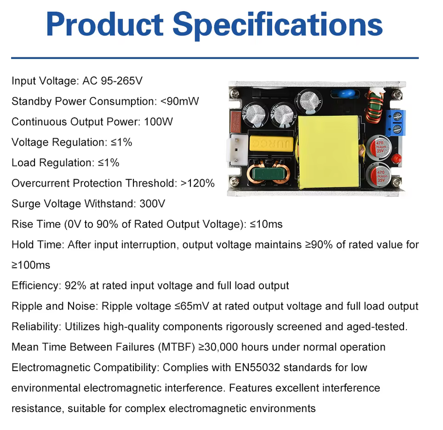

| Paramètre | Valeur annoncée | Pour la machine |
| --- | --- | --- |
| Entrée | 95 à 265 VAC | 230 V au milieu de la plage |
| Consommation à vide | < 90 mW | — |
| Puissance continue | 100 W | 24 V × 4 A = 96 W sur l'étiquette ; retenu : 96 W |
| Régulation (ligne et charge) | ≤ 1 % | 24 V ± 0,24 V, loin des seuils de 15,5 et 30 V de la pompe |
| Protection de surintensité | > 120 % | déclenche au-delà de ≈ 4,8 A, au-dessus du pire cas de 3,8 A |
| Surtension d'entrée tenue | 300 V | — |
| Montée de 0 à 90 % | ≤ 10 ms | — |
| Maintien après coupure secteur | ≥ 90 % pendant ≥ 100 ms | une micro-coupure ne redémarre ni les ESP32 ni la pompe |
| Rendement | 92 % à pleine charge | cohérent avec l'essai (≈ 91–92 %) ; non donné à faible charge |
| Ondulation | ≤ 65 mV à pleine charge | cohérent avec l'essai (42–85 mV en 12 V) |
| MTBF | ≥ 30 000 h | ≈ 3,4 ans sous tension permanente |
| CEM | EN 55032 | — |

### Bilan de puissance

| Poste | Courant sous 24 V |
| --- | ---: |
| Pompe, usage prévu, jusqu'à l'OPV (11 bar) | ≈ 1,1 A |
| Pompe, limite en service continu (> 30 min) | 2,5 A (60 W) |
| Pompe, limite instantanée en service intermittent | 3,5 A (84 W) |
| Électronique de la pompe au repos | 0,06 A |
| Buck, 1 A en 5 V comme la RECOM, rendement ≈ 85 % | ≈ 0,25 A |
| **Pire cas** | **≈ 3,8 A**, sous les 4 A de l'alimentation |
| **Usage prévu** (pompe à 11 bar au plus, buck) | **≈ 1,4 A, 35 W**, 35 % de la charge nominale |

**Profil de charge.** Ces 35 W sont une pointe, pas la charge habituelle :

- **La plupart du temps, 2 à 3 W** (≈ 0,1 A sous 24 V) : les deux ESP32,
  dont un seul utilise la radio. L'alimentation est alors à
  2–3 % de sa charge nominale et chauffe à peine.
- **Pompe en marche, rarement à pleine charge** : le courant suit la
  pression, pas le débit.
  - Faible débit à haute pression (infusion, tenue de pression) : ≈ 0,5 à
    1 A à 9 bar, 12 à 24 W.
  - Fort débit sans résistance (remplissage, purge) : couple faible, courant
    bien en dessous.
  - Le haut des deux à la fois, fort débit à 11 bar, n'arrive pas en usage
    normal.
- **Durées courtes** : une purge dure 5 à 15 s, en général 5 s ; une
  infusion 20 à 60 s, en général 30 s. La température de l'alimentation suit la charge moyenne, proche
  du repos.

- **Buck** : au moins **2 A en 5 V**, pour garder de la marge sur la RECOM
  actuelle.
- **Pas de fusible sur la carte AC.** Le fusible **T2A 250 V** de
  l'alimentation est le premier composant après son connecteur ; il protège
  l'alimentation et la CTN, en série avec lui. Le câblage en amont est
  protégé par le disjoncteur de la maison. Un T1,6 A en amont ne protégerait
  que la carte AC elle-même.
- **CTN : TDK B57236S0100M000** (série S236, 10 Ω à froid), **C125458**
  chez JLCPCB, en série sur la phase. L'alimentation n'en a pas (essai
  ci-dessous). Elle limite la crête d'appel à ≈ 325 V / 10 Ω ≈ 33 A. Fiche :
  [C125458.pdf](datasheets/C125458.pdf).
- **Composant traversant, pas CMS.** Une CTN d'appel absorbe à chaque mise
  sous tension l'énergie des condensateurs d'entrée, ½ × 81 µF × (325 V)² ≈
  4,3 J, et dissipe en continu. Il faut la masse d'un disque ; les CTN CMS
  sont des sondes de mesure. JLCPCB monte le traversant en option.
- **24 V** dans la plage de 20 à 29 V de la pompe, loin de ses seuils de
  15,5 et 30 V.

### CTN d'appel de courant

Cette section décrit la CTN de `pcb/ps_upstream`. Cette carte n'est pas dans
le montage pour l'instant (voir [Appel de courant et
interrupteur](#appel-de-courant-et-interrupteur)) ; le choix reste valable
si elle y revient.

#### Choix de la CTN

Références comparées, toutes 10 Ω, traversantes et « extended » chez JLCPCB :

| | **C125458** TDK S236 | C3790 Ruilon 10D-9 | C6793809 10D-7 | C125456 TDK S235 |
| --- | ---: | ---: | ---: | --- |
| Courant permanent max | **3,5 A** (0 à 65 °C) | 2 A | 1 A | 3 A |
| Capacité admise à 230–240 V | **300 µF** (essai UL et IEC) | 150 µF | 100 µF | non connue |
| Marge sur 81 µF | **× 3,7** | × 1,85 | × 1,2 | — |
| Dissipation | 10 mW/K | ≈ 11 mW/K | 6–9 mW/K | — |
| Constante de temps | 70 s | ≈ 35 s | 20–27 s | 60 s |
| Capacité thermique | 700 mJ/K | ≈ 0,4 J/K | ≈ 0,2 J/K | — |
| Échauffement par allumage (4,3 J) | ≈ 6 K | ≈ 11 K | ≈ 20 K | — |
| Corps | Ø 11,5, haut. 16 mm | Ø 9 mm | Ø 7 mm | Ø 9,5 mm |
| Pas | 5 mm | 7,5 mm | 5 mm | 5 mm |
| Homologations | UL 1434, IEC, VDE, CQC | — | — | UL, VDE, CQC |
| Prix unitaire | 0,33 $ | 0,09 $ | 0,04 $ | 0,20 $ |

- **C125458 retenue** : seule capacité admise vérifiée par un essai
  normalisé, avec la plus grande marge ; ses 3,5 A dépassent le fusible T2A,
  qui lâche avant elle en cas de défaut. Le surcoût est négligeable sur un
  montage unique.
- **C3790** : convient en repli. La fiche donne 2 A ; la base JLCPCB
  affiche 1 A à tort. Sa marge de capacité est deux fois plus faible.
- **C6793809** : écartée, 81 µF sur 100 µF admis, et plus d'échauffement
  à chaque allumage.
- **C125456** : la fiche disponible ne couvre que l'emballage ; repli si les
  16 mm de hauteur de la S236 ne passent pas dans le boîtier, après avoir
  trouvé sa capacité admise.

#### Échauffement de la CTN

La CTN chauffe peu, parce que la charge est le plus souvent celle du repos
(voir [Profil de charge](#bilan-de-puissance)) :

| Situation | Courant secteur | Pertes | Échauffement (S236) |
| --- | ---: | ---: | ---: |
| Repos, 2–3 W | ≈ 0,04 A | ≈ 16 mW | ≈ 2 K |
| Mise sous tension | crête ≈ 33 A | 4,3 J | ≈ 6 K |
| Infusion de 30 s à 35 W | ≈ 0,35 A | ≈ 0,4 W | ≈ 14 K |
| Pompe à 35 W tenue en continu | ≈ 0,35 A | ≈ 0,4 W | ≈ 40 K, vers 3 Ω |

- **Presque toujours à 10 Ω** : elle protège à chaque allumage, y compris
  un rallumage juste après une infusion. Seul un arrêt après plusieurs
  minutes de pompe en continu la laisserait assez chaude pour qu'un
  rallumage immédiat claque.
- **Résistance en charge sans effet** : quelques volts de chute, alors que
  l'alimentation accepte de 95 à 265 V.
- **Température de la machine** : 40–50 °C, dans la plage de 0 à 65 °C où
  TDK garantit les 3,5 A.

#### Montage de la CTN

- **À l'écart** des condensateurs, du plastique et des composants voisins,
  comme le demande TDK pour son refroidissement. Les pattes coudées de la
  S236 fixent sa hauteur au-dessus de la carte.
- **Au sec** : l'eau et les électrolytes traversent le revêtement et
  dégradent la céramique. Dans la machine, la protéger des projections et de
  la vapeur par le boîtier.

### Essai publié de l'alimentation

Essai d'un vidéaste sur la version **12 V / 8 A** du même module (96 W). La
carte 24 V est la même, aux condensateurs de sortie près (voir
[Carte 24 V](#carte-24-v-photo-du-vendeur)).

| Point | Résultat |
| --- | --- |
| Entrée | fusible d'environ 4 A en boîtier rectangulaire, pont redresseur collé au radiateur par pâte thermique, **3 × 27 µF / 400 V** (105 °C), condensateur X à film, self de mode commun. **Pas de CTN** : étincelle au branchement |
| Sortie (12 V) | self, 2 × 1 000 µF / 16 V, LED rouge. La LED reste allumée longtemps après la coupure : les condensateurs de sortie se vident lentement |
| Radiateur | aluminium de 2 mm sur trois faces, film plastique entre la partie haute tension et le radiateur |
| Consommation à vide | non mesurable au wattmètre |
| Tension (12 V) | 12,2 V à vide, 11,87 V à 8 A aux bornes de la charge, fils compris |
| Surcharge | 9 A (≈ 105 W) tenus brièvement |
| Rendement | ≈ 92 % jusqu'à 3 A, ≈ 91 % de 5 à 8 A |
| Ondulation | 42 à 85 mV crête à crête, moins de 1 % |
| Tension secteur | 170 à 250 V sans effet sur la sortie |
| Composants | deux MOSFET 003N10H (100 V, redressement synchrone) et un contrôleur marqué « BST25 », sans fiche : **le GaN n'est pas confirmé** |

Échauffement à 96 W, points chauds sur la self et la zone des condensateurs
de sortie :

| Condition | Self | Condensateurs |
| --- | ---: | ---: |
| À l'air libre, 10 min | 94 °C | 99 °C |
| À l'air libre, 20 min | 104 °C | 108 °C |
| À l'air libre, 30 min (stable) | 109 °C | 109 °C |
| Enfermée dans sa boîte, +10 min | 124 °C | 128 °C |
| Enfermée dans sa boîte, +20 min | 126 °C | **133 °C** |
| Sortie de la boîte, 85 W, +10 min | 93 °C | 102 °C |

Conséquences pour la machine :

- **Charge de 35 W au plus**, pompe en marche, soit un peu plus du tiers de
  la charge nominale. Les pertes, ≈ 9 W à 96 W, tombent vers ≈ 3 W :
  l'échauffement au-dessus de l'ambiante est environ trois fois plus faible.
  Même tenue en continu, cette charge laisserait les points chauds vers
  80–95 °C dans une enceinte à 40–50 °C, sous les 125 °C des condensateurs
  de sortie. Au repos (2–3 W), l'alimentation reste proche de l'ambiante.
- **Le boîtier ne doit pas l'enfermer étroitement** : garder un espace d'air
  autour du radiateur et des ouïes. La pointe de 84 W de la pompe ne dure
  pas : elle ne compte pas pour l'échauffement.
- **Appel de courant confirmé** : condensateurs d'entrée chargés
  directement sur le secteur redressé, sans CTN. Voir [Appel de courant et
  interrupteur](#appel-de-courant-et-interrupteur) pour la décision.
- **Sortie qui décroît lentement à la coupure** : le moteur de la pompe
  s'arrête par sa sous-tension à 15,5 V, l'ESP32-S3 quand le buck décroche ;
  la consigne est alors à 0. Aucune action nécessaire.

### Carte 24 V (photo du vendeur)

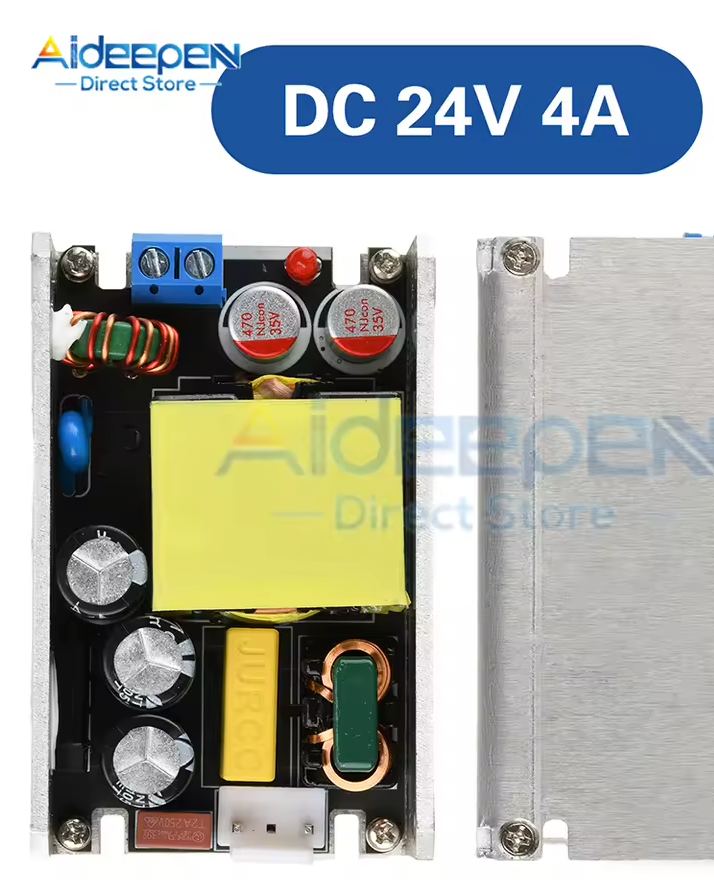

La photo de l'article acheté, « DC 24V 4A », montre la **même carte que
l'essai** : trois condensateurs d'entrée, self de mode commun en fil plat,
condensateur X jaune, fusible T2A rectangulaire près du connecteur secteur, pas de
CTN visible. Seuls changent les condensateurs de sortie, **2 × 470 µF / 35 V**,
et aucun potentiomètre de réglage n'apparaît : la tension de sortie est fixe.

- **35 V suffisent** pour 24 V : marge de 45 %.
- **24 V × 4 A = 96 W**, cohérent avec l'annonce et l'essai.
- **Fusible interne T2A 250 V**, temporisé, lisible sur la photo (l'essai
  l'estimait à 4 A).

## Hydraulique

### Raccords

Les raccords **G1/8** sont à filetage cylindrique. Le vendeur conseille du
ruban PTFE à l'aspiration ; la notice interdit qu'un fragment de ruban ou de
pâte entre dans la pompe. Les raccords cannelés n'ont pas d'épaulement pour
une rondelle.

**Règle : frein-filet Loxeal sur 2 à 3 mm du filetage mâle**, côté
extérieur, les premiers filets laissés nus : le filetage fait 12 mm, le
produit ne peut pas atteindre la pompe. Même étanchéité que celle du
capteur de pression XDB401, qui tient la pression de la chaudière. Pas de
ruban. Une prise d'air à l'aspiration fait entrer des bulles ou empêche la
pompe d'aspirer.

Respecter le **sens de la flèche** du couvercle avant. Pompe près du bac,
aspiration courte, tuyaux au moins aussi gros que les raccords.

### Clapet anti-retour

Une pompe à engrenage n'a pas de clapet : à l'arrêt, la pression de la
chaudière repousse l'eau à travers les engrenages vers le bac. Après une
infusion, la chaudière isolée monte à 9–9,5 bar ; elle se viderait vers le
bac par la pompe, de l'eau chaude atteindrait les engrenages, et le Digmesa,
en amont, compterait ce débit à l'envers comme un débit normal.

**Règle : un clapet anti-retour à la sortie de la pompe**, avant le capteur de
pression, pour que celui-ci continue de lire la chaudière. La machine
d'origine en a un, qui suffit : la pièce 10 du schéma (EM100047-00), sur la
colonne montante, avant le T de l'OPV et du capteur. Il tient ≈ 6 bar après
l'arrêt, et son ressort fait refouler la pompe contre ≈ 0,1 à 0,3 bar à débit
libre.

### Vanne trois voies

La notice demande de ne manœuvrer une électrovanne située après la pompe
qu'une fois la pompe arrêtée, pour éviter les coups de bélier : une pompe
volumétrique qui refoule contre une vanne qui se ferme monte en pression
jusqu'à l'ouverture de l'OPV. **Règle : après un SET à 0, la vanne se ferme
quand le tachymètre indique l'arrêt de la pompe** (200 ms sans front), au plus
tard **1 s** après la consigne à 0. Les arrêts de sécurité (STOP, bail
expiré, verrou, défaut de pompe) ferment la vanne tout de suite.

Mesuré le 13 novembre 2026 en purge à 100 %, sans charge : la pompe met
≈ 0,6 s à s'arrêter une fois la consigne à 0. En 0.5.0, la vanne se fermait avec
la consigne : la pompe qui ralentissait a laissé 0,24 bar dans la chaudière
fermée. 500 ms ne suffisaient donc pas ; la règle passe à 1 s en 0.5.1.

**Exception en fin d'infusion (0.5.7) : sous au moins 5 bar, pompe à
3 500 tr/min au plus, la vanne se ferme avec la consigne à 0.** Tenue
jusqu'à l'arrêt de la pompe (≈ 0,9 s), elle laissait la galette vider le
groupe : le 16/11 à 15 h 02, la pression passe de 8,98 à 6,48 bar avant la
fermeture, et David trouve de l'eau au-dessus de la galette, sans grande
décharge. Avec la vibratoire, la vanne se fermait en 0,4 s. À 9 bar, la
fuite interne (≈ 3 ml/s) absorbe presque tout ce que la pompe refoule en
ralentissant : à 3 500 tr/min (5,8 ml/s), il reste ≈ 0,4 ml, moins de 1 bar
dans la chaudière fermée (compliance ≈ 0,45 ml/bar, estimée par
`simulate_brew_pressure.py`). Une purge sans porte-filtre (sous 1 bar) ou une
pompe rapide gardent la règle du tachymètre : la purge reste le moyen de
faire baisser la pression de la chaudière.

### Filtration

La notice demande un filtre à **10 µm** avant la pompe, avec une surface
assez grande pour ne pas freiner l'aspiration. Le filtre actuel, en amont du
Digmesa, protège une buse de 1 mm : sa finesse est **à relever**. S'il est
plus grossier, ajouter un filtre fin à l'aspiration de la pompe.

### Mise en service

Rincer la pompe et la ligne avant la première infusion. Pour un usage
alimentaire, la notice demande de faire circuler de l'eau à 80 °C pendant
20 minutes, eau jetée ensuite.

## Ce qui change dans le firmware

### Marche à sec

La pompe doit toujours tourner mouillée. Le tachymètre et le Digmesa
détectent un bac vide : la pompe tourne et le Digmesa ne compte rien.

**Règle par défaut** : pompe au-dessus de 1 000 tr/min, aucune impulsion
Digmesa pendant **2 s** et pression qui ne monte pas → consigne à 0 et erreur
« bac vide ». Les seuils se règlent au premier essai, bac débranché.

`DRY_RULE_ENABLED` (`sensors-logic`) coupe la règle. Elle reste active en
service ; une image construite avec la règle coupée fait tourner la pompe au
banc sans Digmesa en amont, comme le 13 novembre 2026 (0.5.2).

### Débitmètre

Le Digmesa est limité à **0,40 L/min (6,7 ml/s)**. La pompe le dépasse à
basse pression au-delà de 4 000 tr/min : jusqu'à 0,5 L/min à 5 000 tr/min.
Le Digmesa envoie toujours ses impulsions (≈ 20 Hz à 0,5 L/min), mais la fiche
pose trois limites :

- **Précision** : les ±2 % ne valent que dans la plage linéaire. Au-delà, le
  nombre d'impulsions par litre dérive sans que rien ne le signale.
- **Usure** : turbine sous **500 tr/min en service continu**, atteints vers
  0,40 L/min.
- **Perte de charge à l'aspiration** : **0,48 bar à 0,40 L/min** pour la buse
  de 1,0 mm, à peu près en carré du débit, soit ≈ 0,75 bar à 0,5 L/min.
  Le Digmesa est en amont de la pompe, annoncée à −0,85 bar au plus, tuyaux
  non compris : elle caviterait et dégazerait l'eau, et les bulles faussent
  le Digmesa.

**Règle** : pas de plafond de vitesse imposé par le Digmesa ; la pompe peut
monter jusqu'à son maximum de 4 500 tr/min. Le débit se lit sur le
tachymètre (impulsions / 2 × 0,1 ml, moins le glissement). Le Digmesa sert
surtout à mesurer les pertes de la pompe (voir
[Calibration du glissement](#calibration-du-glissement)), et il n'a jamais
été très précis : au-dessus de 0,40 L/min, ses impulsions sont encore
comptées, mais la dérive de linéarité les rend inutilisables pour la
calibration. Les échantillons au-dessus de 0,40 L/min sont exclus du calcul
du glissement.

Les deux autres limites restent à surveiller, sans plafond par défaut :

- **Usure de la turbine** : 0,40 L/min est la limite du service continu. Les
  dépassements sont brefs (turbo shot, purge rapide).
- **Perte de charge à l'aspiration** : ≈ 0,39 bar à 3 600 tr/min et
  ≈ 0,6 bar à 4 500 tr/min à 0 bar, contre −0,85 bar au plus pour la
  pompe. Si une purge rapide fait apparaître des bulles ou un écart entre
  tachymètre et Digmesa qui grandit pendant la marche, c'est la cavitation :
  baisser la vitesse de la purge.

### Pression

La pompe vibratoire pousse par impulsions à 50 Hz ; le filtrage de la mesure
de pression du XDB401 a été réglé pour cette ondulation (voir
[firmware.md](firmware.md)). Sans pulsation, ce filtrage pourra être allégé,
après une capture de comparaison.

En panier aveugle, une pompe volumétrique monte la pression jusqu'à
l'ouverture de l'OPV (11 bar), sous les 12 bar de la notice.

### Durée de marche

La limite de 60 s de marche continue venait du thermique de la pompe
vibratoire. Elle reste : elle couvre aussi la vanne, et la pompe a sa propre
limite de 60 W en service continu.

## Calibration du glissement

Le Digmesa, en amont, mesure le débit net (OPV fermée). Le glissement est une
fuite interne de la sortie vers l'entrée de la pompe, après le Digmesa :

```
glissement = volume tachymètre (impulsions / 2 × 0,1 ml) − volume Digmesa
```

Modèle de départ : `glissement(P) = k × P`, à remplacer par une table si les
mesures s'en écartent. **Les premières purges le contredisent** : le
glissement n'est pas nul à 0 bar (voir ci-dessous). Le glissement dépend aussi de la viscosité, donc de la
température de l'eau du bac, à peu près constante.

Protocole :

1. **Panier aveugle, pression asservie** : la pompe tient des paliers de 2,
   4, 6, 8, 9 et 10 bar. Le débit net est nul : la vitesse nécessaire pour
   tenir chaque palier donne le glissement pur. Le Digmesa doit rester à
   zéro, ce qui sert de contrôle. Ne pas lancer de vitesse fixe en panier
   aveugle : la pression monterait jusqu'à l'OPV.
2. **Panier SCACE (trou de 0,3 mm) et balance** : des vitesses fixes donnent
   des points avec débit réel, à comparer au modèle.
3. **En service** : chaque infusion OPV fermée recalcule `k` à partir du
   tachymètre et du Digmesa, pour suivre l'usure.

### Premières purges dans la machine

13 novembre 2026, firmware 0.5.1, eau à l'ambiante aspirée dans un pichet par
un tube en siphon, sans porte-filtre, pression lue 0 à 0,16 bar. Pas de bulle
visible dans les tubes d'aspiration. Le pichet de retour de l'OPV est resté
sec. Débits sur la marche stable, calculés par
`firmware/analysis/pump_capture.py` :

| Purge | Vitesse | Pompe (tours × 0,1 ml) | Digmesa (2 564 imp/L) | Tasse | Tasse / pompe |
| --- | ---: | ---: | ---: | ---: | ---: |
| 40 %, `261113-093547` | 1 720 tr/min | 2,87 ml/s | 1,72 ml/s | 1,82 g/s | 63 % |
| 40 %, `261113-092042` | 1 717 tr/min | 2,86 ml/s | 1,76 ml/s | 1,85 g/s | 65 % |
| 100 %, `261113-092123` | 4 604 tr/min | 7,67 ml/s | 5,93 ml/s | 6,14 g/s | 80 % |

Bilan sur 10 s à 40 % (`261113-093547`), pichet d'aspiration pesé : **17,9 g
aspirés**, 17,7 g en tasse, Digmesa 17,6 ml, tachymètre 28,2 ml.

- **Le glissement vaut ≈ 1,0 ml/s à 1 720 tr/min et ≈ 1,5 ml/s à
  4 600 tr/min, à 0 bar.** L'eau aspirée arrive en tasse : il n'y a pas de
  perte en aval, l'écart est une recirculation dans la pompe. La courbe du
  fabricant ne prévoit pas de glissement à 0 bar. Le relevé à réception
  (5 novembre, sortie libre vers l'évier) donnait au contraire ≈ 100 % : la
  sortie descendait en siphon, à 0 bar ou moins, et la fuite de cet exemplaire
  croît surtout dans le premier bar (voir l'essai au banc ci-dessous).
- **Le Digmesa mesure le débit net à ≈ 2 % près** avec 2 564 imp/L, à
  40 % comme à 100 %. Le tachymètre seul surestime le débit de 25 à 60 %.
- **Panier de 0,2 mm, air de la chaudière purgé par la buse vapeur**
  (`261113-100955`, 30 %, 27 s) : la pompe tourne à 1 225 tr/min
  (2,04 ml/s refoulés, 55 ml au total) et la pression se stabilise en moins
  d'une seconde vers **0,85 bar**. Le pichet d'aspiration perd 1,7 g en 27 s,
  ≈ 0,06 ml/s : à 0,85 bar, la pompe recircule presque tout son refoulé. La
  courbe du fabricant donne encore 0,5 ml/s à 12 bar à 1 000 tr/min. Le
  Digmesa compte 20 impulsions (7,8 ml) : ce débit est sous sa plage, il ne
  vaut rien ici. Avant la purge d'air, les purges au panier de 0,2 mm
  (`261113-095703`, `261113-095839`) montaient lentement en pression parce
  que l'eau comprimait d'abord ≈ 50 ml d'air.
- La purge `261113-093231` (40 %, 1,59 g/s) est écartée : la douche coulait
  plus large que la tasse, les éclaboussures n'étaient pas pesées. Un
  porte-filtre sans fond retient de l'eau : une tasse haute, sans
  porte-filtre, est le bon montage.

### Essai au banc, sortie bouchée (13 novembre 2026)

Pompe sortie de la machine, toujours pilotée par combined (0.5.2, marche à sec
coupée). Aspiration par un tube en silicone rempli d'eau, depuis un pichet sur
la balance ; au refoulement, un prolongateur G1/8 puis le **XDB401 I2C**, qui
ferme la sortie. Le XDB401 est lu par le Core2 (`firmware/xdb401`, BLE
enregistré par `firmware/analysis/xdb401_ble_log.py`, fichier
`captures/xdb401-261113-152846.csv`) ; il lit +0,035 bar à l'air, retiré
ci-dessous.

Sans débit net, la fuite interne égale le refoulé : chaque palier donne la
pression à laquelle la pompe recircule tout ce qu'elle déplace.

| Purge | Vitesse (tachymètre) | Refoulé = fuite | Palier |
| --- | ---: | ---: | --- |
| 30 %, `261113-153034` | 1 211 tr/min | 2,02 ml/s | **1,19 bar** en 1,5 s, puis lente dérive vers 1,2 |
| 45 %, `261113-153310` | 1 774 tr/min | 2,96 ml/s | **2,77 bar** en 1,5 s, stable 6 s |
| 55 %, `261113-154002` | 2 135 tr/min | 3,56 ml/s | **4,98 bar** en 1,5 s, stable 4 s |
| 60 %, `261113-152539` | 2 264 tr/min | 3,77 ml/s | > 7 bar, encore en montée à l'arrêt manuel |

- **La fuite vaut ≈ 5 fois celle de la courbe, avec la même forme.** Fuite de
  la courbe au même point (débit à 0 bar moins débit livré, interpolé entre
  les vitesses) :

  | Palier | Mesurée | Courbe | Rapport |
  | --- | ---: | ---: | ---: |
  | 1 211 tr/min, 1,19 bar | 2,02 ml/s | ≈ 0,42 ml/s | ≈ 5 |
  | 1 774 tr/min, 2,77 bar | 2,96 ml/s | ≈ 0,53 ml/s | ≈ 5,5 |
  | 2 135 tr/min, 4,98 bar | 3,56 ml/s | ≈ 0,68 ml/s | ≈ 5 |

  Une pompe conforme livre encore 0,3 ml/s à 20 bar et 1 000 tr/min ; cet
  exemplaire ne livre plus rien dès 1,2 bar à 1 211 tr/min.
- **La fuite croît moins vite que la pression** (exposant 0,45 entre 30 et
  45 %, 0,31 entre 45 et 55 %), comme sur la courbe. Comme la fuite est
  presque plate à haute pression, quelques tr/min de plus déplacent beaucoup
  le palier : la pente en vitesse grandit (2,8, puis 6,1, puis plus de 16 bar
  par 1 000 tr/min) et 60 % monte « en flèche ». Une bascule du sabot n'est
  pas nécessaire pour l'expliquer.
- **Un rapport constant désigne un jeu plutôt que la précharge** : une
  précharge trop faible creuserait l'écart à basse pression, puis la pression
  reprendrait la main. La fuite d'un jeu varie à peu près comme son cube :
  ×5 correspond à un jeu ≈ 1,7 fois trop grand.
- **À l'arrêt, la pression retombe à 0 en moins d'une seconde**, par les
  engrenages : la pompe n'a pas de clapet.
- Le palier de 30 % s'est reproduit à deux essais (1,16 bar à l'écran du
  Core2 au premier) : ce n'est pas de l'air dans la tête.
- Avec cette fuite, 9 bar avec 2 ml/s en tasse demanderaient
  ≈ 3 500 tr/min : la plage basse, 500 à 1 750 tr/min, ne tient pas la
  pression. Le glissement à 0 bar dans la machine (1 à 1,5 ml/s, plus haut)
  vient probablement du même défaut.
- Un prolongateur ou un raccord trop long qui étranglerait la sortie ne change
  pas ces paliers : sans débit, il n'y a pas de perte de charge.

### Remontage, fil tendu sur le sommet du sabot (14 novembre 2026)

Tête remontée avec un peu plus de tension sur le fil, crochet sur le sommet du
sabot. Pompe hors de la machine, toujours pilotée par combined (0.5.2).
Aspiration en siphon depuis un pichet surélevé sur la balance, sortie libre
dans une tasse. Le capteur de pression de sensors n'est pas sur le circuit
(1,12 bar fixes dans les captures) et le Digmesa reste à 0 impulsion.
Purges de 10 s :

| Purge | Vitesse | Refoulé (tachymètre) | Tasse, marche stable | Bilan total | Tasse / pompe |
| --- | ---: | ---: | ---: | ---: | ---: |
| 20 %, `261114-110205` | 866 tr/min | 1,44 ml/s | 1,49 g/s | ≈ 15,3 g / 14,25 ml | 104 à 107 % |
| 50 %, `261114-105602` | 2 187 tr/min | 3,64 ml/s | 3,77 g/s | 36,5 g / 36,0 ml | 101 % |
| 80 %, `261114-110410` | 3 729 tr/min | 6,21 ml/s | 6,28 g/s | 47,8 g / 47,75 ml | 100 % |
| 100 %, `261114-105751` | 4 657 tr/min | 7,76 ml/s | 7,55 g/s | 76,5 g / 77,1 ml | 97 à 99 % |

Le bilan total est pris une demi-seconde après l'arrêt. Le pichet perd ce que
la tasse gagne, à 0,1 g près : pas de fuite externe après le remontage.

- **0,1 ml/tour tient de 866 à 4 657 tr/min sans résistance.** Le léger
  manque à 100 % sur la marche stable ne se retrouve ni au bilan total ni à
  80 % : c'est la balance, pas un glissement.
- **Le siphon pousse l'eau à travers la pompe arrêtée** : après l'arrêt, la
  tasse gagne encore ≈ 0,1 g/s. Pendant la marche, ce débit s'ajoute au
  refoulé ; il pèse surtout à 20 %, d'où les 104 à 107 %.
- **Ces points ne jugent pas le fil** : le relevé du 5 novembre, même montage
  en siphon avec le fil d'origine, donnait aussi ≈ 100 %. Seul l'essai sous
  pression ci-dessous le juge.

Puis sortie bouchée par le XDB401 (lu par le Core2, fichier
`captures/xdb401-261114-115503.csv`, +0,037 bar à l'air, retiré ci-dessous),
purges de 10 s sauf mention. Écran 0.5.3 dès 57 %, pour les pas de 1 % :

| Purge | Vitesse stable | Refoulé = fuite | Palier | 13 novembre |
| --- | ---: | ---: | --- | --- |
| 20 %, `261114-115603` | 825 tr/min | 1,37 ml/s | **0,48 bar** | — |
| 30 %, `261114-115717` | 1 218 tr/min | 2,03 ml/s | **1,03 bar** | 1,19 bar à 1 211 tr/min |
| 45 %, `261114-115836` | 1 797 tr/min | 3,00 ml/s | **2,42 bar** | 2,77 bar à 1 774 tr/min |
| 55 %, `261114-120140` | 2 188 tr/min | 3,65 ml/s | **4,05 bar**, ± 0,15 | 4,98 bar à 2 135 tr/min |
| 57 %, `261114-120907` (5 s) | 2 207 tr/min | 3,68 ml/s | > 5,8 bar, montée de 0,2 bar/s | — |
| 58 %, `261114-120944` | 2 207 tr/min | 3,68 ml/s | **6,5 bar**, ± 0,3, après 7,1 bar à 5 s | — |
| 59 %, `261114-121034` | 2 207 tr/min | 3,68 ml/s | **7,35 bar**, ± 0,35 | — |
| 60 %, `261114-121152` | 2 182 tr/min | 3,64 ml/s | **8,55 bar**, ± 0,5 | > 7 bar en montée, arrêt à 1,2 s |

Un 60 % de 1,2 s (`261114-120221`) montait encore à 6,9 bar à l'arrêt ; le
palier vient après 2 s. À chaque arrêt, la pression retombe à 0 en moins
d'une demi-seconde.

- **La tension du fil n'a rien changé** : la fuite est même ≈ 7 à 9 % plus
  forte qu'au 13 novembre, à 30, 45 et 55 % (paliers du 13 ramenés à la
  vitesse du jour). La précharge est hors de cause : c'est un jeu.
- **La fuite plafonne à ≈ 3,65 ml/s de 4 à 8,5 bar**, à 1 % près. Le sabot,
  plaqué par la pression, ne la laisse plus croître, mais au niveau d'un jeu
  ≈ 5 fois trop grand.
- **La commande règle la pression, pas la vitesse** : au-dessus de 55 %,
  chaque % ajoute 0,85 à 1,2 bar, et 9 bar se tiennent vers 60–61 %. Le
  moteur ralentit sous la charge jusqu'à égaler la fuite ; la vitesse ne
  bouge plus que de quelques tr/min, sous la résolution du tachymètre (pas de
  ≈ 5 tr/min). Un palier se forme à chaque marche : pas d'emballement.
- **L'ondulation croît avec la pression** (± 0,15 bar à 4 bar, ± 0,5 à
  8,5 bar). Vers 2 200 tr/min, la pente vaut ≈ 0,14 bar par tr/min : quelques
  tr/min de variation du moteur suffisent.
- **Pour l'infusion**, avec la fuite plafonnée, 2 ml/s en tasse à 9 bar
  demandent ≈ 5,7 ml/s refoulés, soit ≈ 3 400 tr/min. Le moteur doit tenir
  cette vitesse sous 9 bar : c'est à mesurer dans la machine, panier SCACE et
  balance, avec la fuite à 9–11 bar et l'hystérésis contre l'OPV.

**Bilan face à la pompe vibratoire.** Cet exemplaire se pilote comme une
vibratoire : à commande fixe, le débit tombe avec la pression jusqu'à une
pression de fermeture, que la commande règle. Le tachymètre ne donne plus le
débit ; le pilotage en débit passe par le Digmesa. Le gain principal est la
précision du Digmesa : sans pulsation à 50 Hz, il mesure le débit net à ≈ 2 %
près. S'y ajoutent une pression lisse et stable sans débit, et le bas de la
plage (0,5 bar à 20 %, purge lente vers 1,4 ml/s). Le débit livré à 9 bar,
mesuré ci-dessous dans la machine, suffit à l'infusion.

### Dans la machine, contre l'OPV (14 novembre 2026)

Pompe remontée, écran 0.5.4 et sensors 0.5.3 (marche à sec active).
Aspiration depuis un pichet pesé ; la vanne trois voies vide le groupe à
chaque arrêt.

**Purges sans porte-filtre** (≈ 0 bar au capteur, tasse sur l'Acaia, le
pichet perd ce que la tasse gagne) :

| Purge | Vitesse | Refoulé | Tasse | Tasse / pompe | K du Digmesa |
| --- | ---: | ---: | ---: | ---: | ---: |
| 30 %, `261114-213636` | 1 301 tr/min | 2,17 ml/s | 1,41 g/s | 65 % | 2 500 imp/L |
| 60 %, `261114-213031` | 2 678 tr/min | 4,46 ml/s | 3,33 g/s | 75 % | 2 485 imp/L |

Au banc, en siphon, la même pompe livrait ≈ 100 %. Le **clapet anti-retour
d'origine** (pièce 10 du schéma, EM100047-00, 1/8 mâle-mâle, sur la colonne
montante avant le T de l'OPV et du capteur) oppose un ressort : la pompe
refoule contre ≈ 0,1 à 0,3 bar, qui croît avec le débit, alors que le
capteur lit 0. Ça suffit pour la fuite des premiers bars. Le Digmesa est
recalé à 2 490 imp/L (0.5.4).

**Panier aveugle, OPV en sortie, retour OPV dans une tasse sur l'Acaia.**
Avant la série, une purge à 60 % buse vapeur ouverte chasse l'air du haut de
la chaudière : la souplesse du circuit passe de ≈ 1,5 à ≈ 0,9 ml/bar. Après
chaque arrêt, la pression retombe vers 6 bar et y reste, tenue par le
clapet ; la vanne trois voies en laisse sans doute passer une partie. Purges
de 10 à 20 s, débits pris sur le plateau :

| Purge | Plateau (OPV) | Vitesse sous charge | Refoulé | Livré (OPV, Acaia) | Digmesa | Fuite |
| --- | ---: | ---: | ---: | ---: | ---: | ---: |
| 60 %, `261114-215739` | 9,48 bar | 2 128 tr/min | 3,55 ml/s | 0,27 g/s | 0,33 ml/s | 3,25 ml/s |
| 70 %, `261114-220125` | 9,68 bar | 2 595 tr/min | 4,33 ml/s | 1,13 g/s | 1,19 ml/s | 3,18 ml/s |
| 80 %, `261114-220501` | 9,85 bar | 3 145 tr/min | 5,24 ml/s | 2,20 g/s | 2,18 ml/s | 3,04 ml/s |
| 90 %, `261114-220809` | 9,98 bar | 3 634 tr/min | 6,06 ml/s | 3,00 g/s | 3,12 ml/s | 3,06 ml/s |
| 100 %, `261114-220901` | 10,10 bar | 4 035 tr/min | 6,73 ml/s | 3,86 g/s | 3,83 ml/s | 2,87 ml/s |

- **La pompe suffit à l'infusion** : 2 ml/s à 9–10 bar vers 78 %, jusqu'à
  3,9 ml/s à 100 %. Entre 70 et 100 %, chaque tranche de 10 % ajoute
  ≈ 0,9 ml/s.
- **La fuite reste plafonnée jusqu'à 10 bar** et baisse un peu avec la
  vitesse (3,25 à 2,87 ml/s). Elle ne croît jamais avec la pression : le
  sabot se plaque comme prévu, mais sur un jeu trop grand.
- **L'OPV d'origine s'ouvre vers 9,45 bar** et monte avec le débit, jusqu'à
  10,1 bar à 3,9 ml/s.
- **De 6 à 10 bar en ≈ 1,7 s** à 90 et 100 %, une fois l'air chassé.
- **Le Digmesa suit l'Acaia à ≈ 3 % près sous pression**, avec 2 490 imp/L.
  Au-dessus de ≈ 2 g/s, pichet, Digmesa et Acaia concordent à ≈ 2 %. Plus
  lentement, la balance du pichet sous-estime la baisse ; elle ne sert pas
  aux plateaux lents.

### Première infusion (15 novembre 2026)

Capture `261115-214106`, single espresso inchangé, galette serrée
(9,05 bar·s/g). L'analyse complète est dans
[journal-infusions.md](journal-infusions.md#15-novembre-21-h-41--261115-214106).

- **Plateau** : 9 bar tenus à ± 0,05 bar par 66 à 71 %, 2 550 tr/min,
  1,08 ml/s au Digmesa, fuite de 3,17 ml/s : les plateaux contre l'OPV
  se retrouvent sur une galette.
- **Pic à 9,92 bar** à la montée : la pompe reste à 100 % jusqu'à 8 bar,
  la régulation réglée sur la vibratoire coupe trop tard (hypothèse).
- **Remplissage à 70 %** : 3,59 ml/s, contre 2,9 à 3,3 ml/s avec la
  vibratoire ; il n'atteint pas 0,8 bar en 10 s (0,48 bar). La galette
  serrée et la pompe ne se séparent pas sur cette infusion.
- **Après l'arrêt**, le clapet garde 6,6 bar dans la chaudière.

## Structure et cotes

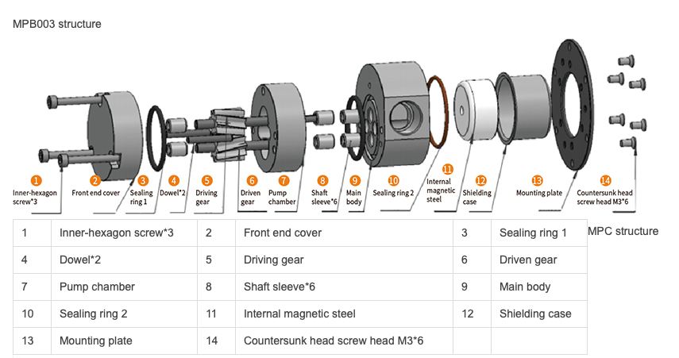

Cette vue éclatée, reprise par l'annonce du vendeur et par celle du fabricant,
**n'est pas celle de la MPB003** : la notice de la MPB010
([mpb010.pdf](datasheets/mpb010.pdf)) porte la même. La page 1 de la notice
MPB003 et son plan coté (tête lisse Ø38 × 32,5, sans vis en face avant)
montrent la tête à sabot décrite ci-dessous. La tête se sépare du moteur par
les 4 vis arrière, resserrées à 1 ± 0,2 Nm.

### Construction réelle : une tête à sabot

Démontée le 13 novembre 2026 après l'essai au banc. Une des trois vis du
chapeau était nettement plus serrée que les deux autres.

| Point | Vue éclatée de l'annonce | Exemplaire reçu |
| --- | --- | --- |
| Engrenages | PEEK, hélicoïdaux | noirs, **droits**, 12 dents |
| Chambre | pièce usinée en 316L, serrée entre couvercle et corps | **sabot en plastique**, plaqué par un ressort en fil |
| Arbres | 316L, 6 bagues, 2 goupilles | axe et pion blancs plantés dans la tête |
| Marquage | gravé sur la tête | « 2025081201 » et flèche gravés, étiquette « MPB003BAA » |

C'est le principe des têtes à sabot (*suction shoe*) de Micropump. Sur la face
de la tête : l'axe blanc de l'engrenage mené par l'aimant (tube hexagonal),
le pion blanc de l'autre engrenage, le trou d'aspiration à gauche de l'axe, le
trou de refoulement à droite, le trou de l'ergot du sabot (sud-ouest) et le
taraudage de la vis du ressort (sud-est). Le sabot couvre les deux engrenages
et la chambre d'aspiration ; il pivote sur son ergot.

Trajet de l'eau : raccord d'entrée, trou sous le sabot, chambre où les dents
se désengrènent, creux des dents le long des **arcs du sabot** (3 pointes au
contact par arc, soit 2 pas), sortie au bout des arcs dans la **cavité sous le
chapeau**, toute au refoulement, puis trou libre et raccord de sortie. À
l'engrènement, les dents vont du refoulement vers le sabot. Moteur en sens
antihoraire vu côté chapeau ; la flèche gravée va du raccord du sabot vers
celui du trou libre.

Le sabot fait seul l'étanchéité entre la cavité et l'aspiration : le bout des
dents contre ses arcs, le dessus des engrenages contre son couvercle, sa base
contre la tête autour du trou d'aspiration. Le fil le plaque dès 0 bar ; la
pression de la cavité sur son dos et son dessus le serre ensuite davantage,
d'où la fuite presque plate au-dessus de 3 bar sur la courbe.

Constats au démontage :

- Sens, montage et arcs conformes (voir ci-dessus).
- Aucune trace d'usure sous le sabot ni sur ses arcs ; des cercles nets sur la
  face de la tête, sous les engrenages. Ni débris ni rayure sur les dents.
- Le sabot reste stable quand on appuie sur ses bords.
- Fil d'origine : boucle sous la rondelle, crochet sur la partie haute du
  sabot, près du tube hexagonal, fléchi pour y arriver. Libre, il retombe sur
  la partie basse, où le dessus du sabot porte des rayures en arc.
- Rotation à la main, eau dans l'entrée : en antihoraire l'eau est aspirée et
  sort au bout des deux arcs ; en horaire, l'air de la chambre est refoulé
  dans l'entrée.

Deux causes étaient possibles : une précharge du fil trop faible, ou un jeu
trop grand (hauteur des engrenages sous le couvercle du sabot, bout des
dents). Le fil retendu le 14 novembre n'a rien changé
([Remontage](#remontage-fil-tendu-sur-le-sommet-du-sabot-14-novembre-2026)) :
c'est le jeu.

### Cotes

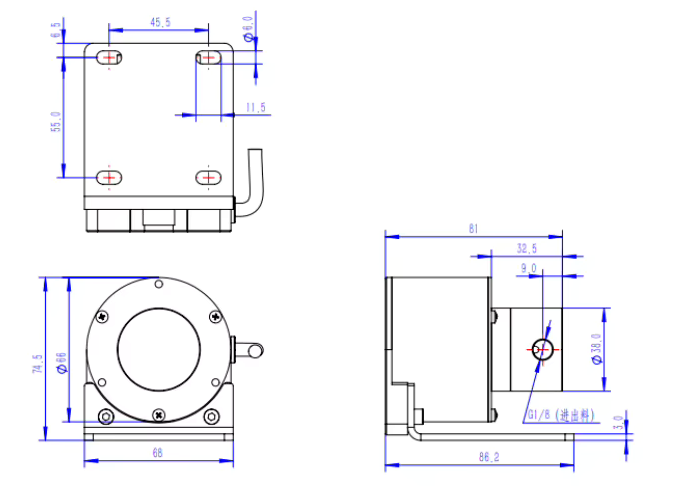

Cotes lues sur le plan, en mm :

| Cote | Valeur |
| --- | ---: |
| Longueur moteur + tête | 81 |
| Longueur de l'équerre | 86,2 |
| Largeur de l'équerre | 68 |
| Hauteur totale | 74,5 |
| Diamètre du moteur | 66 |
| Diamètre de la tête de pompe | 38 |
| Longueur de la tête de pompe | 32,5 |
| Axe des raccords depuis la face avant | 9,0 |
| Épaisseur de l'équerre | 3,0 |
| Entraxe des boutonnières | 45,5 × 55,0 |
| Largeur des boutonnières | 6,0 |

Les deux raccords **G1/8** sont radiaux, opposés sur la tête. Le câble sort
latéralement du moteur, côté équerre.

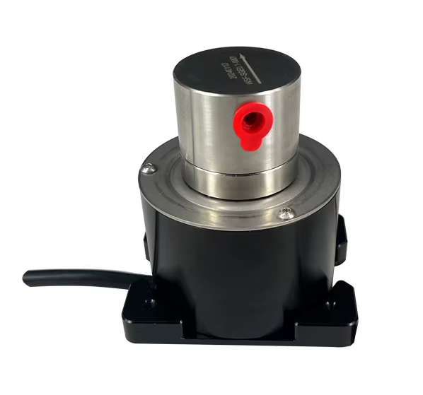

## Mécanique

Pas de support à imprimer : l'équerre d'origine de la pompe est vissée dans
deux des trous de 6 mm de la plaque du fond de la machine, à 40 mm
d'entraxe, que ses boutonnières rejoignent.

## Alternative : MPB010

Même vendeur, même brochage à 7 fils, raccords G1/8
([mpb010.pdf](datasheets/mpb010.pdf)) : 0,28 ml/tour, BLDC 24 V 70 W (3 A),
500 à 4 500 tr/min, 15 bar. Construction à jeux fixes : chambre usinée entre
couvercle avant (3 vis M3 × 25) et corps, deux goupilles, arbres tenus des
deux côtés par des bagues. La vidéo de l'annonce montre des dents droites, pas
les hélicoïdales de la vue éclatée. Un utilisateur l'a montée dans une Gaggia
Classic Pro.

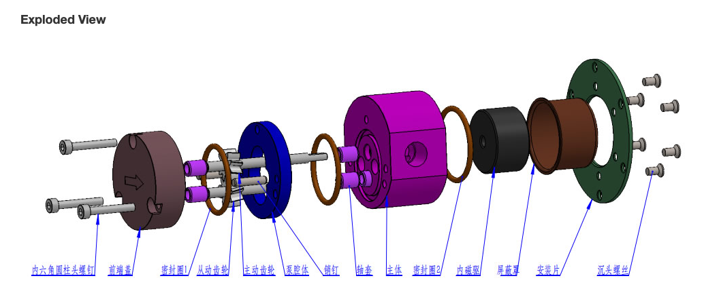

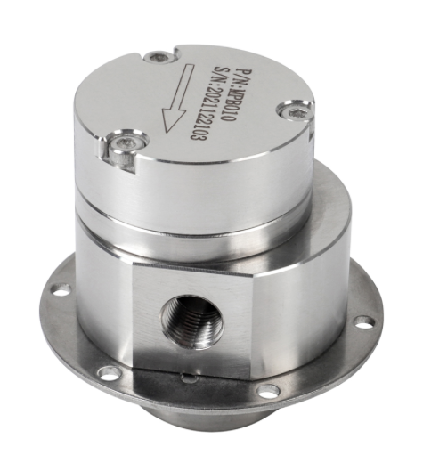

Cette vue éclatée, à engrenages droits, correspond à la photo. De bas en
haut : la cloche sous l'équerre, le corps à six pans qui porte les deux G1/8,
puis le cylindre de la chambre fermé par le couvercle gravé « P/N MPB010 ».
Les [MPB015](#alternative--mpb015) (101 mm) et [MPB030](#alternative--mpb030)
(99 mm) ont presque sa longueur (100 mm) pour 1,3 et 3,3 fois sa cylindrée.

| Étiquette | Pièce | Rôle |
| --- | --- | --- |
| 内六角圆柱头螺钉 | 3 vis à tête cylindrique six pans creux | serrent couvercle, chambre et corps |
| 前端盖 | couvercle avant, flèche gravée | ferme la chambre, porte un palier de chaque arbre |
| 密封圈1 | joint torique 1 | étanchéité couvercle–chambre |
| 从动齿轮 / 主动齿轮 | engrenage mené / menant | le menant porte l'aimant intérieur |
| 泵腔体 | anneau de chambre | son épaisseur fixe la largeur de la chambre |
| 销钉 | 2 goupilles | alignent couvercle, chambre et corps |
| 轴套 | bagues (6 selon la vue MPB003) | paliers des arbres, des deux côtés |
| 主体 | corps | raccords G1/8, paliers côté moteur |
| 密封圈2 | joint torique 2 | étanchéité corps–cloche |
| 内磁驱 | aimant intérieur | entraîné à travers la cloche |
| 屏蔽罩 | cloche | sépare l'eau du moteur |
| 安装片 / 沉头螺丝 | équerre, vis à tête fraisée | fixation sur le moteur |

- **Deux chemins de fuite, à jeux fixes** : entre les faces des engrenages et
  le couvercle ou le corps (jeu axial), entre le bout des dents et l'alésage
  de l'anneau (jeu radial). Sans sabot, rien ne les referme sous pression :
  la fuite croît avec la pression, sans plafond.
- **La taille interne fait le modèle, pas la longueur.** La MPB030 ne peut
  pas loger 3,3 fois la cylindrée de la MPB010 dans une tête plus courte : la
  chambre et les engrenages grandissent à l'intérieur. La part du diamètre et
  de la largeur n'est pas connue.
- **Plus grande, la pompe fuit moins par rapport à sa cylindrée.** Fuite à
  9 bar par ml/tour : ≈ 41 ml/s pour la MPB010, ≈ 19 pour la MPB015, ≈ 17
  pour la MPB030. La MPB010 sort du lot.
- **Démontable** : le jeu axial dépend de l'épaisseur de l'anneau face à celle
  des engrenages, pas du serrage, et les goupilles réalignent les pièces. Un
  rodage léger de l'anneau sur plaque plane réduirait le jeu axial ; le jeu
  radial ne se reprend pas.

Valeurs lues sur sa courbe, à 9 bar :

| Vitesse | Déplacé | Livré | Fuite |
| ---: | ---: | ---: | ---: |
| 4 500 tr/min | 21 ml/s | 9,8 ml/s | ≈ 11 ml/s |
| 3 000 tr/min | 14 ml/s | 2,3 ml/s | ≈ 11,5 ml/s |
| ≈ 2 500 tr/min | 12 ml/s | 0 | ≈ 12 ml/s |

- **Pas de sabot, donc une fuite continue** : à peu près proportionnelle à la
  pression (≈ 4,7 ml/s à 3 bar), sans seuil. Une table fuite = f(P) et le
  Digmesa la compensent ; le tachymètre ne donne plus le débit.
- **Fuite ≈ 3 fois celle de l'exemplaire MPB003 défectueux à 9 bar**, ≈ 15 fois
  celle d'une MPB003 conforme. Elle dépend de la viscosité, donc de la
  température de l'eau (≈ 2 %/°C), et augmente avec l'usure.
- **Petits débits sous pression faciles** : la fuite sert de dérivation,
  0,5 ml/s à 9 bar vers 2 600 tr/min. À basse pression, 500 tr/min déplacent
  déjà 2,3 ml/s : pas de purge lente sous ≈ 2 ml/s.
- **Vitesse plus haute** (≈ 3 000 tr/min pour 2 ml/s à 9 bar) : plus de bruit
  à prévoir, ≈ 10 W de recirculation dans l'eau.
- **Courant** : ≈ 1,5 A à 9 bar et 3 000 tr/min, ≈ 3 A au plus ; avec le buck,
  sous les 4 A de l'alimentation.
- **Encombrement** : 100 mm de long au lieu de 81, tête Ø44 au lieu de Ø38 ;
  l'équerre est à vérifier sur les trous à 40 mm de la plaque du fond.

## Alternative : MPB015

Même famille que la MPB010, à chambre plus grande. C'est le modèle
le plus cité dans les modifications de machines à expresso. Pas de fiche dans
le dépôt. L'annonce décrit les 7 mêmes fils que la MPB003 et la MPB010, avec
le même moteur BLDC 24 V en 70 W, comme la MPB010 (la MPB003 est en 40 W).
L'électronique de commande est supposée la même, fil jaune compris. 101 mm de
long.

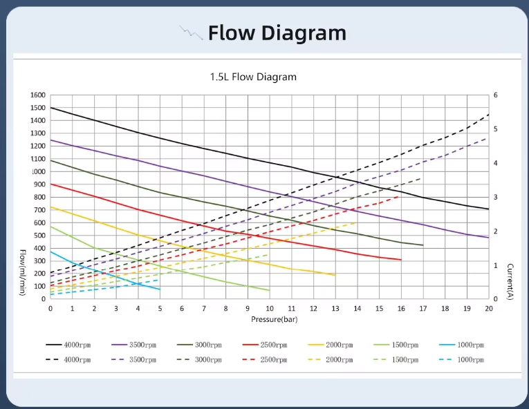

**≈ 0,36 à 0,375 ml/tour** : à 0 bar, 1 500 ml/min à 4 000 tr/min,
900 à 2 500, 370 à 1 000. La courbe s'arrête à 20 bar ; celle de
1 000 tr/min, à 5 bar. Valeurs lues à 9 bar, avec 0,36 ml/tour :

| Vitesse | Déplacé | Livré | Fuite | Courant |
| ---: | ---: | ---: | ---: | ---: |
| 4 000 tr/min | 24 ml/s | 18 ml/s | ≈ 6,5 ml/s | ≈ 3,4 A |
| 3 000 tr/min | 18 ml/s | 11,5 ml/s | ≈ 6,7 ml/s | — |
| 2 000 tr/min | 12 ml/s | 5 ml/s | ≈ 7 ml/s | — |
| 1 500 tr/min | 9 ml/s | 1,7 ml/s | ≈ 7,3 ml/s | ≈ 1,3 A |

- **Jeux fixes, comme la MPB010** : la fuite croît à peu près en proportion
  de la pression, ≈ 0,8 ml/s par bar, sans plafond. Une table fuite = f(P)
  et le Digmesa la compensent ; elle dépend de la température de l'eau.
- **Moins de fuite que la MPB010 avec plus de cylindrée** : ≈ 7 ml/s à
  9 bar contre ≈ 11,5. La chambre plus grande ne gagne pas seulement en
  proportion : la fuite baisse aussi en valeur absolue.
- **Vitesse deux fois plus basse sous pression** : 2 ml/s à 9 bar vers
  1 550 tr/min, contre ≈ 3 000 pour la MPB010 et pour l'exemplaire MPB003
  qui fuit. Une MPB003 conforme fait à peu près pareil (≈ 1 750 tr/min).
  Moins de bruit à prévoir, ≈ 6 W de recirculation dans l'eau.
- **Tenir 9 bar sans débit** : ≈ 1 150 tr/min.
- **Pas de purge lente** : à 500 tr/min, si le bas de plage est le même
  que pour les autres modèles, elle déplace déjà ≈ 3 ml/s à 0 bar. La
  pré-infusion sous quelques bars reste possible : la fuite sert de
  dérivation.
- **Commande plus grossière** : avec ≈ 1 000 tr/min par volt, 0,1 V vaut
  ≈ 0,6 ml/s, contre 0,47 pour la MPB010 et 0,17 pour la MPB003. En
  service, la consigne reste entre ≈ 0,6 et 2 V.
- **Courant** : ≈ 1,3 A à 9 bar pour 2 ml/s, ≈ 3,4 A à 4 000 tr/min ;
  l'OPV limite la pression vers 10 bar. Avec le buck, sous les 4 A de
  l'alimentation.
- **Encombrement** : la pompe est vissée près de la face avant, dans le
  compartiment sous le réservoir, flèche du couvercle vers l'avant. Seule la
  longueur compte : la MPB003 (81 mm) laisse ≈ 25 mm jusqu'à la face, la
  MPB010 (100 mm) ≈ 6 mm, la MPB015 (101 mm) ≈ 5 mm.

## Alternative : MPB030

Même famille, 99 mm de long. Pas de fiche dans le dépôt ; seule la courbe est
connue.

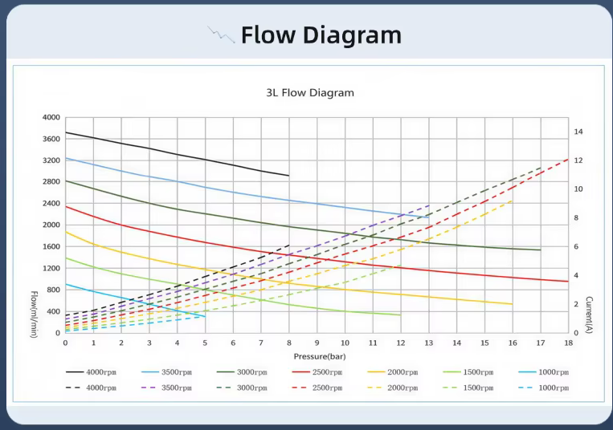

**≈ 0,93 ml/tour** : à 0 bar, 3 700 ml/min à 4 000 tr/min, 2 350 à 2 500,
900 à 1 000. La courbe de 4 000 tr/min s'arrête à 8 bar, celle de
1 000 tr/min à 5 bar. Valeurs lues à 9 bar :

| Vitesse | Déplacé | Livré | Fuite |
| ---: | ---: | ---: | ---: |
| 3 500 tr/min | 54 ml/s | 40 ml/s | ≈ 14 ml/s |
| 3 000 tr/min | 46,5 ml/s | 32 ml/s | ≈ 14,5 ml/s |
| 2 500 tr/min | 39 ml/s | 23 ml/s | ≈ 16 ml/s |
| 2 000 tr/min | 31 ml/s | 14,7 ml/s | ≈ 16,3 ml/s |
| 1 500 tr/min | 23 ml/s | 7,8 ml/s | ≈ 15,4 ml/s |

- **Trop grande pour l'infusion** : 2 ml/s à 9 bar vers 1 150 tr/min, et
  9 bar tenus sans débit vers 1 000 tr/min. Toute l'infusion tient dans
  ≈ 150 tr/min, et 0,1 V de consigne vaut ≈ 1,5 ml/s.
- **Pas de purge lente** : 500 tr/min déplacent ≈ 7,7 ml/s à 0 bar.
- **Fuite ≈ 1,7 ml/s par bar**, ≈ 14 W de recirculation dans l'eau à 9 bar.
- **Courant**, lu grossièrement : ≈ 2 à 3 A à 9 bar entre 1 500 et
  2 000 tr/min, ≈ 6 A à 4 000 tr/min et 8 bar, au-delà des 4 A de
  l'alimentation.

## À relever à réception

| Point | Méthode |
| --- | --- |
| Seuil de démarrage et bas de la plage (< 1,2 V) | essais automatisés avec combined v2, montage étanche |
| Courant d'appel au démarrage | shunt ou pince, démarrage à 9 bar |
| Tension de sortie à vide et à 1,5 A | multimètre aux bornes ; 20 à 29 V pour la pompe |
| Clapet d'origine | fait le 14 novembre : pièce 10, sur la colonne montante |
| Finesse du filtre actuel | référence du filtre |
| Sabot : précharge | fait le 14 novembre : fil retendu, paliers inchangés, hors de cause |
| Sabot : bascule | fait le 14 novembre : fuite plafonnée jusqu'à 10 bar, de 60 à 100 % ; l'hystérésis n'est pas mesurable sans changer la commande en cours de purge |
| Sabot : jeu | si le fil ne change rien : épaisseur des engrenages contre hauteur sous le couvercle du sabot |
| MPB010 et MPB015 : brochage, tachymètre, fixation | comparer aux 7 fils, aux 2 impulsions par tour et à l'équerre de la MPB003 avant de brancher combined |
| MPB015 : pré-infusion au bas de la plage | 500 et 600 tr/min sous ≈ 1 bar : débit au Digmesa (≈ 2,2 et 2,8 ml/s attendus) et régularité du tachymètre |
| Bruit, MPB003 contre MPB015 | à 9 bar (OPV ou galette) et à ≈ 5,5 ml/s vers 1 bar : niveau au téléphone, distance fixe, machine fermée si possible. La MPB003 crie à 4 500 tr/min au remplissage ; la MPB015 y tournerait vers 1 050 tr/min, et vers 1 350 à 1 550 au plateau |
