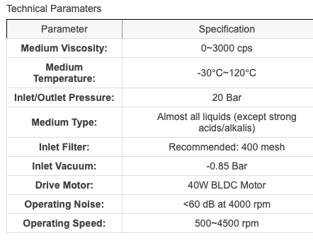
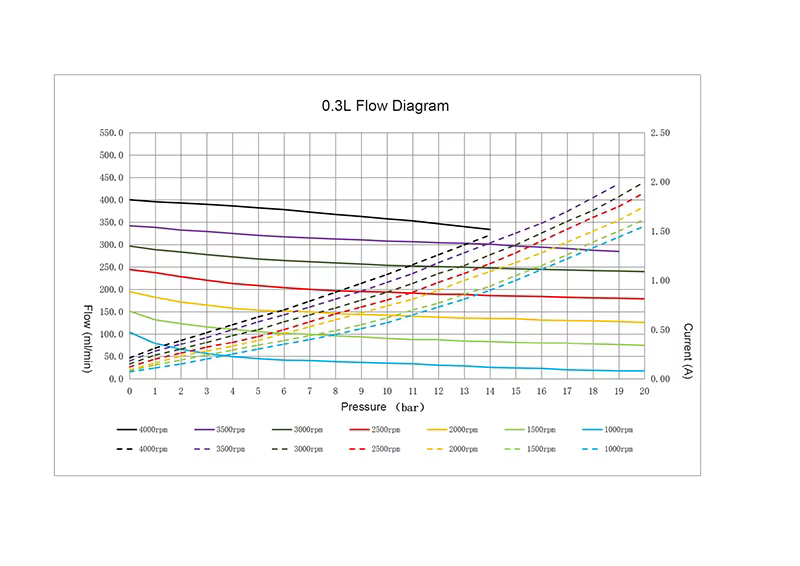
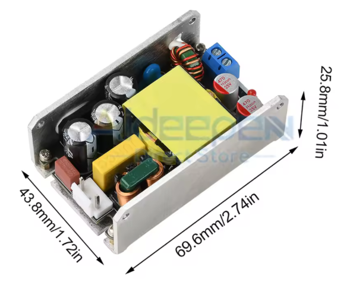
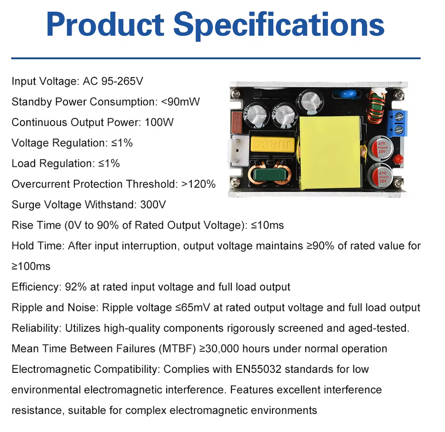
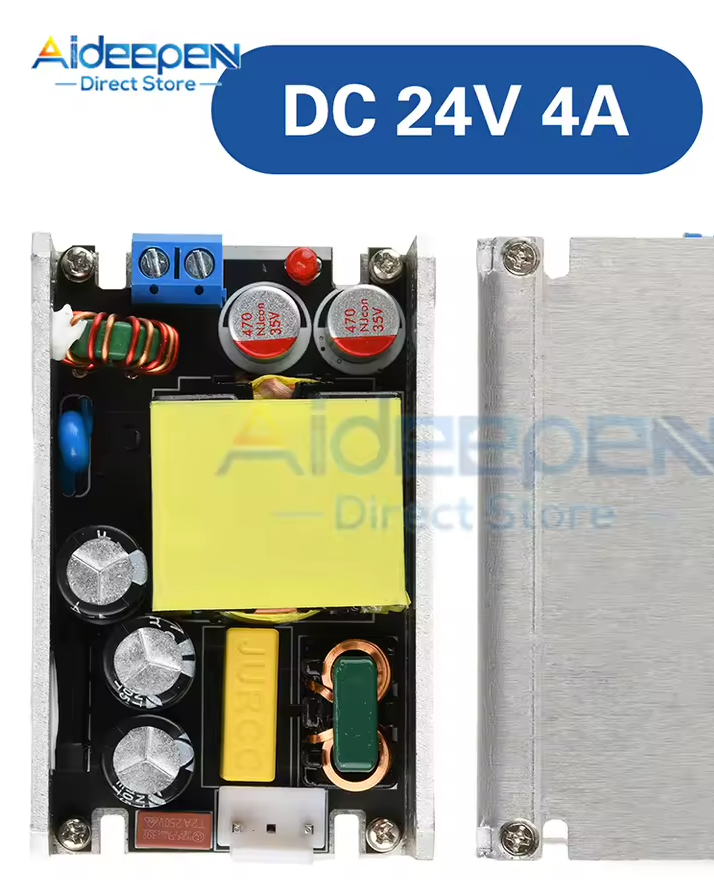
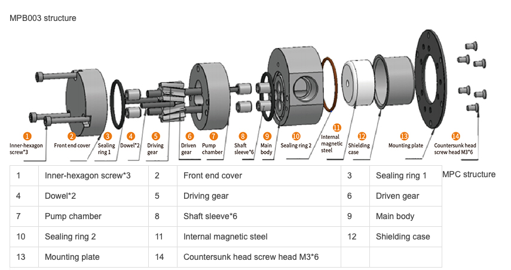
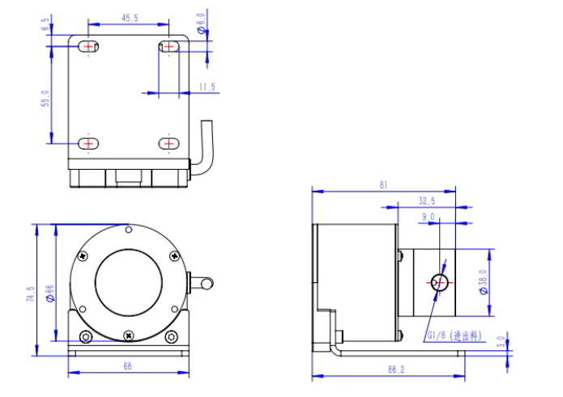
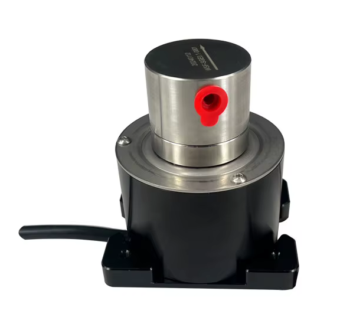

# Pompe à engrenage SOVOFLO MPB003

Pompe envisagée pour remplacer la pompe vibratoire OLAB Silent Green 35 W.
Commandée le 22 octobre 2026, **pas encore installée** : le remplacement
n'est pas décidé. Les valeurs viennent de la fiche du vendeur et de la notice
du groupe moteur-pompe ([gearpump.pdf](datasheets/gearpump.pdf), série FG,
électronique 82 040 001) ; les points marqués **à relever** se mesurent à
réception.

Deux usages motivent le changement :

- **Piloter le débit pendant l'infusion** : une pompe volumétrique donne un
  débit fixé par la vitesse, sans pulsation.
- **Purge lente chauffée** : à 1–2 ml/s, la loi au débit compense l'eau
  entrante pendant la purge. L'eau sort par le bas et la colonne descend :
  l'eau chaude du haut remplace la couche froide de la cuvette du groupe, sans
  refroidir la chaudière ni imposer d'attente avant l'infusion (voir
  [chauffe-chaudiere.md](chauffe-chaudiere.md)).

## Référence

**MPB003BAAA**, moteur BLDC **24 V, 40 W** avec électronique intégrée.

| Lettre | Code | Signification |
| --- | --- | --- |
| MP | — | série à engrenage, entraînement magnétique |
| B | MPB | joint torique caoutchouc (FKM) ; MPC = joint PTFE |
| 003 | 003 | 0 à 0,3 L/min, **0,1 ml par tour** |
| B | corps | inox 316L |
| A | engrenages | PEEK, arbres 316L |
| A | raccords | **G1/8** |
| A | moteur | BLDC |

Engrenages hélicoïdaux en PEEK dans une chambre en inox 316L. Le moteur
entraîne la pompe par un accouplement magnétique à travers une cloche
(*shielding case*) : aucun joint tournant, seulement des joints toriques
statiques. Les matériaux en contact avec le liquide sont annoncés aptes au
contact alimentaire.

## Limites



Le vendeur et la notice ne disent pas la même chose ; la valeur retenue est la
plus prudente.

| Paramètre | Vendeur | Notice | **Retenu** |
| --- | --- | --- | --- |
| Pression au refoulement | 20 bar | **12 bar maximum**, tuyauterie à 12 bar × 1,5 | **12 bar** |
| Température du liquide | −30 à 120 °C | 55 °C au couple maximal, 95 °C à couple réduit | 55 °C |
| Température ambiante | — | 5 à 40 °C au couple maximal, 70 °C à 70 mNm | 70 °C (voir ci-dessous) |
| Filtration | 400 mesh (≈ 37 µm), particules < 20 µm | **10 µm** | 10 µm |
| Vitesse | 500 à 4 500 tr/min | 300 à 5 000 tr/min (moteur) | 500 à 4 500 tr/min |
| Viscosité | 0 à 3 000 cP | eau propre à l'ambiante | eau du bac |
| Dépression à l'aspiration | −0,85 bar (auto-amorçante) | à faire fonctionner mouillée | — |
| Bruit | < 60 dB à 4 000 tr/min | — | — |

- **L'OPV à 11 bar reste sous les 12 bar de la notice.** Elle protège aussi
  la pompe : l'accouplement magnétique ne limite pas la pression de
  refoulement, une soupape après la pompe est obligatoire.
- **Couple à 9 bar** : idéalement `ΔP × cylindrée / 2π` = 9·10⁵ × 0,1·10⁻⁶ /
  2π ≈ **14 mNm**, plus les frottements. On reste loin des 70 mNm : l'ambiance
  de 40–50 °C de la machine est admise.
- **Eau du bac à l'ambiante**, sous les 55 °C. Le clapet anti-retour (plus bas)
  empêche l'eau chaude de la chaudière de refluer vers la pompe.

## Courbes débit-pression



Traits pleins : débit en ml/min. Pointillés : courant en A sous 24 V. Valeurs
lues sur le graphique, à environ ±10 ml/min, converties en ml/s :

| Vitesse | 0 bar | 3 bar | 6 bar | 9 bar | 12 bar | Glissement à 9 bar |
| ---: | ---: | ---: | ---: | ---: | ---: | ---: |
| 4 000 tr/min | 6,7 | 6,5 | 6,3 | 6,0 | 5,8 | 0,7 |
| 3 000 tr/min | 5,0 | 4,7 | 4,4 | 4,25 | 4,15 | 0,75 |
| 2 000 tr/min | 3,25 | 2,8 | 2,5 | 2,35 | 2,3 | 1,0 |
| 1 500 tr/min | 2,5 | 2,0 | 1,75 | 1,65 | 1,5 | 0,85 |
| 1 000 tr/min | 1,75 | 0,9 | 0,7 | 0,65 | 0,5 | 1,05 |

Glissement = débit théorique (vitesse × 0,1 ml) − débit lu.

- **0,1 ml/tour est confirmé** : à 0 bar, chaque courbe part de la vitesse
  × 0,1 ml.
- **Le glissement à 9 bar vaut 0,7 à 1 ml/s**, à peu près indépendant de la
  vitesse, un peu plus fort à basse vitesse. C'est la moitié d'un débit
  d'infusion de 1,5–2 ml/s : le compteur Hall seul ne suffit pas, il faut un
  modèle de glissement en fonction de la pression (voir
  [Calibration du glissement](#calibration-du-glissement)).
- **Points de fonctionnement utiles** :

  | Besoin | Vitesse estimée | Consigne (≈ 1 000 tr/min par V) |
  | --- | ---: | ---: |
  | 1 ml/s à 9 bar | ≈ 1 200 tr/min | ≈ 1,2 V |
  | 2 ml/s à 9 bar | ≈ 1 750 tr/min | ≈ 1,75 V |
  | 2 ml/s à 0 bar (purge lente) | ≈ 1 300 tr/min | ≈ 1,3 V |
  | 3,6 ml/s à 2 bar (remplissage actuel) | ≈ 2 300 tr/min | ≈ 2,3 V |
  | Débit nul à 9 bar (tenir la pression) | ≈ 500–900 tr/min | ≈ 0,5–0,9 V |
  | Maximum à 9 bar | ≈ 6,5 ml/s à 4 500 tr/min | ≈ 4,5 V |

  À la vitesse minimale de 500 tr/min, le débit théorique (0,83 ml/s) est de
  l'ordre du glissement à 9 bar : la pompe peut **tenir une pression sans
  débit**, ce que la pompe vibratoire ne sait pas faire.
- **Courant** : environ 0,5 à 1 A à 9 bar selon la vitesse (12 à 24 W), au
  plus ≈ 1,1 A jusqu'à l'OPV (11 bar). Le courant suit surtout la pression :
  c'est le couple.
- **Fluide des courbes non précisé**, supposé de l'eau à l'ambiante, comme
  l'eau du bac.

## Interface électrique

Brochage : page 2 de la [notice](datasheets/gearpump.pdf).

| Fil | Signal | Rôle |
| --- | --- | --- |
| Rouge | PWR_VCC | +24 V |
| Noir | PWR_GND | masse puissance |
| Orange | SPEED_IN | **consigne analogique 0–5 V** |
| Marron | 0V | référence de la consigne : **non branché** (voir ci-dessous) |
| Jaune | TACHO | sortie tachymètre |
| Vert | DIRECTION | sens de rotation |

### Masses : ne jamais relier PWR_GND et 0V

La notice l'écrit trois fois : relier le marron (0V) au noir (PWR_GND)
**détruit l'électronique du moteur**. Le buck 24 → 5 V n'est pas isolé : la
masse de toutes les cartes est PWR_GND. Brancher le marron sur une masse de
carte reviendrait à les relier.

**Règle : montage alternatif de la notice.** Le marron reste **non branché**,
extrémité isolée sous gaine. La consigne et le tachymètre se réfèrent à
PWR_GND, comme dans le schéma « possible alternative connection ». La notice
annonce alors une linéarité consigne-vitesse moins bonne que ±5 % : sans
importance, la vitesse est relue sur le tachymètre.

### Consigne de vitesse (orange)

| Tension | Vitesse |
| --- | --- |
| < 0,2 V | arrêt |
| 0,3 à 5 V | 300 à 5 000 tr/min, linéaire à ±5 % à vide, soit ≈ 1 000 tr/min par volt |

- **C'est une entrée analogique, pas une entrée PWM.** L'ESP32-S3 n'a pas de
  DAC : la carte doit produire la tension, par un DAC ou par un PWM filtré.
- Impédance d'entrée **162 kΩ** ; tenue −5 à 15 V.
- Plage utile 0,5 à 4,5 V (500 à 4 500 tr/min), plafonnée à 3,6 V
  (3 600 tr/min) tant que le Digmesa sert de référence (voir
  [Débitmètre](#débitmètre)).
- **Exigences pour combined v2** :
  - consigne **sous 0,2 V** à la mise sous tension, pendant un reset de
    l'ESP32-S3 et quand le firmware ne tourne pas ;
  - un DAC à mémoire non volatile ne doit jamais avoir sa valeur de démarrage
    réécrite (même règle que l'EEPROM du DimmerLink) ;
  - résolution d'au moins 10 mV, soit 10 tr/min ou 0,017 ml/s.

### Tachymètre (jaune)

- **32 impulsions par tour** : `tr/min = fréquence × 60 / 32`. 4 500 tr/min
  donnent 2,4 kHz, 500 tr/min 267 Hz.
- **0,0031 ml par impulsion** de déplacement théorique, contre 0,42 g par
  impulsion pour le Digmesa.
- Sortie push-pull TTL avec 390 Ω en série : 3,8 à 4,4 V à l'état haut,
  0,1 à 0,44 V à l'état bas, 5 mA au plus.
- **Exigence pour combined v2** : ramener le signal à 3,3 V. Un tampon à
  entrée tolérante 5 V alimenté en 3,3 V (de type 74LVC1G17) suffit. Un
  diviseur résistif est limite : 3,8 V × 2/3 = 2,53 V, juste au seuil haut de
  l'ESP32-S3 (2,48 V). Compter les impulsions avec le PCNT.

### Sens (vert)

- Sous 2 V : sens horaire côté pompe. Au-dessus de 4 V : sens antihoraire.
- Les deux schémas de la notice le laissent non branché. Le sens par défaut
  à vide est **à relever** et doit correspondre à la flèche du couvercle.
- **Exigence pour combined v2** : un pont à souder vert → non branché, PWR_GND
  ou 5 V, choisi au premier essai. Jamais commandé par le firmware.

### Protections internes

| Protection | Seuil | Réarmement |
| --- | --- | --- |
| Sous-tension | 15,5 V | alimentation > 16,5 V, puis consigne à 0 |
| Surtension | 30 V | alimentation < 29 V, puis consigne à 0 |
| Température | 120 °C interne | < 110 °C (90 °C selon la procédure), puis consigne à 0 |
| Blocage | rotor bloqué 1 s | rotor libre, puis consigne à 0 |

Le réarmement exige la **consigne à 0 V pendant au moins 10 ms**. Le firmware
reconnaît un arrêt sur défaut quand le tachymètre reste muet alors que la
consigne est au-dessus de 0,3 V : il remet la consigne à 0, journalise le
défaut et ne relance pas tout seul pendant une infusion.

Au démarrage à froid (alimentation sous 9 V), l'électronique met **65 ms** à
s'initialiser : une consigne envoyée plus tôt est ignorée.

## Alimentation

Montage prévu, en remplacement de la RECOM RAC05-05SK (5 V, 1 A) :

1. **Carte AC** : bornier L + N et thermistance CTN d'appel de courant,
   sans fusible. L'alimentation « claque » à la mise sous tension : c'est la charge
   de ses condensateurs d'entrée.
2. **Alimentation 24 V, 96 W** (4 A), vendue comme GaN, 69,6 × 43,8 ×
   25,8 mm, sur équerre aluminium. Elle ne rentre pas dans `boitier_ps`
   actuel (logement de la RECOM : 21,9 × 27,1 × 33 mm) : nouveau boîtier.
3. **Carte DC** : buck 24 → 5 V, une sortie 24 V (pompe) et deux sorties 5 V
   (écran, combined).
4. **Combined v2** : la partie dimmer disparaît ; une partie commande la
   pompe (consigne 0–5 V à partir du 5 V reçu) et lit le tachymètre.



Pour le boîtier : radiateur en U (fond et deux flancs de 25,8 mm), trous de
fixation aux coins des flancs. L'entrée secteur (connecteur **JST VH 3,96 mm à
trois positions, broche centrale supprimée** pour écarter L et N à 7,92 mm,
et fusible) et la sortie 24 V (bornier à vis bleu, LED) sont aux **deux
extrémités opposées** sur la longueur de 69,6 mm : prévoir le passage des fils
aux deux bouts. Le dessus de la carte est ouvert ; c'est par là et par les
bouts que l'air circule.

### Fiche du vendeur



| Paramètre | Valeur annoncée | Pour la machine |
| --- | --- | --- |
| Entrée | 95 à 265 VAC | 230 V au milieu de la plage |
| Consommation à vide | < 90 mW | — |
| Puissance continue | 100 W | 24 V × 4 A = 96 W sur l'étiquette ; retenu : 96 W |
| Régulation (ligne et charge) | ≤ 1 % | 24 V ± 0,24 V, loin des seuils de 15,5 et 30 V de la pompe |
| Protection de surintensité | > 120 % | déclenche au-delà de ≈ 4,8 A, au-dessus du pire cas de 3,8 A |
| Surtension d'entrée tenue | 300 V | — |
| Montée de 0 à 90 % | ≤ 10 ms | — |
| Maintien après coupure secteur | ≥ 90 % pendant ≥ 100 ms | une micro-coupure ne redémarre ni les ESP32 ni la pompe |
| Rendement | 92 % à pleine charge | cohérent avec l'essai (≈ 91–92 %) ; non donné à faible charge |
| Ondulation | ≤ 65 mV à pleine charge | cohérent avec l'essai (42–85 mV en 12 V) |
| MTBF | ≥ 30 000 h | ≈ 3,4 ans sous tension permanente |
| CEM | EN 55032 | — |

### Bilan de puissance

| Poste | Courant sous 24 V |
| --- | ---: |
| Pompe, usage prévu, jusqu'à l'OPV (11 bar) | ≈ 1,1 A |
| Pompe, limite en service continu (> 30 min) | 2,5 A (60 W) |
| Pompe, limite instantanée en service intermittent | 3,5 A (84 W) |
| Électronique de la pompe au repos | 0,06 A |
| Buck, 1 A en 5 V comme la RECOM, rendement ≈ 85 % | ≈ 0,25 A |
| **Pire cas** | **≈ 3,8 A**, sous les 4 A de l'alimentation |
| **Usage prévu** (pompe à 11 bar au plus, buck) | **≈ 1,4 A, 35 W**, 35 % de la charge nominale |

**Profil de charge.** Ces 35 W sont une pointe, pas la charge habituelle :

- **La plupart du temps, 2 à 3 W** (≈ 0,1 A sous 24 V) : les deux ESP32,
  dont un seul utilise la radio. L'alimentation est alors à
  2–3 % de sa charge nominale et chauffe à peine.
- **Pompe en marche, rarement à pleine charge** : le courant suit la
  pression, pas le débit.
  - Faible débit à haute pression (infusion, tenue de pression) : ≈ 0,5 à
    1 A à 9 bar, 12 à 24 W.
  - Fort débit sans résistance (remplissage, purge) : couple faible, courant
    bien en dessous.
  - Le haut des deux à la fois, fort débit à 11 bar, n'arrive pas en usage
    normal.
- **Durées courtes** : une purge dure 5 à 15 s, en général 5 s ; une
  infusion 20 à 60 s, en général 30 s. La température de l'alimentation suit la charge moyenne, proche
  du repos.

- **Buck** : au moins **2 A en 5 V**, pour garder de la marge sur la RECOM
  actuelle.
- **Pas de fusible sur la carte AC.** Le fusible **T2A 250 V** de
  l'alimentation est le premier composant après son connecteur ; il protège
  l'alimentation et la CTN, en série avec lui. Le câblage en amont est
  protégé par le disjoncteur de la maison. Un T1,6 A en amont ne protégerait
  que la carte AC elle-même.
- **CTN : TDK B57236S0100M000** (série S236, 10 Ω à froid), **C125458**
  chez JLCPCB, en série sur la phase. L'alimentation n'en a pas (essai
  ci-dessous). Elle limite la crête d'appel à ≈ 325 V / 10 Ω ≈ 33 A. Fiche :
  [C125458.pdf](datasheets/C125458.pdf).
- **Composant traversant, pas CMS.** Une CTN d'appel absorbe à chaque mise
  sous tension l'énergie des condensateurs d'entrée, ½ × 81 µF × (325 V)² ≈
  4,3 J, et dissipe en continu. Il faut la masse d'un disque ; les CTN CMS
  sont des sondes de mesure. JLCPCB monte le traversant en option.
- **24 V** dans la plage de 20 à 29 V de la pompe, loin de ses seuils de
  15,5 et 30 V.

### CTN d'appel de courant

#### Choix de la CTN

Références comparées, toutes 10 Ω, traversantes et « extended » chez JLCPCB :

| | **C125458** TDK S236 | C3790 Ruilon 10D-9 | C6793809 10D-7 | C125456 TDK S235 |
| --- | ---: | ---: | ---: | --- |
| Courant permanent max | **3,5 A** (0 à 65 °C) | 2 A | 1 A | 3 A |
| Capacité admise à 230–240 V | **300 µF** (essai UL et IEC) | 150 µF | 100 µF | non connue |
| Marge sur 81 µF | **× 3,7** | × 1,85 | × 1,2 | — |
| Dissipation | 10 mW/K | ≈ 11 mW/K | 6–9 mW/K | — |
| Constante de temps | 70 s | ≈ 35 s | 20–27 s | 60 s |
| Capacité thermique | 700 mJ/K | ≈ 0,4 J/K | ≈ 0,2 J/K | — |
| Échauffement par allumage (4,3 J) | ≈ 6 K | ≈ 11 K | ≈ 20 K | — |
| Corps | Ø 11,5, haut. 16 mm | Ø 9 mm | Ø 7 mm | Ø 9,5 mm |
| Pas | 5 mm | 7,5 mm | 5 mm | 5 mm |
| Homologations | UL 1434, IEC, VDE, CQC | — | — | UL, VDE, CQC |
| Prix unitaire | 0,33 $ | 0,09 $ | 0,04 $ | 0,20 $ |

- **C125458 retenue** : seule capacité admise vérifiée par un essai
  normalisé, avec la plus grande marge ; ses 3,5 A dépassent le fusible T2A,
  qui lâche avant elle en cas de défaut. Le surcoût est négligeable sur un
  montage unique.
- **C3790** : convient en repli. La fiche donne 2 A ; la base JLCPCB
  affiche 1 A à tort. Sa marge de capacité est deux fois plus faible.
- **C6793809** : écartée, 81 µF sur 100 µF admis, et plus d'échauffement
  à chaque allumage.
- **C125456** : la fiche disponible ne couvre que l'emballage ; repli si les
  16 mm de hauteur de la S236 ne passent pas dans le boîtier, après avoir
  trouvé sa capacité admise.

#### Échauffement de la CTN

La CTN chauffe peu, parce que la charge est le plus souvent celle du repos
(voir [Profil de charge](#bilan-de-puissance)) :

| Situation | Courant secteur | Pertes | Échauffement (S236) |
| --- | ---: | ---: | ---: |
| Repos, 2–3 W | ≈ 0,04 A | ≈ 16 mW | ≈ 2 K |
| Mise sous tension | crête ≈ 33 A | 4,3 J | ≈ 6 K |
| Infusion de 30 s à 35 W | ≈ 0,35 A | ≈ 0,4 W | ≈ 14 K |
| Pompe à 35 W tenue en continu | ≈ 0,35 A | ≈ 0,4 W | ≈ 40 K, vers 3 Ω |

- **Presque toujours à 10 Ω** : elle protège à chaque allumage, y compris
  un rallumage juste après une infusion. Seul un arrêt après plusieurs
  minutes de pompe en continu la laisserait assez chaude pour qu'un
  rallumage immédiat claque.
- **Résistance en charge sans effet** : quelques volts de chute, alors que
  l'alimentation accepte de 95 à 265 V.
- **Température de la machine** : 40–50 °C, dans la plage de 0 à 65 °C où
  TDK garantit les 3,5 A.

#### Montage de la CTN

- **À l'écart** des condensateurs, du plastique et des composants voisins,
  comme le demande TDK pour son refroidissement. Les pattes coudées de la
  S236 fixent sa hauteur au-dessus de la carte.
- **Au sec** : l'eau et les électrolytes traversent le revêtement et
  dégradent la céramique. Dans la machine, la protéger des projections et de
  la vapeur par le boîtier.

### Essai publié de l'alimentation

Essai d'un vidéaste sur la version **12 V / 8 A** du même module (96 W). La
carte 24 V est la même, aux condensateurs de sortie près (voir
[Carte 24 V](#carte-24-v-photo-du-vendeur)).

| Point | Résultat |
| --- | --- |
| Entrée | fusible d'environ 4 A en boîtier rectangulaire, pont redresseur collé au radiateur par pâte thermique, **3 × 27 µF / 400 V** (105 °C), condensateur X à film, self de mode commun. **Pas de CTN** : étincelle au branchement |
| Sortie (12 V) | self, 2 × 1 000 µF / 16 V, LED rouge. La LED reste allumée longtemps après la coupure : les condensateurs de sortie se vident lentement |
| Radiateur | aluminium de 2 mm sur trois faces, film plastique entre la partie haute tension et le radiateur |
| Consommation à vide | non mesurable au wattmètre |
| Tension (12 V) | 12,2 V à vide, 11,87 V à 8 A aux bornes de la charge, fils compris |
| Surcharge | 9 A (≈ 105 W) tenus brièvement |
| Rendement | ≈ 92 % jusqu'à 3 A, ≈ 91 % de 5 à 8 A |
| Ondulation | 42 à 85 mV crête à crête, moins de 1 % |
| Tension secteur | 170 à 250 V sans effet sur la sortie |
| Composants | deux MOSFET 003N10H (100 V, redressement synchrone) et un contrôleur marqué « BST25 », sans fiche : **le GaN n'est pas confirmé** |

Échauffement à 96 W, points chauds sur la self et la zone des condensateurs
de sortie :

| Condition | Self | Condensateurs |
| --- | ---: | ---: |
| À l'air libre, 10 min | 94 °C | 99 °C |
| À l'air libre, 20 min | 104 °C | 108 °C |
| À l'air libre, 30 min (stable) | 109 °C | 109 °C |
| Enfermée dans sa boîte, +10 min | 124 °C | 128 °C |
| Enfermée dans sa boîte, +20 min | 126 °C | **133 °C** |
| Sortie de la boîte, 85 W, +10 min | 93 °C | 102 °C |

Conséquences pour la machine :

- **Charge de 35 W au plus**, pompe en marche, soit un peu plus du tiers de
  la charge nominale. Les pertes, ≈ 9 W à 96 W, tombent vers ≈ 3 W :
  l'échauffement au-dessus de l'ambiante est environ trois fois plus faible.
  Même tenue en continu, cette charge laisserait les points chauds vers
  80–95 °C dans une enceinte à 40–50 °C, sous les 125 °C des condensateurs
  de sortie. Au repos (2–3 W), l'alimentation reste proche de l'ambiante.
- **Le boîtier ne doit pas l'enfermer étroitement** : garder un espace d'air
  autour du radiateur et des ouïes. La pointe de 84 W de la pompe ne dure
  pas : elle ne compte pas pour l'échauffement.
- **Appel de courant confirmé** : condensateurs d'entrée chargés
  directement sur le secteur redressé, sans CTN. La CTN de la carte AC est
  nécessaire.
- **Sortie qui décroît lentement à la coupure** : le moteur de la pompe
  s'arrête par sa sous-tension à 15,5 V, l'ESP32-S3 quand le buck décroche ;
  la consigne est alors à 0. Aucune action nécessaire.

### Carte 24 V (photo du vendeur)



La photo de l'article acheté, « DC 24V 4A », montre la **même carte que
l'essai** : trois condensateurs d'entrée, self de mode commun en fil plat,
condensateur X jaune, fusible T2A rectangulaire près du connecteur secteur, pas de
CTN visible. Seuls changent les condensateurs de sortie, **2 × 470 µF / 35 V**,
et aucun potentiomètre de réglage n'apparaît : la tension de sortie est fixe.

- **35 V suffisent** pour 24 V : marge de 45 %.
- **24 V × 4 A = 96 W**, cohérent avec l'annonce et l'essai.
- **Fusible interne T2A 250 V**, temporisé, lisible sur la photo (l'essai
  l'estimait à 4 A).

## Hydraulique

### Raccords

Les raccords **G1/8** sont à filetage cylindrique : l'étanchéité se fait par
une rondelle (rondelle à lèvre de type Dowty) ou un joint en face d'appui, pas
par le filetage. Le vendeur conseille du ruban PTFE à l'aspiration ; la
notice interdit qu'un fragment de ruban ou de pâte entre dans la pompe.
**Règle : rondelles d'étanchéité, sans ruban.** Une prise d'air à
l'aspiration empêche la pompe d'aspirer.

Respecter le **sens de la flèche** du couvercle avant. Pompe près du bac,
aspiration courte, tuyaux au moins aussi gros que les raccords.

### Clapet anti-retour

Une pompe à engrenage n'a pas de clapet : à l'arrêt, la pression de la
chaudière repousse l'eau à travers les engrenages vers le bac. Après une
infusion, la chaudière isolée monte à 9–9,5 bar ; elle se viderait vers le
bac par la pompe, de l'eau chaude atteindrait les engrenages, et le Digmesa,
en amont, compterait ce débit à l'envers comme un débit normal.

**Règle : un clapet anti-retour à la sortie de la pompe**, avant le capteur de
pression, pour que celui-ci continue de lire la chaudière. Si la machine
d'origine a déjà un clapet à l'entrée de la chaudière (**à vérifier** au
démontage), il suffit.

### Vanne trois voies

La notice demande de ne manœuvrer une électrovanne située après la pompe
qu'une fois la pompe arrêtée, pour éviter les coups de bélier : une pompe
volumétrique qui refoule contre une vanne qui se ferme monte en pression
jusqu'à l'ouverture de l'OPV. **Règle : en fin d'infusion, la vanne se ferme
quand le tachymètre indique l'arrêt de la pompe**, au plus tard 500 ms après
la consigne à 0.

### Filtration

La notice demande un filtre à **10 µm** avant la pompe, avec une surface
assez grande pour ne pas freiner l'aspiration. Le filtre actuel, en amont du
Digmesa, protège une buse de 1 mm : sa finesse est **à relever**. S'il est
plus grossier, ajouter un filtre fin à l'aspiration de la pompe.

### Mise en service

Rincer la pompe et la ligne avant la première infusion. Pour un usage
alimentaire, la notice demande de faire circuler de l'eau à 80 °C pendant
20 minutes, eau jetée ensuite.

## Ce qui change dans le firmware

### Marche à sec

La pompe doit toujours tourner mouillée. Le tachymètre et le Digmesa
détectent un bac vide : la pompe tourne et le Digmesa ne compte rien.

**Règle par défaut** : pompe au-dessus de 1 000 tr/min, aucune impulsion
Digmesa pendant **2 s** et pression qui ne monte pas → consigne à 0 et erreur
« bac vide ». Les seuils se règlent au premier essai, bac débranché.

### Débitmètre

Le Digmesa est limité à **0,40 L/min (6,7 ml/s)**. La pompe le dépasse à
basse pression au-delà de 4 000 tr/min. **Règle** : plafonner la vitesse à
**3 600 tr/min** (6 ml/s théoriques) tant que le Digmesa sert de référence.
Ce plafond couvre le remplissage actuel (3,6 ml/s).

### Pression

La pompe vibratoire pousse par impulsions à 50 Hz ; le filtrage de la mesure
de pression du XDB401 a été réglé pour cette ondulation (voir
[firmware.md](firmware.md)). Sans pulsation, ce filtrage pourra être allégé,
après une capture de comparaison.

En panier aveugle, une pompe volumétrique monte la pression jusqu'à
l'ouverture de l'OPV (11 bar), sous les 12 bar de la notice.

### Durée de marche

La limite de 60 s de marche continue venait du thermique de la pompe
vibratoire. Elle reste : elle couvre aussi la vanne, et la pompe a sa propre
limite de 60 W en service continu.

## Calibration du glissement

Le Digmesa, en amont, mesure le débit net (OPV fermée). Le glissement est une
fuite interne de la sortie vers l'entrée de la pompe, après le Digmesa :

```
glissement = volume tachymètre (impulsions / 32 × 0,1 ml) − volume Digmesa
```

Modèle de départ : `glissement(P) = k × P`, à remplacer par une table si les
mesures s'en écartent. Le glissement dépend aussi de la viscosité, donc de la
température de l'eau du bac, à peu près constante.

Protocole :

1. **Panier aveugle, pression asservie** : la pompe tient des paliers de 2,
   4, 6, 8, 9 et 10 bar. Le débit net est nul : la vitesse nécessaire pour
   tenir chaque palier donne le glissement pur. Le Digmesa doit rester à
   zéro, ce qui sert de contrôle. Ne pas lancer de vitesse fixe en panier
   aveugle : la pression monterait jusqu'à l'OPV.
2. **Panier SCACE (trou de 0,3 mm) et balance** : des vitesses fixes donnent
   des points avec débit réel, à comparer au modèle.
3. **En service** : chaque infusion OPV fermée recalcule `k` à partir du
   tachymètre et du Digmesa, pour suivre l'usure.

## Structure et cotes



Vis creuses ×3, couvercle avant, joint 1, goupilles ×2, engrenage menant,
engrenage mené, chambre, bagues d'arbre ×6, corps, joint 2, aimant intérieur,
cloche, platine de fixation, vis fraisées M3 ×6. La tête se sépare du moteur
par les 4 vis arrière, resserrées à 1 ± 0,2 Nm.



Cotes lues sur le plan, en mm :

| Cote | Valeur |
| --- | ---: |
| Longueur moteur + tête | 81 |
| Longueur de l'équerre | 86,2 |
| Largeur de l'équerre | 68 |
| Hauteur totale | 74,5 |
| Diamètre du moteur | 66 |
| Diamètre de la tête de pompe | 38 |
| Longueur de la tête de pompe | 32,5 |
| Axe des raccords depuis la face avant | 9,0 |
| Épaisseur de l'équerre | 3,0 |
| Entraxe des boutonnières | 45,5 × 55,0 |
| Largeur des boutonnières | 6,0 |

Les deux raccords **G1/8** sont radiaux, opposés sur la tête. Le câble sort
latéralement du moteur, côté équerre.



## Mécanique

Pas encore de support. À dessiner quand l'emplacement de la pompe vibratoire
sera relevé : équerre à quatre boutonnières de 6 mm, entraxe 45,5 × 55 mm.
Le moteur de 66 mm de diamètre et la tête de 38 mm dépassent l'encombrement
d'une pompe vibratoire ; la pompe doit rester près du bac, aspiration courte.

## À relever à réception

| Point | Méthode |
| --- | --- |
| Sens par défaut, vert non branché | essai à vide, pompe amorcée, comparé à la flèche du couvercle |
| Comportement avec l'orange non branché | essai : la pompe doit rester arrêtée ; sinon tirage vers PWR_GND sur combined v2 |
| Courant d'appel au démarrage | shunt ou pince, démarrage à 9 bar |
| Tension de sortie à vide et à 1,5 A | multimètre aux bornes ; 20 à 29 V pour la pompe |
| Clapet à l'entrée de la chaudière d'origine | démontage de l'arrivée |
| Finesse du filtre actuel | référence du filtre |
